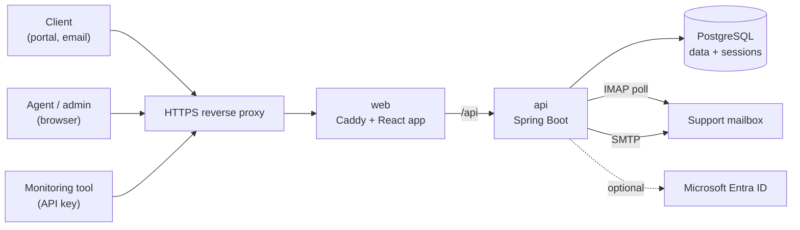

# MSP Helpdesk

[](https://github.com/haier7611/msp-helpdesk/actions/workflows/ci.yml)
[](LICENSE)
[](https://openjdk.org/projects/jdk/21/)

A self-hosted helpdesk for managed service providers (MSPs) that support many client organisations from one team. Clients raise tickets through a customer portal, by email or from their monitoring tools; agents work one queue with SLAs, public replies and internal notes; an admin manages organisations, people, SLAs, mailboxes and sign-in.

The central rule is **isolation between client organisations**: a client, and an agent who is not assigned to that client, can never see another organisation's tickets, people or files.

## Features

| Feature | Where it lives |
|---|---|
| **Per-organisation isolation enforced twice**: every client-data repository method takes an `AccessScope` and the SQL itself carries the organisation condition (`ScopeSql`); ArchUnit rules fail the build if a repository, controller or job bypasses this | `api/.../access`, `api/src/test/.../architecture/ArchitectureTest.java` |
| **Email in and out per mailbox**: IMAP polling turns email into tickets and threads replies onto them; each support mailbox can send through its own SMTP account; replies, CC handling and email follow-ups | `api/.../mail` |
| **Customer portal** (raise and follow tickets) and an **API for monitoring alerts** with per-organisation API keys | `api/.../portal`, `api/.../integration` |
| **SLA engine**: first-response and resolution targets per priority and organisation, business calendars and holidays, pause on "Pending on client/vendor", at-risk and breach notifications, an SLA report, and admin-defined **automation rules** (notify, assign, raise priority, add a note) | `api/.../sla` |
| **Two-step sign-in** (TOTP, recovery codes, trusted devices) and **step-up** before sensitive admin actions | `api/.../auth/mfa`, `web/src/components/useStepUp.tsx` |
| **Microsoft Entra ID single sign-on**, configured by the admin in the app | `api/.../auth/entra` |
| **Audit log** of security and admin events, with allow-listed details per event | `api/.../audit` |
| **Retention and erasure**: scheduled retention with a dry-run mode, and erasure of a person's data | `api/.../retention`, `api/.../erasure` |
| **Encrypted secrets at rest** (MFA secrets, mailbox and SSO credentials) with **data-key rotation** | `api/.../crypto` |
| Per-organisation ticket references (`ACME-1042`), saved replies, email signatures, notifications and a daily digest | `api/.../reference`, `api/.../signature`, `api/.../notification` |

`api/...` is short for `api/src/main/java/com/ticketsystem/api`.

## Tech stack

- **api**: Java 21, Spring Boot 4 (Spring Framework 7, Spring Security 7), Spring Session JDBC, Spring Data JPA, Flyway, PostgreSQL 16, Gradle (Kotlin DSL), JUnit 5, Testcontainers, ArchUnit
- **web**: React 19, TypeScript, Vite, Vitest, Testing Library with axe accessibility checks
- **runtime**: Docker Compose - the api, the web app served by Caddy (which also proxies `/api`), PostgreSQL, and Mailpit as a local mail catcher in development
- **CI**: GitHub Actions running the same `scripts/ci/*.sh` you can run by hand, plus a Trivy dependency scan

## Quick start

You need Docker (with Compose v2.20+), bash and openssl. No JDK or Node is needed on the host.

```sh
git clone https://github.com/haier7611/msp-helpdesk.git
cd msp-helpdesk
scripts/dev-up.sh --demo
```

`dev-up.sh` writes a local `.env` with freshly generated secrets, builds and starts the stack, and with `--demo` loads synthetic demo organisations, people and tickets (their passwords go to `demo-credentials.txt`, which is git-ignored). Then open http://localhost:8080; every email the app sends lands in Mailpit at http://localhost:8025/mailpit/.

Stop with `scripts/dev-down.sh` (keeps data) or `scripts/dev-down.sh --wipe`. More: [docs/guides/local-development.md](docs/guides/local-development.md). To run it on a server: [docs/deployment.md](docs/deployment.md).

## Architecture



The api is a modular monolith: one package per feature, client-owned data reached only through scoped repositories, background work (mail polling, SLA evaluation, outbox delivery, retention) as scheduled jobs in the same process. Read more:

- [docs/40-architecture.md](docs/40-architecture.md) - modules, isolation model, jobs and data flow
- [docs/diagrams/00-index.md](docs/diagrams/00-index.md) - context, containers, deployment, data model, ticket lifecycle, email flows
- [docs/35-security.md](docs/35-security.md) - security design and accepted risks
- [docs/15-product-spec.md](docs/15-product-spec.md) - the product as built
- [docs/10-decision-log.md](docs/10-decision-log.md) - design decisions and their reasoning
- [docs/README.md](docs/README.md) - every document

## How this was built

Spec first, a decision log, a separate review of every change before it merged, and tests that enforce the isolation rules. The process, including how an AI assistant was used, is described in [docs/how-this-was-built.md](docs/how-this-was-built.md).

## Status

Version 0.1.0: the first scope is complete (see the product spec for what is in and out). There is no hosted demo; use `scripts/dev-up.sh --demo`. English only. Issues and pull requests are welcome - see [CONTRIBUTING.md](CONTRIBUTING.md). Security reports: [SECURITY.md](SECURITY.md).

## Licence

[Apache License 2.0](LICENSE). See [NOTICE](NOTICE) for the bundled fonts (SIL Open Font License 1.1).
