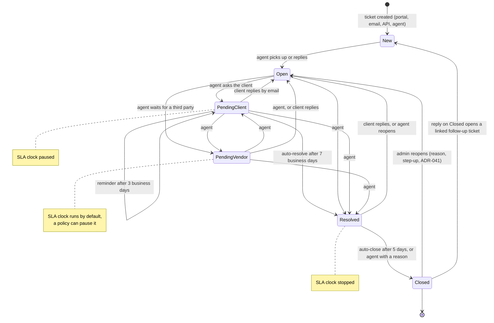
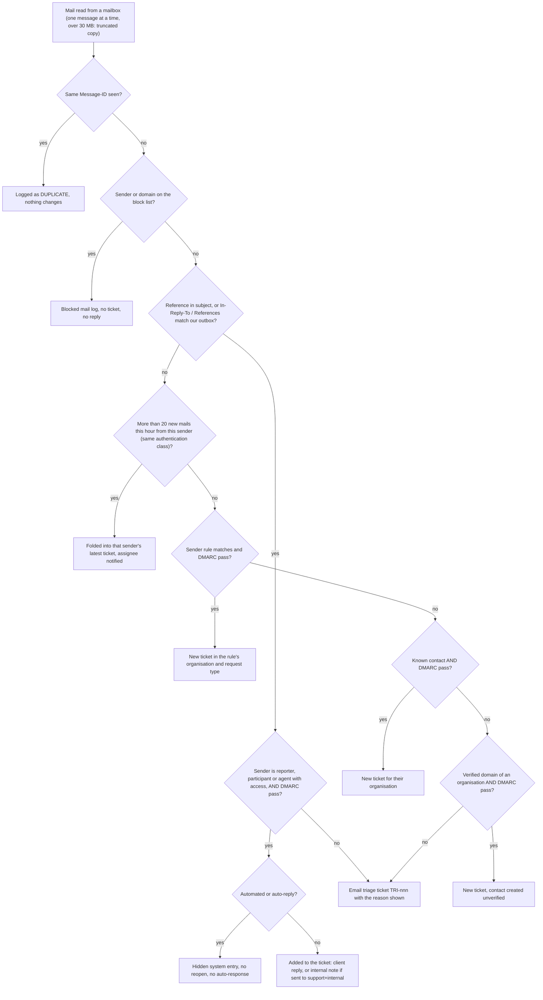

# Product spec

The product as built and decided. Every behaviour change updates this file in the same change. If code and this spec differ, this spec wins and the code is fixed.

Product: **MSP Helpdesk**. The name shown to users is the support name set in Admin - Branding.

Decisions behind it are in [10-decision-log.md](10-decision-log.md). Examples use made-up organisations such as **Acme Dental** (prefix `ACD`), **Northwind Logistics** (`NWL`) and **Contoso Legal** (`CTL`).

## 1. Purpose and users

A helpdesk for a small MSP that supports several client organisations. One installation, one MSP, many clients (ADR-002).

- **Customer** (a client's staff member) - raises tickets through a simple portal form or by email, and follows them **by email only** (ADR-018). Desktop and phone browser.
- **Agent** (MSP engineer) - works the queue, replies, changes status, logs internal notes. Mostly desktop, sometimes replies from their mail app.
- **Admin** (MSP manager) - everything an agent does, plus organisations, agents, request types, SLAs, mailboxes, API keys and branding.
- **System integrations** - monitoring tools (uptime monitors, RMM or endpoint-security consoles) open tickets through the API.

"Agent" in this spec means an engineer or an admin. In the product the word is Agent; in code, API paths and the database the same people are called supporters (ADR-032).

## 2. Roles and permissions

| Role | Can | Cannot |
|---|---|---|
| Customer | Raise tickets for their own organisation through the New ticket form (with attachments) or by email; reply and add attachments **by email only**; manage their own account (ADR-018) | View any ticket, status or history online; see internal notes, other organisations, assignee workload, any SLA information, set priority |
| Agent | All tickets of the organisations they are assigned to (default: all); reply, add internal notes, change status, priority, request type; **reassign any ticket in those organisations** (F8); create tickets on behalf of a customer; create and invite customer contacts in their organisations (F2); mark duplicates and link tickets; export the queue to CSV | Manage agents, organisations, SLAs, mailboxes, API keys, templates, branding |
| Admin | Everything an agent can, plus all configuration and the audit log | Read stored passwords, MFA secrets or API key secrets (keys are shown once at creation) |
| API key | Create tickets (and add comments to tickets it created) for the one organisation the key is bound to | Read other tickets, act as a user |

All rules are enforced on the server, never only in the UI. The API has three trees, `/api/v1/portal`, `/api/v1/agent` and `/api/v1/admin`, each with its own role gate (section 9).

## 3. Ticket statuses

| Status | Meaning | SLA clock | Emails to the client | How it moves on |
|---|---|---|---|---|
| **New** | Created, nobody has picked it up | Running | "Ticket created" confirmation | Agent picks up or replies -> Open |
| **Open** | Being worked on by the MSP | Running | Only public replies (no email for the status change itself) | Agent sets any other status |
| **Pending on client** | Waiting for the client to answer | **Paused** | Public reply that asked the question; **reminder** after 3 business days; "Resolved" email if auto-resolved after 7 business days (both timers per organisation, can be switched off) | Any client email reply -> Open automatically |
| **Pending on vendor** | Waiting for a third party (supplier, ISP, Microsoft, ...) | Set per SLA policy: **default keeps running**; a policy can choose to pause it | **None** - no reminders, never auto-resolves | Agent moves it back manually; a client reply -> Open (see note) |
| **Resolved** | MSP believes it is fixed | Stopped | "Resolved" email | No client reply for 5 days -> Closed; a client reply -> Open |
| **Closed** | Finished, read-only | Stopped | "Closed" email when it auto-closes | A reply to a Closed ticket opens a new linked **Follow-up** ticket (F4) |

Notes:

- Customers never see statuses in a portal (there is no ticket view, ADR-018); they learn of progress only through the emails in the matrix below.
- A client reply on either Pending status moves the ticket to Open, so the assignee sees new information at once.
- Marking a ticket as a duplicate closes it without a client email; the agent can add a public reply first if the client should be told.
- **Status changes an agent can make by hand**: New -> Open, Pending on client, Pending on vendor or Resolved; Open -> either Pending status or Resolved; Pending on client <-> Pending on vendor, either -> Open or Resolved; Resolved -> Open (reopen) or Closed (close now). Nothing ever goes back to New, and a Closed ticket refuses every change except internal notes (spec 11a). Setting the status a ticket already has changes nothing. Pending on client -> Resolved by auto-resolve and Resolved -> Closed by auto-close are system-only (scheduled jobs). **ADR-041**: closing by hand needs a reason (section 11a), and only an admin can reopen a Closed ticket (Closed -> Open, with a reason and a step-up).

### Client email matrix (F5)

The client (reporter plus client participants) is emailed **only** on these events. Everything else (status changes, assignment, priority, internal notes, Pending on vendor) sends nothing to the client.

| Event | Email to client |
|---|---|
| Ticket created by the client (portal, email; API alerts only when opted in) | Confirmation with reference and a copy of what they submitted |
| Ticket opened by an agent for the client (F2, ADR-040) | Sent like the agent's public reply: agent's name, "We've logged your request as <REF>.", the agent's description as their own message, full signature, footer (no "This is what you sent") |
| Public reply by an agent (agent UI or by email) | The reply, agent's name and signature |
| Ticket set to Resolved (by an agent or by the Pending-on-client auto-resolve) | Resolved notice, "reply to reopen" |
| Pending on client reminder (after 3 business days) | Reminder |
| Auto-close after 5 days in Resolved | Closed notice |

As built: the reminder and the Closed notice are sent by the SLA timer jobs; the "Resolved" email (also after an auto-resolve) is sent by the ticket mail composer, from the `StatusChanged -> RESOLVED` event. Automatic client emails go to the reporter and confirmed participants only and never to automated addresses (no-reply, mailer-daemon, postmaster, bounces). "Business days" for the Pending timers = business time on the organisation's calendar from when the ticket entered Pending on client (one business day = the longest weekday's hours); one reminder per Pending spell. The 5-day auto-close counts 5 x 24 hours from when the ticket was Resolved.

API alert tickets send no client email unless the organisation has opted in (admin setting, default off).

**Client email switches (ADR-048, as built).** Admin - Organisations - <organisation> - "Client emails" turns four of these emails on or off for that organisation: **Ticket received** (the confirmation with the reference, from the portal, an email, a client's reply to a closed ticket that opens a follow-up, a follow-up an agent starts by hand, and API alerts when opted in), **Resolved notice** (an agent's Resolve or the auto-resolve), **Closed notice** (after the auto-close; the ticket still closes) and **Pending reminder** (the Pending-on-client reminder; this is the same stored switch the SLA timers already had, `organisation_sla_settings.pending_reminder_enabled`, so existing values are kept; the reminder days stay on the SLA screen). All four are **on by default** for every existing and new organisation (V99 adds the other three columns `NOT NULL DEFAULT TRUE`; an organisation without a settings row reads as all on), so nothing changes until an admin turns one off. **Never switchable**: agent public replies and the email for a ticket an agent opens for a client (ADR-040) - they are the conversation. **Triage tickets** (no organisation) are never affected (they get no automatic client email anyway, section 11b). The switch is read where the email is queued, in the same transaction (the confirmation and the Resolved notice in the ticket mail composer, the Closed notice and the reminder in the SLA timers). When an email is skipped only because its switch is off - it would otherwise have been queued (there is a deliverable recipient, the ticket was not opened by a bulk or automated sender, an API alert ticket's organisation opted in) - the agent ticket timeline gets one slim system line: "<Email> not sent - turned off for <organisation>" (for example "Resolved notice not sent - turned off for Acme Dental"; the organisation name goes through the viewer's access like every timeline name). A switched-off reminder writes its line once per Pending spell. The line is a `ticket_event` row of type `CLIENT_EMAIL_SKIPPED` (email name in `new_value`, organisation id in `reason_ref_id`, actor SYSTEM): agent-only, never in the portal, an email or an export. Turning a switch back on does not send the skipped emails later.

**Lifecycle diagram.** Solid arrows are agent actions or client replies; the timer arrows are scheduled jobs. The SLA clock is paused only in **Pending on client** (and in **Pending on vendor** when the SLA policy says so); it is stopped in Resolved and Closed.



## 4. Main flows

1. **Portal ticket** - customer signs in, the only page is the **New ticket** form: picks request type, fills subject, description, impact and urgency, attachments -> ticket `New`, reporter = customer, organisation = customer's organisation, reference issued (e.g. `ACD-001`), auto-assignment rule applied (section 4.6), SLA started, confirmation email with `[ACD-001]` in the subject. After submitting, the page shows "Ticket ACD-001 received - we will reply by email" and a button to raise another. Everything after that happens by email.
2. **Email ticket** - mail arrives at a configured mailbox -> the poller (every 1-2 minutes, ADR-005) first tries to match an existing ticket (section 6). If no match:
   - sender is a known customer **and** the mail passes DMARC -> new ticket for their organisation;
   - unknown sender, domain matches an organisation's verified domain **and** the mail passes DMARC -> new ticket, contact created as an unverified customer (cannot sign in until invited);
   - otherwise -> held in the **Unassigned email** triage queue with the reason shown (e.g. "not authenticated", "unknown sender"); it gets a triage reference such as `TRI-001` and is never auto-attached to an organisation.
   - **CC on a client's email (ADR-043)**: the other To/Cc addresses of the email become participants, so Reply All lands on the same ticket and replies go to them like the sender. When the email is **verified** (our receiving server's `Authentication-Results`, from a trusted authserv-id, shows DMARC pass - the same check as the guards below) every such address is added **confirmed**: it gets the ticket confirmation and the following replies. When the email is **not verified**, every address is added **unconfirmed** (waiting for an agent, no mail until an agent confirms it in the composer's CC editor, ADR-035), because a forged email must never put an outsider on a client's ticket. This applies to new tickets, client replies (including a follow-up opened by a reply to a Closed ticket) and Email triage tickets. In practice an unverified email never reaches an organisation's ticket (it goes to triage, section 6), so CCs on organisation tickets are always confirmed and CCs on a triage ticket from an unverified email always wait. An address already waiting for confirmation is confirmed when it is CC'd again on a verified email from the client.
     - Never added: our own support addresses and their plus addresses (`support+internal@` ...), staff accounts (agents, admins), deactivated accounts, contacts of another organisation (skipped silently, nothing about them is shown or written; on a triage ticket every saved contact is skipped), reserved test domains (`.example`, `.test`, `.invalid`, `.localhost` and subdomains, ADR-034), the sender and the reporter. Addresses are matched in lower case and each is added once.
     - At most 10 participants per ticket (the ADR-035 CC limit, counting confirmed and waiting ones). Addresses over the limit are not added; a hidden system entry lists them: "Not added (limit): a@x, b@y" (at most 20 named, then "and more"). At most 50 distinct addresses of one email are looked at.
     - Each addition is a timeline line with the client as actor: "<name or address> added as CC (from the client's email)", with " (waiting for confirmation)" for an unverified email, and "<name or address> confirmed as CC (from the client's email)" for a waiting address confirmed by a verified email.
     - Moving a ticket to another organisation re-checks all participants as before (contacts of another organisation removed, address-only participants wait for an agent again).
3. **API / webhook ticket** - monitoring tool POSTs with an API key bound to one organisation -> ticket `New`, request type "Alert", deduplicated by an optional `external_id` (repeat alerts add a comment instead of a new ticket; a "resolved" alert can auto-resolve).
4. **Agent new ticket** (F2) - for phone calls and walk-ins: agent picks organisation and contact (or creates a new contact inline, optionally sending an invitation), then fills the ticket as in the portal. Source = agent.
   - **Client email (ADR-040)**: instead of the "Thank you. We have received your request" confirmation, the client gets an email built like the agent's public reply: From the agent's display name with the support name (e.g. `Alex Tran (Support) <support@helpdesk.example>`), Reply-To the support mailbox, subject `[REF] <subject>`, body = one opening line "We've logged your request as <REF>." then the agent's description as the agent's own message (with its inline images and files), the agent's full signature (section 5) and the standard reference footer. Plain-text and HTML parts as for replies. It goes to the reporter and confirmed participants through the same outbound path as replies (sending mailbox SMTP per ADR-034, reserved test domains never sent through a real mailbox). With no description the email is the opening line and the signature only.
   - **On the ticket**: the description is stored once, as the ticket's first public message authored by the agent (shown as "Reply to client" with the agent's name, not as the client's text). It is the request itself, so it does **not** meet first response (section 4.7); the agent's next public reply does.
   - A follow-up an agent starts by hand (F4) has no message of the agent's and keeps the confirmation. Tickets raised by the client (portal, email, API) keep the confirmation unchanged.
5. **Agent work** - agent picks up -> `Open`, assignee set.
   - **Composer** (C12): two tabs. **"Reply to client"** shows the To and CC line and a "Send to client" button; **"Internal note"** has a different colour and an "Add note" button (no To or CC line). The composer opens on the agent's default tab on every ticket; there is no confirmation dialog. A note can never be turned into a public reply, and a sent reply cannot be edited.
   - **CC from the composer** (ADR-035): the reply line reads "To: <reporter>   CC: <names>   Edit" (contact names, or the address when there is no contact; more than two shown as "+N"; "(this reply only)" when keep is off). To stays the reporter (changing the reporter is a separate action). "Edit" is a link-styled button (48 px target, `aria-expanded`) that opens an inline editor under the line:
     - the people in CC as chips, each with a remove button ("Remove Sam Okoye");
     - participants from an email still waiting for confirmation, each with "Confirm and add";
     - an add box ("Add someone (name or email)", combobox pattern) suggesting contacts of the ticket's organisation from `GET /api/v1/agent/contacts?organisationId=` (only organisations the agent works on); Enter or the "Add" button next to the box (48 px, accessible name "Add to CC") adds the highlighted suggestion or the typed address (hint: "Press Enter or Add. Contacts of <organisation> are suggested."), Backspace in the empty box removes the last chip, Esc closes the suggestions and then the editor;
     - "Keep on future replies" (default on) and Done; Done and Esc put focus back on Edit. Done with text still in the add box first adds it exactly like Enter; if that leads to the outside-address question or an error, the editor stays open with focus on the question or the error, and it closes only when nothing is pending.
     - Early refusal: before adding a typed address that is not a suggested contact, the editor asks the server (`POST /api/v1/agent/tickets/{id}/cc-check`, agent-scoped like the ticket, answer only a reason code `allowed` / `external` / `staff` / `not_allowed`, never a name or organisation). A staff (agent or admin) account says "<address> is a staff account and can't be CC'd as a client."; another refused address says "You can't add <address> to this ticket."; neither is added. If the check fails the editor falls back to the verified domains and the server refuses at send time.
     - Every CC error or refusal (invalid address, already in CC, at most 10, staff or refused address) shows inline and as a pop-up error at the top of the screen (role="alert", stays until closed). A reply the server refuses because of its CC (`cc_not_allowed`, `external_cc_unconfirmed`, `cc_limit`) shows "The reply was not sent: <server message naming the address> Change CC and send again - your text is still here." inline and as the same pop-up; the draft and the CC choice are kept.
     A typed address on one of the organisation's verified domains, or a suggested contact, is added at once; any other address asks "<address> is not from <organisation>. Add anyway?" (Add anyway / Cancel), and "Add anyway" is the agent's external-CC confirmation. At most 10 people: the editor says "At most 10 people can be in CC. Remove someone first.". Not shown on Email triage or Closed tickets.
     Only when the agent changed the list does the reply carry the choice (`cc`: recipients, keepOnFutureReplies, confirmExternal); the server checks every rule again: plain valid addresses; the reporter is ignored; at most 10 on a reply, and at most 10 participants on the ticket when someone joins; a contact of the organisation or an address on its verified domains is added at once; any other address needs `confirmExternal`; an agent or admin account, a deactivated contact of the organisation or a support mailbox is refused without naming an organisation. Another organisation's contact is treated exactly like any outside address (the check says `external`, the agent is asked "Add anyway?", and once confirmed it is shown and recorded like any confirmed outside address), so the composer never reveals that an address is registered with another client. On that ticket they are then a normal outside participant (ADR-035 change): emailed like any outside CC (replies, Pending reminder, Resolved and Closed notices), never linked to their account (no name shown, nothing in their portal), and an email reply from them on that ticket is added as an outside participant's comment; their mail quoting any other ticket of the organisation goes to Email triage. With keep on, people removed leave the ticket's participants, people added join it (confirmed), and a waiting participant who is added is confirmed; with keep off, the participants stay as they are and the change applies to this reply only. The reply is emailed with exactly the chosen CC (stored with the reply, V92) after the usual re-check (accounts must still be live contacts of the organisation - an address-only CC that belongs to an account is checked as that account, except another organisation's customer, who stays an outside address; our own addresses dropped). Every change is a timeline line with the agent as actor (wording below). Reserved test domains are never sent through a real mailbox (ADR-034 guard in the outbox).
   - Both tabs support rich text, inline images (pasted or uploaded) and attachments; attachments take the visibility of their comment.
   - **Canned responses** (F3): shared (admin-managed) and personal, with placeholders such as `{client_first_name}` and `{ticket_ref}`, inserted by typing "/" in the composer.
   - **Public reply**: shown on the ticket in the agent UI and emailed to the reporter and confirmed client participants (or the CC the agent chose, ADR-035) from the support mailbox with the agent's name as display name (e.g. `Alex Tran (Support) <support@helpdesk.example>`), Reply-To the support mailbox, the agent's signature (section 5) and the ticket footer. The email carries only the new reply, never the thread history. The agent can set the status in the same action (e.g. "Send and set Pending on client").
   - **Internal note**: visible to agents only. Notes and their images and attachments are never emailed to customers and never returned by customer or API-key calls. Shown with a yellow background and an "Internal" label.
   - **Priority** (F6): set by agents only. The request type sets the starting priority; the impact and urgency the customer chose are shown to the agent as guidance.
   - **Merge duplicates** (F1): "Mark as duplicate of ACD-014" closes the source, links both tickets both ways, copies participants to the target, and makes the source reference an alias of the target, so later emails quoting either reference land on the target. "Link related ticket" links two tickets without closing either.
   - **Follow-up** (F4): an email reply to a Closed ticket creates a new ticket "Follow-up to ACD-001", linked to the old one, with the same organisation, reporter and participants.
   - **Export** (F7): CSV of the filtered queue, including first response time, resolution time, SLA met yes/no and (ADR-041) the close reason, for monthly client reports. Every export is audit-logged.

### 4.6 Auto-assignment and out of office

- Each organisation can have an optional **default assignee**; each request type can also have one. When a ticket is created, the request type's default wins, otherwise the organisation's default is used, otherwise the ticket stays Unassigned.
- The default assignee must be an active agent with access to that organisation; if not, the ticket stays Unassigned.
- If the chosen agent is **out of office**, they are skipped: the ticket goes to Unassigned and an internal system note says "Not assigned to <name>: out of office until <date>".
- Deactivating an agent clears them from every default-assignee setting (shown in the deactivation wizard).
- No round-robin or load balancing in v1 (Later).
- **As built**: a default who cannot be assigned (not active, or no access to the organisation) is ignored and the next one is tried (request type, then organisation); an out-of-office default stops the search (Unassigned plus the system entry). "Out of office" (set in My settings) counts when it is switched on and today, in the ticket organisation's timezone, is within its dates (both included; a missing date is open-ended); the note then reads "Not assigned to <name>: out of office" without a date. Auto-assignment runs once, when the ticket is created (after commit; the minute job catches up if that failed); a ticket created with an assignee, or in triage, is left alone. The system assigning a ticket does not pick it up (it stays New). Admins set the defaults through `/api/v1/admin/organisations/{id}/sla/default-assignee` and `/api/v1/admin/request-types/{id}/default-assignee` (Admin screens); deactivating an agent clears them from both defaults in the same transaction.
- **Assignment lines in the timeline (ADR-032)**: every assignee change shows in the agent ticket timeline as one slim muted line (small icon, text, date and time in the viewer's timezone such as "19 Nov 2026, 14:32"), in time order among the replies, notes and system entries - not a comment card. Wording: "Assigned to <agent> by <actor>", "Reassigned from <a> to <b> by <actor>", "Unassigned from <a> by <actor>", "Assigned to <agent> automatically (default for <organisation or request type>)", "Reassigned from <a> to <b> (<a> deactivated) by <actor>" (or "Unassigned from <a> (<a> deactivated) by <actor>" when the chosen agent cannot work that organisation), and "Unassigned from <a> (ticket moved to <organisation>) by <actor>" when a move clears an assignee who cannot work the new organisation. A ticket created already assigned gets an "Assigned to" line too. A change by the system without a reason reads "... automatically". The lines come from the ticket history (`ticket_event` rows of type ASSIGNEE, with a reason and the organisation or request type id); user ids are stored and names are looked up when the ticket is read, so a renamed or erased user shows their current name, and a user who cannot be resolved reads "a former agent". Agent-only: only the agent ticket endpoint returns them (`assignmentEntries`), scoped by organisation like the rest of the ticket; never a portal response, an email or an export. No backfill: changes recorded before reasons were added show without a reason.
- **Every change in the timeline (ADR-032 change)**: every ticket change is the same slim one-line row as the assignment lines (small decorative icon, text, `<time>` in the viewer's timezone), in time order among the replies, notes and system entries, oldest first; the side-panel raw "History" list is gone because the timeline now shows every history row in words. Each row names who acted - an agent ("by Jo Example"), the client (an email reply: "by client reply"; the portal: "by <contact>"), the system ("automatically": jobs, auto-assignment) or an API key ("by a monitoring alert"). Wording:
  - Created: "Ticket created by <agent>", "Ticket created in the portal by <contact>", "Ticket created from an email", "Ticket created by a monitoring alert (API)". A follow-up has no separate created line (its follow-up line says how it started); at the same instant the created line comes before the description.
  - Status: "Status changed from <a> to <b> by <actor>" (plus " (picked up)" or " (public reply)" when assigning yourself or a reply moved it), "Moved to Open by client reply" (from either Pending status), "Reopened by client reply" (from Resolved), "Resolved automatically (no client reply)" and "Closed automatically" (scheduled jobs; since ADR-041 "Closed automatically: No client reply after it was resolved"), "Closed by <agent>: <reason>" and "Reopened by <admin>: <reason>" (ADR-041), "Reopened by a repeat monitoring alert" and "Resolved by a monitoring alert". Marking a duplicate shows only the duplicate line, not a second "Status changed" line.
  - Priority: "Priority changed from P3 Medium to P2 High by <actor>", followed by "SLA due times recalculated for the new priority" when the SLA engine moved the due times (section 4.7: the change and the old due times are kept in the history); after a move to another organisation (or out of triage, ADR-047) the line reads "SLA due times recalculated for the new organisation" (a recalculation that leaves the ticket on the triage defaults, with no organisation, reads "SLA due times recalculated for the triage defaults" - a ticket cannot be moved back to triage today, so this is defensive wording only). Pending reminder: "Pending-on-client reminder emailed to the client" (or "... due (no client email sent)"). Client email switched off (ADR-048): "<Ticket received | Resolved notice | Closed notice | Pending reminder> not sent - turned off for <organisation>".
  - Request type: "Request type changed from <a> to <b> by <actor>"; an archived type reads "<name> (archived)", a type that no longer exists "a removed request type".
  - Assignment: as above; the same lines are in `assignmentEntries` and `timelineEntries`.
  - Organisation: "Organisation set to <org> (from email triage) by <actor> (reference TRI-001 is now ACD-004)"; "Moved from <a> to <b> by <actor> (reference ACD-004 is now BCL-002)". Then what the move caused, one line each: "Related link to <ref> removed (a ticket moved to another organisation) by <actor>" on both tickets, "<contact> removed as a participant (not a contact of the new organisation) by <actor>", and the unassign line.
  - Reporter: "Sender saved as contact <name> and set as reporter by <actor>" (triage "Save as contact"); otherwise "Reporter changed from <a> to <b> by <actor>".
  - Duplicates: "Marked as a duplicate of <ref> and closed by <actor>" on the source; "<ref> marked as a duplicate of this ticket (merged) by <actor>" on the target, plus "<participant> added as a participant (from a merged duplicate) by <actor>" for each participant (and the source's reporter) actually copied.
  - Links and follow-ups: "Linked to related ticket <ref> by <actor>" on both tickets; "Follow-up <ref> created by <actor>" / "Follow-up of <ref> created by <actor>", or "... opened by a client reply to this closed ticket" / ", opened by a client reply to the closed ticket" (and "a repeat monitoring alert" for API follow-ups), on both tickets.
  - Participants from email (ADR-043, actor client): "<address or contact> added as CC (from the client's email)", plus " (waiting for confirmation)" when the email was not verified; "<address or contact> confirmed as CC (from the client's email)" when a waiting address is CC'd on a verified email; already-present participants add nothing. Rows written before ADR-043 show in the same wording.
  - CC from the composer (ADR-035): "<contact or address> added as CC by <agent>", "... added as CC (outside address, confirmed) by <agent>", "<address> confirmed as CC (outside address) by <agent>", "... removed from CC by <agent>"; with keep off "... CC'd on this reply only by <agent>" (plus " (outside address, confirmed)" for an outside address) and "... left out of CC on this reply only by <agent>". Stored as PARTICIPANT_ADDED / PARTICIPANT_REMOVED rows, actor AGENT, reason AGENT_ADDED, AGENT_ADDED_EXTERNAL, AGENT_CONFIRMED_EXTERNAL, AGENT_REMOVED, REPLY_ONLY or REPLY_ONLY_EXTERNAL.
  - **Stored**: `ticket_event` rows with `actor_kind` (AGENT, CLIENT, SYSTEM, API_KEY), the status trigger or participant/link/reporter reason in `reason`, and the reference before and after a move (`old_reference`, `new_reference`); new row types PARTICIPANT_ADDED, PARTICIPANT_REMOVED, REPORTER, LINK_REMOVED. Ids and codes only, names looked up when the ticket is read; the one exception is an email-only participant's address, which "Erase personal data" now removes from these rows too (the line then reads "Someone (address removed) ..."). A renamed or erased user shows their current name; a user who cannot be resolved reads "a former agent" (or "a former user" for a client).
  - **Organisation protection**: names are resolved through the viewing agent's own organisation access. An organisation they do not work on reads "another organisation" (and its reference is left out, because the prefix names it), a contact of such an organisation "a contact of another organisation", a ticket they cannot open "another ticket". A restricted agent never learns another client's name through a timeline line.
  - **Agent-only**: only the agent ticket endpoint returns them (`timelineEntries`), scoped by organisation like the rest of the ticket; never a portal response, a client email or any export (the queue CSV has no history).
  - **No backfill**: rows written before the full timeline existed show in their plain form (no actor kind, no trigger: "Status changed from <a> to <b> by <agent>" or "... automatically"; a move without references; "Participants re-checked after the move (2 removed)"); participant, reporter and link-removed lines start with the full timeline. Participants added before it and copies made for follow-ups have no line.

### 4.7 SLA and resolution time (ADR-017)

**Default targets**. Every new organisation starts with this policy; the admin can edit it per organisation and per request type.

| Priority | First response | Resolution | Clock |
|---|---|---|---|
| P1 Critical | 30 min | 4 h | **24/7, always** |
| P2 High | 1 h | 8 business hours | Business hours |
| P3 Normal | 4 business hours | 3 business days | Business hours |
| P4 Low | 1 business day | 10 business days | Business hours |

Default business hours: Monday-Friday 08:30-17:30 in the organisation's timezone, with a holiday list per organisation. A business day, as a duration, = the longest weekday's business hours in that calendar (9 h for the default). The first-response clock pauses on the same statuses as resolution. A ticket resolved with no public agent reply has first response "not applicable". While paused, due times are empty and the UI shows "Paused" (ADR-017 change).

**What counts:**
- **First response** = the first public reply by an agent (agent UI or email). Not the automatic "ticket created" email, not the opening message of a ticket an agent opened (ADR-040), not an internal note, not a status change.
- **Resolution time** = time from creation until the ticket is set to Resolved, minus paused time (Pending on client always; Pending on vendor only if the policy says so). If a client reopens a Resolved ticket, the clock carries on from where it stopped, and the final Resolved counts.
- A priority change recalculates the due times from the ticket's creation under the new targets; the change and the old due times are kept in the ticket history.
- Stored on each ticket: `first_response_due_at`, `resolution_due_at`, `first_responded_at`, `resolved_at`, total paused minutes, and met/breached flags for both targets. These are what reports and the CSV use.

**Warnings:** a job every minute flags "about to breach" (80% of the target used) and "breached" in the queue, and notifies the assignee (or every agent of that organisation if unassigned). **P1 tickets** also notify all agents at once at creation and at 80%, day or night, because the P1 clock runs 24/7. Someone must be reachable out of hours for P1 (on-call rota is a Later item; v1 sends email + in-app to everyone).

**As built:**
- Due times and results are recalculated from creation after every status change, priority change, public reply and organisation move, and by the minute job when a ticket changed or its next 80% or breach moment has come; a request-type change is picked up by the minute job. A policy or calendar change applies to open tickets at their next recalculation; stored results of finished tickets never change.
- Each 80% and each breach of a target notifies once; if a recalculation (e.g. lower priority) drops a ticket below a level, crossing it again notifies again. Going straight past 80% to breached sends only the breach notice. P1: every agent who can work the organisation at creation (or when raised to P1) and at 80% of either target, out-of-office agents included, preferences ignored; P1 breaches go to the assignee (or the organisation's agents). Agents without access to the organisation are never notified.
- **Triage tickets (ADR-047 Decision 2, as built).** A ticket in Email triage (no organisation, TRI- reference) runs the built-in defaults a new organisation is seeded with: the ADR-017 policy above and Monday-Friday 08:30-17:30, no holidays, in the MSP timezone (the server setting `app.notifications.default-timezone`, default Asia/Ho_Chi_Minh - the same zone as the report's default range). So it has First response and Resolution due times, pauses on the same statuses, met/breached results, the queue SLA chip and the SLA card. `sla_policy_fallback` is not set for them (the defaults are their policy by design). When the ticket is assigned or moved to an organisation, its targets are recalculated from the **original creation time** under that organisation's policy and calendar (the clock is not restarted; a first reply already given in triage still counts), and the ticket history keeps the old and new due times like a priority change (timeline: "SLA due times recalculated for the new organisation"). Warnings on a triage ticket have no organisation to go to, so they reach only its assignee (while it is open); a warning nobody received is not marked as sent, so it goes to the organisation's agents once the ticket is moved there. The Pending-on-client reminder, auto-resolve and auto-close timers are organisation settings and still skip triage tickets. A triage P1 alert follows the same rule: an unassigned triage P1 alerts nobody, the alert is left unsent and goes to every agent of the organisation when the ticket is moved there. Triage tickets filed before ADR-047 get their values from the minute job (it calculates every never-calculated triage ticket once, Closed ones included; once stamped they leave its work list). The work-list query is served by the partial index `ticket_sla_work_ix` (V98), whose predicate is the query's WHERE clause word for word, so the job reads only tickets that need work, never the whole table; `TicketSlaWorkListIndexIntegrationTest` fails if the two drift apart. **Not yet covered (follow-up):** the daily digest still lists only organisation tickets (`organisation_id IS NOT NULL`), so a breaching triage ticket reaches its assignee in-app and by email but is not in anyone's digest.
- Fallbacks: an organisation without business hours uses Monday-Friday 08:30-17:30; a missing or unreadable policy falls back to the organisation default, then the ADR-017 defaults (logged, `sla_policy_fallback` set on the ticket).

**Who sees it:** SLA targets, due times, warnings and results are **internal only**. Customers never see SLA information, due times or met/breached anywhere: not in emails, not in the New ticket page, not in any API response.

**SLA panel on the ticket page (ADR-042, as built).** The agent ticket page has an "SLA" card with one row per target (First response, Resolution). Agents and admins only; never shown to clients (no customer page, email or API response carries it).

- **Placement.** The card sits in the ticket header, right of the reference, chips and title, level with the top of the Details sidebar; it is no longer in the Details card (shown once only). The title keeps at least 420 px: when the header is narrower than the title plus the card (380 px; phones, narrow windows), the card wraps under the title and takes the full width, with no sideways scrolling. Checked at 1440, 1280 and 390 px. The card has a border, a surface background and a coloured left edge from its worst row (red breached or in the last 10%, amber at risk, green on track or met, grey paused) - decoration only, the rows carry the words. The queue SLA chip next to the status stays as it was.

- **Server-side.** `GET /api/v1/agent/tickets/{id}` carries `slaPanel` (triage tickets too, ADR-047), and `GET /api/v1/agent/tickets/{id}/sla` returns it alone for re-syncs. Both are supporter-only and organisation-scoped (404 for an organisation the agent does not work, exactly like a missing ticket; 403 for customers). The panel is calculated at request time by the same engine, policy, calendar and status history as the stored values the queue SLA column and the Reports page use (no second copy of the business-hours maths, nothing stored, no notification). Between minute-job runs the panel can be up to a minute ahead of the stored queue chip.
- **Per target**: state, target, due time, warn time (80%, the queue's "At risk" point), business minutes left (rounded up), minutes used, met at, breached by (rounded up), next clock start, today's closing time, paused reason; plus the policy label ("P2 High - business hours (Europe/London)" / "P1 Critical - 24/7"), the timezone and the length of one day on the priority's clock.
- **Simplified display.** Two rows, "First response" and "Resolution", side by side when the card is wide enough (stacked otherwise). Each row has the label, one large value (24 px, steady-width digits) and a state shown as icon + word + colour, never colour alone:
  - Running: the time left ("1d 3h 39m", "3h 39m", "12m"), counting down once a minute, with "On track" (clock icon, green) or, from the warn point (80% used), "At risk" (warning icon, amber); the time turns amber from the warn point and red in the last 10% of the target. A day is one business day, or 24 h for P1.
  - Paused (Pending on client, or on vendor when the policy pauses it): the frozen time left and "Paused" (pause icon, grey).
  - Stopped outside business hours: the time left, not ticking, with "On track" or "At risk" as above (the tooltip and screen-reader text say the clock is stopped).
  - Met: green tick and "Met" in place of the time (screen-reader text: "Met - answered in 42m" / "Met - resolved in 2d 3h").
  - Breached: the time over the target as the large value with a smaller "over" ("1h 15m over"), and "Breached" (cross icon, red) under it like the other states; screen-reader text "Breached by 1h 15m". Kept after the ticket is resolved. Every state line fits on one line at 1280 and 1440 px.
  - Not applicable (first response on a ticket resolved without a public reply; both targets on a duplicate): the row is hidden; no rows, no card.
  - The target, due time (or "met <time>", "was due <time>", "no due time while paused", "clock stopped until Mon 08:30") and the policy label are in the row's tooltip and in visually hidden text, never as visible lines. Icons and words always, never colour alone; the live region announces state changes only, not every tick.
- **Refresh**: the page never works out business hours itself. It counts a running row down between refreshes, stops at today's closing time, and asks the server again every 5 minutes (unless every row is final), when a countdown reaches zero, when today's hours end, and whenever the ticket changes. A failed background refresh shows "The SLA times could not be refreshed; they may be out of date." (no pop-up) and is tried again after 30 seconds, so the line clears on the next success. If the server cannot work the panel out (for example a history row it cannot read), the ticket still opens: `slaPanel` is null with a WARN log and the card is hidden. The opening message of an agent-created ticket (ADR-040) never counts as the first response. State changes are announced politely to screen readers; the minute ticks are not.

**SLA report page** (agents and admins), any date range, filter by organisation, engineer, request type and priority:
- Tickets opened, resolved, still open (with ageing: 0-2, 3-7, 8-30, 30+ days).
- First response met %, resolution met %, average and median first-response and resolution time (business hours, and P1 in clock hours).
- Breached tickets listed with reference, priority, assignee and by how much.
- Per-engineer view: tickets handled, met %, average times.
- "Export CSV" of the same data (F7), audit-logged.
- **As built**: range = dates inclusive in a chosen timezone (default the MSP timezone); opened = created in range; resolved = last set to Resolved in range (a reopened ticket is not resolved); still open = not Resolved or Closed now, aged by creation date (0-2, 3-7, 8-30, over 30 days). First response met % = met / (met + breached) over tickets opened in range ("not applicable" and still-running ones left out); resolution met % over tickets resolved in range. Times: business minutes for P2-P4 and clock minutes for P1, shown separately. **Tickets marked as duplicates** (closed, usually straight from New or Open) are counted as opened and as duplicates but left out of every SLA measure (met %, times, breached list, per engineer) - the work is measured on the ticket they duplicate. **Triage tickets** (ADR-047) count in every measure like other tickets, with no organisation (`organisationId` null, an empty `organisation_id` in the CSV, "Email triage" in the Organisation column of the breached list); every agent sees triage (spec 11a), so they are in a restricted agent's report too, and choosing an organisation leaves them out. The CSV holds the report's ticket rows, the same as the page. API: `GET /api/v1/agent/sla-report` and `/csv`.
- **Reports page (as built)**: Agent - Reports reads the real report. Filters: From and To dates (default the last 30 days; an end before the start is refused on the page and by the server), organisation, engineer, request type and priority; the organisation list is the supporter's own organisations and the server scopes every figure, so a restricted agent never sees another organisation's tickets. Summary tiles: tickets opened (and resolved), still open with ageing, first response met %, resolution met % ("x of y met", "-" when nothing was measured) and breaches. Tables: breached tickets (reference linking to the ticket, organisation, priority, target, over by - marked "business" for P2-P4 - and assignee), response and resolution times (count, average, median; P2-P4 business hours and P1 24/7 on separate rows) and by engineer (resolved, resolution met %, average times with the P1 figure underneath). Duplicates and a truncated report (over 20,000 tickets) are noted above the figures. No matching tickets shows "No tickets in this period for these filters." A failed load or a refused export pops up an error (no silent failures); "Export CSV" downloads the CSV for the applied filters and confirms that the export is audit-logged. The page header says "Internal only - never shown to clients".

### 4.8 SLA automation rules (ADR-049, as built)

Admin-defined rules. Admin - SLA automation (admins only; no step-up) holds a list of rules, each with a **name**, **on/off** and a **position** (run order), plus one **trigger**, optional **conditions** and one or more **actions**. The built-in SLA notifications (4.7) are unchanged and still go out.

- **Triggers** (one per rule): First response at risk, First response breached, First response met, Resolution at risk, Resolution breached, Resolution met. They come from the existing SLA evaluation - there is no second calculation: whenever a recalculation (the minute job or the after-commit reaction to a ticket change) saves the ticket's SLA values, the saved state is compared with the state stored before. At risk = the target went from below 80% to at least 80% used while not breached (going straight past 80% to breached counts as breached only, like the built-in warnings); breached = the target became breached; met = the target became met. A ticket's very first calculation when it is already Resolved or Closed triggers nothing, so old tickets never fire rules retroactively.
- **Conditions** (all optional, combined with AND; nothing ticked = any): organisations, where "Email triage" stands for tickets with no organisation yet; priorities; request types. Conditions are matched against the ticket facts at the moment of the state change: a later rule in the same evaluation still sees the original priority and assignee, even if an earlier rule raised the priority or assigned the ticket (the after-commit recalculation does not re-run rules for a trigger that has already happened).
- **Actions** (1 to 10, run in the order listed), all done by the system and shown in the ticket timeline as "Automation (<rule name>)":
  - **Notify chosen agents**: email + bell as an SLA notification (bell text "SLA automation: first response breached" and so on; it follows each agent's "SLA warning" choices in My settings). Only active agents who can work the ticket's organisation are told - an agent without access to it is never notified; for a triage ticket any chosen active agent (every agent may see triage). Timeline: "Automation (Escalate): 2 agents notified (first response breached)".
  - **Notify every agent of the organisation**: every active agent who can work the organisation. A triage ticket has no organisation, so nobody is told (as the built-in triage warnings, ADR-047); the timeline says "nobody notified". One agent chosen by both notify actions of a rule gets one notification.
  - **Assign to an agent, only if unassigned**: never a pick-up (the status stays). Skipped with a timeline line when the ticket already has an assignee, or when the agent is deactivated or cannot work the ticket's organisation. A successful assignment is the normal assignment line, "Assigned to <agent> by Automation (<rule>)", and the assignee gets the usual "assigned to you" notification.
  - **Raise the priority one level** (P4 to P3, P3 to P2, P2 to P1; never above P1 - "priority not raised - it is already P1 Critical" otherwise). Exactly like a manual change: the history line "Priority changed from P3 Medium to P2 High by Automation (<rule>)", the SLA recalculated from creation under the new targets with the old and new due times kept, and the P1 alert when it reaches P1.
  - **Add an internal note** with the rule's fixed text (plain text, 1 to 1,000 characters, line breaks kept; author "System"). No notification of its own.
  - Assignment and priority actions on a Closed ticket are skipped with a timeline line (Closed tickets are read-only).
- **Safety**: a rule fires **at most once per ticket, per target and per trigger**. Before its actions run, the rule writes a firing record (rule, ticket, target, trigger) that is unique; if it exists already the rule does nothing. The record is written in the same transaction as the actions, so restarts, recalculations, a lost stored state and the rule's own priority raise never repeat it, and rules cannot loop (another rule with a different trigger can still act on the new state, once). A reopened and re-resolved ticket does not fire a "Resolution met" rule twice. Rules run in position order; each runs in its own savepoint, so a rule that fails is rolled back completely (its firing record included), logged with ids only and skipped, while the other rules and the SLA values are saved. Disabled rules do nothing. Editing a rule (its trigger, conditions or actions) keeps its firing history, so the edited rule will not fire again on tickets it already fired on for that target and trigger; to run it again on those tickets, create a new rule. The ticket events of a priority raise or assignment by a rule (which drive the SLA recalculation and the "assigned to you" notification) are published only once the rule's savepoint has committed, so a rule that is rolled back leaves no event behind. Creating and reordering rules are serialised, so two admins adding rules at once get distinct positions. Deleting a rule deletes its firing records; its timeline lines and audit events stay. Every action is also an audit event (`SLA_AUTOMATION_ACTION`: rule id, ticket id, trigger, action type, outcome - never the note text).
- **Admin screen** (Admin - SLA automation): the table lists, in run order, Order (up and down buttons), Name, When (trigger), Tickets (conditions summary, e.g. "Email triage, Acme Dental; P1, P2; any request type"), Then (actions summary) and Status (an on/off checkbox, "On"/"Off"); Edit and Delete per row. Delete asks in the row itself ("Delete this rule? Yes, delete / Keep"). Add/Edit opens a wide dialog: Name, When, "Rule is on", ticked lists for organisations (with "Email triage (no organisation yet)"), priorities and request types, and the actions builder (choose the action; agents to notify, the agent to assign or the note text; add or remove actions). A refused save or a failed change pops up an error and keeps the dialog open with the server's message (no silent failures). The page passes axe.
- **API** (admin only; agents and customers 403; every change audit-logged with the rule id and changed field names): `GET/POST /api/v1/admin/sla-automation/rules`, `PUT/DELETE /api/v1/admin/sla-automation/rules/{id}`, `PUT /api/v1/admin/sla-automation/rules/{id}/enabled`, `PUT /api/v1/admin/sla-automation/order` (every rule id once). Validation: a name (1-100 characters, one line), a known trigger, 1 to 10 actions, existing organisation and request type ids, active agents or admins for the notify and assign actions, note text as above; at most 100 rules. Whether a chosen agent can work a ticket's organisation is checked when the rule runs (access can change). Documented in `openapi/sla-automation.yaml`. Data: `sla_automation_rule` and `sla_automation_firing` (V100).
- **Out of v1 (Later)**: time-based triggers ("X minutes before due"), OR conditions, actions that email the client, webhooks or Teams.

## 5. Email signatures (ADR-011)

- Each agent fills **fixed fields** in My settings: display name, job title, phone, mobile, and one free-text line (e.g. "Microsoft 365 specialist"). No per-agent rich-text editor and no per-agent images.
- The admin defines one **company template** that lays these fields out with placeholders (`{name}`, `{title}`, `{phone}`, `{mobile}`, `{line}`, `{logo}`, company address, confidentiality line). Empty fields and their labels are left out.
- **One company logo**, uploaded by the admin and **embedded in every email** as an inline MIME part (`cid:`), so it always shows without the client allowing images (ADR-015). The logo is resized on upload to keep each email small (target under 30 KB) and has alt text.
- **Full signature on every public reply** (ADR-015 change): the first and every later reply on a ticket carry the same full signature with the inline logo. There is no short signature.
- **Gap before the signature**: outbound replies put a fixed 24 px spacer (a one-cell table that Outlook and Gmail keep) between the message and the signature, and a blank line before "-- " in the plain-text part. The signature previews show the signature alone, so they are unchanged.
- **Default template layout**, top to bottom:

  | Line | Content | Style |
  |---|---|---|
  | 1 | `{name}` | Bold, larger (about 20 px), brand colour (default dark blue `#2B5797`) |
  | 2 | `{title}` | Bold, black, about 16 px |
  | 3 | **A:** company address | Label bold in brand colour, value regular black. Address is set once by the admin, not per agent |
  | 4 | **E:** email | Label as above, value a `mailto:` link. Shows the **agent's own email address** by default (ADR-015); the admin can switch the template to show the support mailbox instead. Note: clients who email an agent directly bypass the ticket and SLA |
  | 5 | **P:** `{phone}` (and **M:** `{mobile}` if filled) | Label as above |
  | 6 | `{line}` if filled | Regular |
  | 7 | Divider | Grey dashed line |
  | 8 | `{logo}` | Company logo, about 150 px wide, with alt text |

  Built with simple tables and inline styles so it renders the same in Outlook (desktop and web), Gmail and phone mail apps. Empty lines (no mobile, no free line) are dropped with their labels. Example rendering with synthetic data: "Alex Tran / Service Desk Engineer / A: 1 Example Street, Example City / E: alex.tran@helpdesk.example / P: +00 000 000 000 / ---- / [Example MSP logo]".
- **Live preview** in My settings and in the admin template editor, rendered by the server exactly as sent, in both HTML and plain text. Every outbound email is multipart (HTML + plain text).
- Placeholder values are HTML-escaped when the template is rendered.
- As built: outbound public replies use the same server renderer as the preview, so the sent signature is the preview except that the logo is the inline part `cid:signature-logo` instead of a `data:` image.

## 6. Ticket references and email threading (ADR-014)

**Format.** Every ticket has a reference `<PREFIX>-<number>`, e.g. `ACD-001`, `ACD-042`.

- The **prefix** belongs to the organisation: 2-6 characters, uppercase letters and digits, starting with a letter, unique across the installation, set by the admin when creating the organisation. `TRI` is reserved for the triage queue.
- The **number** is a per-organisation sequence, zero-padded to at least 3 digits: `ACD-001` ... `ACD-999`, `ACD-1000`.
- Numbers are issued race-safely from a per-organisation counter row taken with a row lock in the same transaction that creates the ticket (never `max()+1`). Numbers are never reused.
- References are generated and parsed only by the reference module (the reference rule).

**Aliases.** A reference, once issued, keeps working forever. A ticket can have several references: one primary and any number of aliases.

- **Prefix change**: the admin may change an organisation's prefix; existing tickets keep the references they were issued, new tickets use the new prefix and the sequence continues, and the old prefix stays reserved to that organisation for ever.
- **Triage**: a ticket in the Unassigned email queue gets a `TRI-` reference. When an agent assigns it to an organisation it gets a new primary reference from that organisation's counter (e.g. `ACD-043`); `TRI-007` stays as an alias.
- **Duplicate**: the source reference becomes an alias of the target. Every reference of the source (its primary and any aliases) is re-pointed at the target; if the chosen target is itself a duplicate, the chain is followed to the final target. The source keeps showing its own last reference in the agent UI.

**Outbound.** Every outbound email has the primary reference in square brackets in the subject, e.g. `[ACD-001] Outlook keeps asking for a password`, and in the body footer: "Reference: ACD-001. Reply to this email to add to your ticket, and please keep [ACD-001] in the subject." No portal link (customers cannot view tickets online). Every outbound email gets its own Message-ID, stored in the outbox, and carries `In-Reply-To` / `References` for the ticket thread and `Auto-Submitted: auto-replied` (or `auto-generated`). Every outbound email also carries `X-Auto-Response-Suppress: OOF, AutoReply` so Exchange/Outlook do not send out-of-office replies back. Agent-only mail has `(Internal)` after the reference.

**Inbound matching**, in order:

1. Look for a bracketed reference anywhere in the subject, tolerating `RE:`, `FW:`, `AW:`, `SV:` and similar prefixes, extra brackets, any letter case and missing leading zeros (`[acd-1]` = `ACD-001`). Primary references and aliases both match.
2. If none, match `In-Reply-To` / `References` against the Message-IDs in the outbox.
3. A matched mail is added to the ticket **only if** both guards pass:
   - the sender is the reporter, a confirmed participant (including CCs added confirmed from a verified client email, ADR-043, and CCs an agent confirmed) or an active agent with access to that ticket's organisation; **and**
   - the receiving server's `Authentication-Results` shows DMARC pass.
4. Otherwise it goes to triage with the reason shown ("not a participant", "not authenticated", "reference not found", "reference belongs to another organisation"). A contact of another organisation who is a confirmed participant of that ticket (an outside CC an agent confirmed, ADR-035 change) passes the first guard like any outside participant; their comment is stored by address only, never linked to their account.
5. A reference that does not exist, or that belongs to a different organisation than a customer sender's own organisation, never attaches; it goes to triage. Agents and confirmed external participants are checked against the ticket itself, not by organisation.
6. Auto-replies, out-of-office replies and bulk mail (`Auto-Submitted`, `Precedence: bulk`, list headers) are stored on the ticket as a hidden system entry at most, never reopen a ticket and never trigger an auto-response. Each sender is rate-capped.
7. Quoted history is stripped from the reply as far as possible; the original `.eml` is kept for 90 days.
8. Parsing details: only our own receiving server's `Authentication-Results` counts (a configured trusted authserv-id, topmost header only - if the topmost header's id is not trusted the mail is not authenticated, lower headers are never read; a DMARC pass for another domain than the From address is a fail). Forwarded mail (outermost subject prefix `FW:`, `Fwd:` ...) keeps its forwarded content; replies are cut at the first quote marker. Remote images in inbound HTML are replaced by "[Remote image blocked]" until clicked; inline `cid:` images become attachments. Mail too large (over 30 MB), too deeply nested or broken still becomes a triage ticket marked unparseable with the raw `.eml` kept. Oversized headers (Subject over 2 KB, address headers over 32 KB, others over 8 KB) are cut and the ticket is flagged "headers truncated"; the mail is never dropped.

**Inbound email flow (as built, section 11b).** Every mail ends as a ticket, a comment on a ticket, a hidden system entry, or (block list only) a log row.



**Agent replies by email.** Agents can reply from their own mail app.

- **Role of the support mailbox**: it is the one mailbox that (a) receives client emails and turns them into tickets or client replies, (b) sends the client every public reply an agent writes in the agent UI, and (c) emails agents alerts such as "client replied". Client email replies are recorded on the ticket as **client replies** (public, shown with the client's name and a "via email" label), visually distinct from internal notes.
- **Client-facing emails** have `Reply-To: support@<mailbox>`. An agent's emailed reply to a client thread (e.g. when CC'd) becomes a public reply only if the admin setting below allows it.
- **Agent-only notifications** (ticket assigned, **client replied**, mentioned, SLA warning, internal note added) have `Reply-To: support+internal@<mailbox>` and subject `[ACD-001] (Internal) ...`. A reply to those becomes an **internal note** and is never emailed to the client.
- Mail to `support+internal@` from anyone who is not an active agent with access to that ticket goes to triage and never becomes a note or a comment.
- **Plus-addressing must be enabled on the mailbox.** Microsoft 365 and Gmail both support it (M365: enabled at tenant level, on by default in new tenants). The admin "test connection" check sends a test mail to `+internal` and fails with a clear message if it does not arrive.
- Admin setting **"Agent replies by email"**, three choices, changed only with step-up: **Off** (agent emails go to triage) / **Internal notes only** (default: replies to `support+internal@` become notes, replies to client threads go to triage) / **Notes and public replies**. The setting screen explains that email replies skip two-factor sign-in, so a hacked agent mailbox could post as that agent. Every agent email reply is audit-logged with its authentication results.

## 7. Screens

**Errors:** no failure is silent. Any user action that fails shows a pop-up error at the top of the screen (role="alert", stays until closed) as well as any inline error. Wording by status: 403 "You don't have permission to do that.", 404 "That item no longer exists or you can't see it.", 409/400/422/413 the server's own message, 429 the server's wait time, or "Too many attempts - please wait a moment.", 5xx "Something went wrong on our side. Please try again.", no connection "Connection lost. Check your internet and try again."; a 401 sends the person to sign-in. The server's text is shown only from its `{error, message}` shape and never for a 5xx. Background refreshes (the bell's unread count) never pop up; they show a "couldn't refresh" hint until a refresh works.

### Navigation outline

```
Top bar (agents): Queue | Customers | Organisations | [Admin] | bell (unread count) | avatar -> My settings, Sign out
Portal (customers): New ticket | avatar -> My account, Sign out

Admin
- Agents: list (filters) -> Invite (modal) -> detail panel: Overview / Access / Security / Activity / Deactivate wizard
- Organisations: details, ticket prefix, domains, Entra tenant, business hours, agents, default assignee,
  customers, Pending-on-client timers, API keys
- Customers (search across organisations; detail panel; resend invitation, password reset, sign out everywhere,
  deactivate / reactivate, move to another organisation, erase - ADR-038)
- Request types (starting priority, default assignee) | SLA policies | Canned responses (shared)
- Email: mailboxes (test connection incl. plus-addressing, last poll, errors) | company signature template (+ preview)
  | agent email replies on/off
- Sign-in - Microsoft: on/off, Entra app details, Test sign-in, allowed tenant per organisation (11c)
- Branding (logo, colours, support name) | Audit log (filters, CSV)

My settings
- Profile: display name (email "From" name), job title, phone, mobile, free-text line, profile photo
- Email signature: live preview of the real email, HTML + plain text (fields above, laid out by the company template)
- Security: password, two-factor, trusted devices, Microsoft account, active sessions
- Notifications | Preferences (default composer tab, default queue view, timezone, date format, light/dark/system theme)
- Out of office | Canned responses (personal)
```

### Sign-in (all roles)

- One sign-in page for everyone. Password and "Sign in with Microsoft" for all roles; **magic link for customers only** (ADR-013). After sign-in the user lands on their area: customers -> New ticket form, agents -> queue, admins see the Admin menu. Customers get 403 on every `/agent` and `/admin` route and endpoint.
- **MFA**: agents must use TOTP (authenticator app, 10 one-time recovery codes); the first sign-in forces enrolment. "Sign in with Microsoft" counts as MFA only when the token comes from the **MSP's own Entra tenant** and says MFA was done; a token from any other tenant still asks for TOTP.
- **Trusted device**: optional "trust this device for 30 days", offered at the 6-digit code step **and** at the recovery-code step (ADR-031), skips the code at sign-in on that browser; it never skips step-up. The trust cookie and the trust record both last exactly 30 days. Agents can list and remove trusted devices.
- **Two-step exemption (ADR-031)**: two-step sign-in stays required for every agent; there is no organisation-wide off switch. An admin can pause it for **one named engineer** (role Agent, never an admin) for a short time - for example a lost phone - with a required reason (up to 200 characters) and a required end date (7 days by default, at most 30 days). While paused the engineer signs in with password or Microsoft only (no set-up or code step), step-up for them is their password, and they see "Two-step sign-in is paused for your account until <date>". The pause ends on its own at the end date, can be ended early by an admin, and is removed when the engineer becomes an admin or is deactivated. Details: "Two-step exemption details" below.
- **Sessions**: server-side, stored in Postgres (Spring Session JDBC), not JWT. Agents (engineers and admins alike): 8 hours idle, 24 hours absolute. Customers: same limits.
- **Step-up**: sensitive admin actions (role change, inviting or re-inviting an agent, MFA reset, force sign-out (agents and customers), moving a customer to another organisation (ADR-038), erasing a user, pausing two-step sign-in for an engineer or ending the pause, API key creation, mailbox credentials, signature template, agent email replies setting, Microsoft sign-in settings and an organisation's allowed tenant) ask for a fresh TOTP code, valid 10 minutes. An agent linking or unlinking their own Microsoft account also needs step-up.
- **security_version**: every user has one; a change of role, organisation access, MFA or password, or deactivation, increments it and ends all their other sessions at once.
- **Throttling**: a growing delay after failed attempts per account and per IP instead of a hard lock (so nobody can lock an agent out on purpose). Passwords at least 12 characters, checked against a breached-password list, hashed with Argon2id. Every sign-in, failure and throttle is audit-logged.
- **Links**: invitation, password reset, setup and magic links are single use, stored hashed and short-lived (magic link and reset 15 minutes). **Agent invitations** need only the link (valid 48 hours, single use) and a new password - no code since ADR-046 (accepted risk: anyone who obtains the invitation email within 48 hours can activate the account).
- **Sign-in details (as built)**:
  - The sign-in page shows "Email me a sign-in link" to everyone, because it cannot know the role before the email is entered; the server sends a link only to an active customer and answers every request the same way (202, same text). "Forgot password" works the same way for any active account. At most 3 such mails per address per 15 minutes.
  - Wrong password, unknown email and an invited or deactivated account all get the same 401 message ("The email or password is not right.").
  - Customer invitations last 7 days (section 11a); agent and admin invitations last 48 hours. No invitation has a code (ADR-046 overrides the earlier 6-digit code): opening the link and setting a password accepts it. Invitations issued before ADR-046 with a stored code are accepted without the code too (the stored hash is ignored). The accept endpoint ignores a `code` field if an older page still sends one. Re-inviting a still-invited person replaces the old link. Accepting sets the password; the person then signs in normally and the two-step sign-in rules apply as for any agent.
  - Links in emails carry the token in the URL fragment (`/reset-password#token=...`), so it never reaches a server log; the page sends it in a POST and removes it from the address bar. The magic-link page spends the link only when the person presses "Continue to sign in", so a mail scanner opening the link does not use it up.
  - A password reset or change bumps `security_version`, voids the user's other unused reset and magic links, and sends the "password changed" security notice. Ending other sessions on that bump is described below.
  - Failed sign-ins slow down per account and address: from the 3rd failure the next try waits 1 s, then 2 s, 4 s ... up to 15 minutes (429 with Retry-After); the real user on another address is not affected. Flat caps per address on sign-in (30/min), link requests (10/10 min), token checks (20/min) and setup (5/10 min). Per agent: public replies and internal notes from the agent UI share one cap, 30 a minute and 300 an hour by default (settings `app.rate-limits.agent-messages.*`), and CC checks (`cc-check`) 60 per minute; over a cap 429 `too_many_requests` with Retry-After ("Too many attempts. Please wait N seconds and try again."), shown as the composer's usual "The reply was not sent: ..." / "The note was not saved: ..." error with the draft kept.
- **Two-step sign-in details (as built)**:
  - After the password an agent without TOTP goes to set-up (QR code plus the key to type in, then the 10 recovery codes shown once); one with TOTP is asked for the 6-digit code or a recovery code, unless the browser is a trusted device. The step must be finished within 10 minutes. Until then only the set-up or code step, `me` and sign-out work.
  - The web app treats such a half-signed-in session as not signed in: every agent, admin and portal page sends it to the set-up or code step without showing the app shell, and both step pages offer "Cancel and sign out" (the real sign-out); `/sign-in` stays reachable.
  - A code is accepted once (a replayed code is refused). Wrong codes slow down like passwords (below).
  - From the 11th failed password or code on one account from any address, every further try from a browser the account has not signed in on before waits 1 s, then 2 s, 4 s ... up to 15 minutes; the account holder on a browser they have used before is not slowed.
  - The sign-in code also counts as a step-up for 10 minutes; a trusted-device sign-in does not. Setting up a new authenticator and making new recovery codes also need step-up.
  - Sign-in from a browser the user has not used before (other than their first ever) sends the "new sign-in" notice. Re-enrolling sends the "two-step sign-in set up" notice and also revokes trusted devices.
  - Admin "force sign-out" (step-up) ends all the agent's sessions but keeps their trusted devices; "reset MFA" (step-up) ends all sessions, revokes trusted devices and makes them set up TOTP again.
  - Live sessions end at once - on their next request - after deactivation or a role change, even before the security_version bump.
  - API: `POST /api/v1/auth/mfa/enrolment`, `mfa/enrolment/confirm`, `mfa/verify` (`trustDevice`), `mfa/recovery`, `step-up`, `mfa/recovery-codes`; `GET /api/v1/auth/mfa`; `GET|DELETE /api/v1/auth/sessions[/{id}]`, `POST sessions/sign-out-others`; `GET|DELETE /api/v1/auth/trusted-devices[/{id}]`; `POST /api/v1/admin/supporters/{id}/security/sign-out-everywhere|reset-mfa`.
- **Two-step exemption details (ADR-031, as built)**:
  - **Trust after a recovery code**: `POST /api/v1/auth/mfa/recovery` takes `trustDevice` like `mfa/verify`. Trusting sets a separate random token in the `__Host-TS_TRUST` cookie (HttpOnly, Secure, SameSite=Lax, Max-Age exactly 30 days) and stores only its SHA-256 on the device row with `trusted_until` = now + 30 days; the code is skipped only when that cookie matches a row of the same user that is still trusted. The long-lived `__Host-TS_DEVICE` cookie (400 days) is the "known device" marker for the new-device notice and the back-off, and no longer skips anything. Trust given before the separate trust cookie existed was cleared by the migration (V88), so people tick the box once more.
  - **Who can be exempt**: an active supporter with role Agent. An admin is refused (409 `exemption_not_allowed`), as are yourself (400), inactive accounts (409) and customers (404). Only admins can grant or end it (admin tree), and both need step-up.
  - **Limits**: reason required, 1-200 characters, one line; it is shown to admins only (Admin - Agents) and never in the audit log or an email. End time required, later than now and at most 30 days from now; the form offers a date (default today + 7 days) and sends that date at the current time of day. Granting again replaces the reason and end date.
  - **While exempt**: after a correct password or Microsoft sign-in the session is fully signed in without set-up or code, even if the engineer never set up an authenticator (a trusted device or a Microsoft MFA claim still counts first). The session is marked as "signed in through the exemption". Step-up accepts the engineer's password (`POST /api/v1/auth/step-up` with `password`, same back-off as codes); everyone else gets 403 `password_step_up_not_allowed`. `GET /api/v1/auth/me` returns `mfaExemptUntil` for the banner.
  - **Ending**: no scheduled job. The end date is checked at every sign-in and, for sessions marked as signed in through the exemption, on every request: once it has passed, such a session ends on its next request (401) and the next sign-in asks for two-step again (set-up first if they never set it up); sessions that did enter a code or used a trusted device carry on. An admin's "End exemption now" ends **every** session of the engineer at once (security_version bump; trusted devices stay). Becoming an admin or being deactivated removes the exemption (those actions already end every session); a database trigger removes it too on any other role or status change.
  - **Email and audit**: granting sends the engineer the "Two-step sign-in was paused" security notice with the end date (no token, no reason). Audit events `MFA_EXEMPTION_GRANTED` (`exempt_until`, `replaced`), `MFA_EXEMPTION_REVOKED` (`ended_by` = `admin`, `role_change` or `deactivation`) and `MFA_EXEMPTION_EXPIRED` (written once, by whichever sign-in or request first sees the end date has passed); a sign-in that skipped the code is `MFA_SIGN_IN_SUCCEEDED` with method `exemption`.
  - **Screens**: Admin - Agents list shows "Exempt until <date>" in the 2FA column; the side panel's Security tab shows it with the reason and "End exemption now", or (engineers only) the "Pause two-step sign-in" form; for an admin it says "Admins always use two-step sign-in." The engineer sees the banner on every agent page.
  - API: `PUT|DELETE /api/v1/admin/supporters/{id}/security/mfa-exemption` (`{reason, endsAt}`), documented in `openapi/two-step.yaml`.
- **First admin**: no default password. A one-time setup token comes from an environment variable, is never written to logs, and creates the first admin with MFA. A break-glass command inside the container resets a lost admin MFA. After that, admins are only created by another admin.
- **Microsoft account linking**: accounts are linked by Entra tenant id and object id (`tid`, `oid`), never by email. Allowed tenants: the MSP tenant for agents; one configured tenant per client organisation for customers. Agents link Microsoft only from an already signed-in session.
- **Microsoft sign-in details (as built)** - (configured by an admin, section 11c):
  - Authorisation code flow with PKCE against the Microsoft identity platform v2.0, `response_mode=query`; state, nonce and the PKCE verifier live in the server-side session for 10 minutes and are spent once. The ID token is checked for signature (Microsoft's published keys), audience = the client ID, issuer = exactly `https://login.microsoftonline.com/{tid}/v2.0` for the token's own `tid`, expiry, not-before and issued-at (60 s skew), nonce; personal Microsoft accounts are refused.
  - A user is found **only** by (`tid`, `oid`). On every sign-in the tenant is checked again: an agent's must be the MSP tenant (B2B guests refused, and an account Microsoft does not mark as a member - `acct` missing - is treated as a guest); a customer's must be the tenant set on their organisation now. Changing an organisation's tenant therefore stops its old links working.
  - Agents are never linked at sign-in. A **customer** without a link is linked automatically at sign-in only when all of these hold: `tid` is their organisation's tenant, Microsoft says the email's domain is verified by that tenant (optional claim `xms_edov` = true), the account is not a guest (`acct` is not 1), the token's email equals an active customer's email, and that domain is one of the organisation's verified domains. Otherwise the page says "This Microsoft account is not linked to an account here. Sign in with your password, then link Microsoft in your settings." and nothing is created.
  - After Microsoft: customers are fully signed in. An agent without TOTP goes to set-up; an agent whose token is from the MSP tenant with `amr` containing `mfa` is fully signed in; anyone else owes the TOTP step (a trusted device skips it, as after a password). Entra's MFA is never a step-up.
  - Linking from My settings - Security (agents, step-up) or My account (customers) sends the browser to Microsoft's sign-in for the one allowed tenant; the result comes back to the same signed-in user. One Microsoft account per user and one user per (`tid`, `oid`). Unlink keeps password sign-in (an active account always has a password).
  - The callback always redirects to a page with a short result word (`/sign-in?microsoft=not_linked|failed|unavailable|disabled|cancelled|throttled`, `...settings/security?microsoft=linked|wrong_tenant|linked_elsewhere|...`, `/admin/sign-in?test=passed|failed&code=...`), never token content. A Microsoft outage or timeout (10 s) shows "Microsoft sign-in is unavailable at the moment. Use your password instead."
  - Audit: sign-in success and failure (method `microsoft`, reason, tenant), link (`reason` `settings` or `auto`), link failure, unlink, settings changed (field names only), switched on/off, Test sign-in passed/failed (with the `AADSTS` code), organisation tenant changed. Object ids, emails from tokens and tokens are never stored in the audit log.
  - API: `GET /api/v1/auth/microsoft` (`{enabled}`), `POST /api/v1/auth/microsoft/sign-in` (answers `{authorizationUrl}`), `GET /api/v1/auth/microsoft/callback` (redirect URI), `GET|POST|DELETE /api/v1/auth/microsoft/link` (FULL sessions); admin: `GET|PUT /api/v1/admin/sign-in/microsoft`, `PUT .../enabled`, `POST .../test`, `PUT .../organisations/{id}` (`{tenantId}`).

### Customer portal

- **Raise only** (ADR-018).
- **New ticket** form: request type, subject, description, impact, urgency, attachments (same limits as section 8). Success page shows the reference and "we will reply by email".
- **My account**: name, password, Microsoft account, magic-link sign-in.
- No ticket list, no ticket detail, no portal replies, no organisation-wide view. The customer API tree only has: create ticket, read/update own account. Clients add information, attachments and replies by replying to the ticket emails.
- **As built** (clarifications): subject, description, request type, impact and urgency are required (impact defaults to "Just me", urgency to "Partly"); a description must contain text. No CC at submission in v1. Pressing Send twice (or a retry on a slow network) raises one ticket. My account changes the name only (email and organisation are shown read-only); the Microsoft account section appears only once an admin switches Microsoft sign-in on (section 11c). The customer API is exactly `POST /api/v1/portal/tickets`, `GET /api/v1/portal/request-types`, `POST /api/v1/portal/attachments` and `GET|PATCH /api/v1/portal/account`; password change uses the shared `/api/v1/auth/password/change`.
- **Default request types (ADR-027, Flyway V81)**: the form offers 8 types as radio buttons, each with short helper text underneath (linked with `aria-describedby`), in this order: Account and access - "Passwords, locked accounts, permissions" (P3); Email and Microsoft 365 - "Outlook, Teams, OneDrive, SharePoint" (P3); Computers and devices - "Laptops, phones, printers, scanners" (P3); Network and internet - "Wi-Fi, VPN, internet down" (P2); Software and applications - "Installs, errors, licences" (P3); New starter or leaver - "Setting people up or removing them" (P3); Security concern - "Phishing, viruses, suspicious email" (P2); Other or general question - "Anything else" (P4, the former "General", same id). Alert (P2) stays hidden. No type starts at P1, so a client's choice never starts the 24/7 P1 clock; agents set the final priority (F6). Request types carry an optional description (up to 200 characters) and a display order; `GET /api/v1/portal/request-types` returns id, name and description in that order. Admins edit the list in Admin - Request types.

### Agent UI

- **Queue** with saved filters: my tickets, unassigned, pending on client, pending on vendor, breaching, by organisation, triage email. Out-of-office agents are marked next to their name. CSV export of the current filter.
- **Queue columns and refresh (ADR-047 Decision 1, as built)**: Ticket, Subject, First response, Priority, Status, Assignee, SLA (only when a row has SLA values), Updated. The grey line under the subject reads "<organisation> - <reporter> - <request type>" ("Email triage - ..." for a triage ticket); there is no Organisation column any more. "First response" is the only header allowed to wrap onto two lines, and Updated shows a compact date ("21 Nov, 02:41"; the full date on hover), so the subject keeps room at 1280 px without sideways scrolling; at phone width (640 px and below) rows stack as cards as before.
  - **First response** shows, for each row: the business time left ("1d 2h 5m", "1h 25m", "8m", the same format as the ticket's SLA card; a day is one business day, 24 h for P1) while the target runs, also outside business hours (the time stays frozen; a tooltip and screen-reader text say the clock is stopped); "Met" with a green tick once answered in time; "<time> over" with a red cross when breached (still counting while unanswered, final once answered); "Paused" with a pause icon (Pending on client, or vendor when the policy pauses it); a dash when there is no target (duplicates, no first response needed, or no SLA yet). Triage tickets (ADR-047 Decision 2) show the same values as any other ticket, counted on the triage default business hours (Monday-Friday 08:30-17:30 in the MSP timezone; 24 h for P1). At **10 minutes or less** left the value turns red with a warning icon and the hidden words "Due soon" - never colour alone; breached is red too.
  - **Server-side**: the agent queue list (`GET /api/v1/agent/tickets`) carries `firstResponseTimer` per row (state, business minutes left rounded up, minutes over, due time, length of one day on the priority's clock, as-of time), worked out at request time from the stored SLA values and the organisation's business hours - for a triage ticket the same triage default calendar its SLA runs on (no business-hours maths in the browser). Agent-only and organisation-scoped like the rest of the queue; never in the CSV export, a portal response or an email.
  - **Sort "First response due"** (`sort=first_response`): breached and still unanswered first (longest overdue first), then running by due time (soonest first), then paused, then the rest (answered, no target, no SLA yet); newest first within each group. The column header itself is not clickable (the queue sorts only from the Sort menu).
  - **Refresh**: the queue reloads its rows every 60 seconds while the browser tab is visible, and at once when the agent comes back to the tab (no polling while hidden). A background reload shows no spinner and replaces the rows in place, so scroll position, keyboard focus, text being typed in the filters and the page number stay as they were; the countdown is recomputed by the server on each reload (it does not tick in the browser between reloads). If a background reload fails, the old rows stay and one quiet line says "The queue could not be refreshed. Showing the list from <time>; it will try again in a minute." (no pop-up, no repeat); the next good reload removes it. The views, organisations and agents lists in the filters are not reloaded.
- **Ticket detail**: composer tabs, status, priority, assignee, request type, organisation, reporter, participants (with external-CC confirmation), linked tickets, duplicate / link actions, all references (primary and aliases).
- **New ticket** with contact picker and inline new contact.
- **Customers** and **Organisations** views.
- **Notification centre**: bell with unread count, list of recent notifications, mark read.
- **Top bar (as built)**: shows the signed-in agent's name and initials; Admin appears to admins only (the server still enforces it). The bell opens a panel of the 20 most recent notifications (keyboard: Enter/Space opens, Escape closes); opening one goes to its ticket and marks it read; "Mark all as read". The search box opens the queue's All open tickets view with that search and closed tickets included (`/agent/queue?view=all&q=...&closed=1`). Sign out ends the server session and wipes unsent drafts before going to the sign-in page; if the call fails the agent stays signed in and is told so.
- **Queue and composer (as built)**:
  - Queue views: My tickets (default unless the agent chose another in Preferences), Unassigned (tickets of organisations, not triage), Pending on client, Pending on vendor, Email triage, All open tickets, and one per organisation; "Breaching" and the SLA column show the SLA fields. Filters (search by subject, reporter email or any reference including aliases; status; priority; assignee; sort; include closed) are URL parameters, so a view can be bookmarked or shared; 50 rows per page.
  - The CSV export uses exactly the on-screen filter (up to 10,000 rows) and is audit-logged; it includes first response, resolution time and SLA met columns.
  - The composer opens on Internal note until an agent chooses another default in Preferences, so nothing reaches a client by accident. Unsent drafts are kept per ticket in the browser tab, also after a failed send or a sign-in. The split button offers "Send to client" and "Send and set Pending on client"; other statuses are set from the status menu.
  - Saved replies: typing "/" lists shared (admin) and the agent's personal replies; the server fills `{client_first_name}`, `{client_name}`, `{ticket_ref}`, `{organisation_name}` and `{agent_name}` (unknown placeholders are left as typed).
  - A new contact created by an agent (Customers or New ticket) cannot sign in until invited; inviting is optional. An address that already has any account cannot be added again.
  - Triage "remember" ticks: "Save <sender> as a contact" is offered when the sender is not yet known and also makes them the ticket's reporter; "Add <domain> as a verified domain" is offered only when the domain is not public and no organisation holds it.

### Admin - Agents (C18)

- **List** with filters (role, status) and a **side panel** with tabs Overview / Access / Security / Activity. List shows name, email, role, status (Invited / Active / Deactivated), organisations, MFA on/off, last sign-in, open tickets, out of office.
- **Invite** (modal): email, name, role (Agent or Admin), organisations (all or chosen). The emailed link is valid 48 hours and works once; no code to read out (ADR-046). Resend (new link, old one void) or revoke while pending. Sending and resending an invitation need step-up (any role: an invitation can create an admin, the same escalation as a role change; invites are rare, so one rule for every role). Revoking needs none.
- **Edit**: name, job title, role, organisation access. Among edits, step-up only when the role changes.
- **Deactivate** as a two-step wizard: (1) reassign their open tickets to a person or Unassigned and clear default-assignee settings, (2) confirm. Ends all sessions at once and blocks sign-in. No hard delete; can be reactivated.
- **Security actions**: reset MFA, force sign-out, send password reset link, and for an engineer pause two-step sign-in until a date (reason, at most 30 days, step-up) or end the pause (ADR-031). The list shows "Exempt until <date>" for a paused engineer. Admins never see or set passwords.
- **Guards**: the "demote" and "deactivate" buttons are disabled with a reason for the last active admin and for yourself.
- Every action is written to the audit log.

### Admin - Customers (ADR-038)

Admin only (server: the `/api/v1/admin` role gate and an admin check in the service; agents, engineers and customers get 403). Agents never see it; the agent top-menu Customers page is unchanged.

- **List** of customers of **every** organisation (customers only, never agents or admins), paginated on the server (50 a page): search by name or email, filter by organisation and status - Active, Invited (not signed in yet), Deactivated, Erased; without a status filter erased customers are hidden. Sort by name (default), organisation, or last sign-in (newest first, never signed in last). Columns: name with the email under it (wraps at "@"), organisation, status, last sign-in; at phone width each row is a card. Filters live in the address (`?q=&org=&status=&sort=&page=`).
- **Detail panel**: name, email, organisation, status, sign-in methods ("Password set" or "No password yet", "Microsoft linked"), last sign-in ("Never (or over a year ago)" - it comes from the audit log, kept 1 year), invitation (accepted / sent with the link's end / expired / not sent yet - a contact made from email or by an agent), tickets raised (count of tickets with them as reporter; there is no exact reporter filter in the queue, so the panel links to the queue searching all tickets, closed included, for their email), created date.
- **Actions** (each one server-side admin-only and audit-logged without the name or address; an erased customer can no longer be acted on, 409 `erased`):
  - **Send / Resend invitation** - invited customers only: the portal invitation (link 7 days, no code); an older unused link stops working. No step-up (customer invitations are not on the step-up list; agents can invite contacts too). Audit `INVITATION_CREATED`.
  - **Send password reset link** - active customers only (15 minutes, as "Forgot password"). Audit `PASSWORD_RESET_REQUESTED` (`reason` = admin).
  - **Sign out everywhere** - step-up (as force sign-out for agents): security_version bump, every session ends at once. Audit `CUSTOMER_SIGNED_OUT_EVERYWHERE` (and `SECURITY_VERSION_BUMPED` with the session count).
  - **Deactivate** (confirmation dialog) - active or invited customers: status Deactivated, every unused link revoked, every session ends, they cannot sign in (same 401 as a wrong password) and get no ticket email (the mail composer sends only to live contacts of the ticket's organisation). Their tickets stay exactly as they are. An active customer gets the "account deactivated" security notice. No step-up (deactivating an agent has none either). Audit `CUSTOMER_DEACTIVATED` (`status` = before).
  - **Reactivate** - back to Active when they had set a password, otherwise back to Invited (they need an invitation, as before). Audit `CUSTOMER_REACTIVATED` (`status` = after).
  - **Move to another organisation** - step-up; a dialog lists only other organisations and the consequences. Their sessions end (security_version) and they sign in again as part of the new organisation. The organisation-move participant rule (ADR-024: participants are contacts of the ticket's organisation) is applied from the customer's side: they stop being a participant (CC) of every ticket of any other organisation - matched by account and by their address - and each removal is an agent-only timeline line "<name> removed as a participant (moved to another organisation) by <admin>". Triage tickets are left alone (assigning one re-checks its participants). **Tickets they raised stay with the old organisation** (chosen: a ticket belongs to the client it was raised for, its reference and SLA come from that client, and moving tickets would change references and other clients' reports); they stop getting email about those tickets because they are no longer a contact there, and an agent can change the reporter. Audit `CUSTOMER_MOVED` (`organisation`, `old_organisation`, `tickets` = participations removed). The older `PUT /api/v1/admin/users/{id}/organisation` (no screen) now needs step-up too and applies the same participant re-check.
  - **Erase personal data** - the erase endpoint (`POST /api/v1/admin/users/{id}/erase`, fresh step-up). The dialog says it cannot be undone and enables "Erase permanently" only when the admin types the customer's email exactly (spaces and case ignored). Afterwards the panel closes and the row shows only with the Erased filter, as "Former user" with no email.
- Errors from any action show as the pop-up error (section 7 "Errors") and, in dialogs, inline too.
- API: `GET /api/v1/admin/customers` (`q`, `organisationId`, `status`, `sort` = name/organisation/lastSignIn, `page`, `limit` up to 100), `GET {id}`, `POST {id}/invitation`, `POST {id}/password-reset`, `POST {id}/sign-out-everywhere` (step-up), `POST {id}/deactivate`, `POST {id}/reactivate`, `PUT {id}/organisation` (`{organisationId}`, step-up); documented in `openapi/admin-customers.yaml`. Security notes: [35-security.md](35-security.md).

### Admin - other settings

- **Organisations**: name, ticket prefix (section 6), verified domains, Entra tenant id (optional), business-hours calendar, timezone, assigned agents, default assignee, Pending-on-client timers, API alert client emails on/off, retention period.
  - **Client emails (ADR-048, as built)**: the Organisations side panel has a "Client emails" section under Verified domains, with four labelled checkboxes, each with a one-line description: Ticket received, Resolved notice, Closed notice, Pending reminder, and the note "Agent replies and tickets an agent opens are always sent". A change saves at once (all four values are sent) and shows "<Email> turned off for <organisation>." (or "on"); a failed save shows the pop-up error ("The client email setting was not changed. ...") and an inline message, and the checkbox keeps its saved value. If the switches cannot be loaded the section says so instead of showing checkboxes. The SLA policies screen's timers card no longer has the "Remind the client" checkbox (it moved here; the reminder days stay there). API: `GET` / `PUT /api/v1/admin/organisations/{id}/client-emails` with `{ticketReceived, resolvedNotice, closedNotice, pendingReminder}` (all four required, 400 otherwise); admins only (agents and customers 403, an organisation the admin may not see or that does not exist 404); no step-up; a save that changes something is audit-logged as `CLIENT_EMAILS_CHANGED` (organisation id and the changed switches, e.g. `resolved_notice:off`); documented in `openapi/admin-config.yaml`. `PUT .../sla/timers` still accepts `pendingReminderEnabled` but no longer needs it (left out = keep the stored value).
- **Request types**: name, starting priority, default assignee. **SLA policies**: targets per request type and priority, "Pending on vendor pauses SLA" (default off). **SLA automation**: admin-defined rules on SLA at risk / breached / met (section 4.8, ADR-049).
- **Mailboxes**: IMAP/SMTP, password or OAuth2; test connection, last poll, errors. Optional "Outgoing email" (SMTP) per mailbox for ticket mail and, since ADR-046, account mail (section 11b "Built in ADR-034" and "Built in ADR-046"). The list's "Last error" column shows the incoming (poll) error and the last sending error (`smtpLastError`, ADR-034) on separate lines ("Incoming: ...", "Sending: ..."), or "None".
  - **Add/Edit mailbox dialog (ADR-036)**: a wide dialog. Name and support address side by side, then "Poll this mailbox". Two sections, side by side on wide screens and stacked on narrow ones: **Incoming (IMAP)** - server, Port (narrow) and Security on one line, Sign-in method radios inline (Password / OAuth2 (Microsoft 365)), user name, password or client secret, tenant and client id for OAuth2, and a collapsed **Advanced** with Folder, Trusted authserv-ids and (OAuth2) token URL and scope; **Outgoing (SMTP)** - as ADR-034. Each section has a one-line help with the longer explanation behind an info toggle (a button with `aria-expanded`).
  - **Trusted authserv-ids defaults**: an empty list trusts nothing, so every mail would go to triage as "not authenticated". When the IMAP server is `imap.gmail.com` or `imap.googlemail.com` and the field is empty, the form fills in `mx.google.com`; for `outlook.office365.com` it fills in `(none)` (Exchange Online writes no authserv-id; the parser matches exact ids, case-insensitive, and `(none)` stands for "no id"). A value the form filled in follows a server change; a typed value is never replaced. Hint: "For Gmail use mx.google.com; for Microsoft 365 use (none)." The api applies the same default when a mailbox is saved with an empty list on those servers, stores it and returns it in the response like a typed value; other servers stay empty. Existing mailboxes change only when next saved.
- **Company signature template**, logo, branding, shared canned responses, API keys, audit log viewer with filters and CSV export.

### Admin settings (as built)

- **Screens**: Admin - Request types, SLA policies, Email and signature (tabs Mailboxes, Agent email replies, Company signature, Sender rules, Public domains), Block list, Branding, Audit log. Endpoints in `api/src/main/resources/openapi/admin-config.yaml` (and `sla-notifications.yaml`).
- **Request types**: name (1-100, unique, any case), description (0-200, shown under the name in the portal), starting priority, "clients can choose it in the portal", default assignee, archive and display order. There is no delete: an archived type is no longer offered to clients or agents for new tickets, but tickets keep it and system routing (sender rules, alerts) still uses it. Guards: the built-in **Alert** type keeps its name, stays hidden from the portal and cannot be archived; a type clients can choose cannot start at **P1** (it would start the 24/7 clock); a type used by a sender rule cannot be archived until the rule changes.
- **SLA policies**: per organisation; the resolution target cannot be shorter than the first response (compared on the priority's own clock; a business day = the standard 9 hours).
- **Company signature template**: company name (1-100), address (0-200), brand colour (`#RRGGBB`, at least 4.5:1 contrast on white), E: line (agent's own address by default, or the support mailbox address), logo alt text (1-100) and an optional **confidentiality line** (0-300, small grey text under the logo, also in plain text). The preview renders the unsaved values with a synthetic sample agent through the same renderer as My settings and outbound mail. Saving needs step-up.
- **Logo**: PNG, JPEG or WebP up to 2 MB, scaled to fit 300 x 150 pixels, shown at up to 150 x 75, re-encoded to PNG; a logo that cannot fit in 30 KB is refused with a message. Upload and removal need step-up. Without an upload the built-in placeholder is used. Outgoing mail embeds the same logo the preview shows (the upload, else the placeholder), in both E: modes.
- **Branding**: the support name (0-100, one line; empty = the server's `MAIL_SUPPORT_NAME`) is used in every From name (`<Display name> (<support name>)`), as the From name of system mail and in system email templates from the next email; the brand colour is the signature's. Saving needs step-up. The app's own colours are fixed (tested contrast).
- **Support name in the web UI (ADR-045, as built)**: the agent top bar (next to the "TS" mark, links to the queue), the sign-in card on every sign-in page (sign-in, reset, invitation, setup, two-step) and the browser tab title show the same support name as the emails: the Branding support name if set, else the server's `MAIL_SUPPORT_NAME`, else the neutral "Support desk". The page loads it once at start from the public, read-only `GET /api/v1/display-name` (answers `{"name": "..."}` only, `Cache-Control: no-cache`, so a Branding change shows on the next page load). Until it arrives the page shows the name from this browser's last visit (kept in local storage; the neutral "Support desk" on a first visit or if storage is blocked); if the call fails the current name stays, with no pop-up - it is cosmetic. A long name is cut with an ellipsis in the top bar. No product or client name is written in the code; the HTML's own title is the neutral "Support desk".
- **Audit log**: filters by date (whole UTC days, at most one year back), part of the actor's email address, event type and organisation; 100 events a page, newest first; CSV export of the same filter (at most 10,000 rows - more is refused with a message, never cut silently), itself audit-logged.
- **Public email domains**: shown read-only with a filter; the list is maintained in the repository.
- **Shared saved replies**: Admin - Saved replies creates, edits and deletes the shared replies (`/api/v1/admin/saved-replies`, audit-logged) that every agent sees in the "/" picker; personal replies are never listed or changed there (404). The editor is plain text: a blank line starts a paragraph; placeholders as for agent saved replies.

### Agent settings ("My settings", every agent and admin)

- **Profile**: display name (email "From" name), job title, phone, mobile, free-text line, profile photo (shown in the app only, never in emails).
- **Email signature**: read-only live preview of the signature (the full signature every reply carries), HTML and plain text.
- **Security**: change password, MFA (re-enrol, regenerate recovery codes), trusted devices, link or unlink Microsoft account, active sessions with "sign out" per session.
- **Notifications**: per event, email and/or in-app: ticket assigned to me, client replied on my ticket, mentioned in an internal note, internal note added on my ticket, SLA about to breach, SLA breached. Optional **daily digest** email of open and breaching tickets. As built: notifications follow the stored choices ("SLA about to breach" = 80%); with nothing stored, email and in-app are on for every event and the digest is off; nobody is notified of their own action; the digest goes out at 08:00 in the agent's timezone (ADR-024) and lists their open tickets plus about-to-breach and breached tickets of organisations they work.
- **Preferences**: default composer tab (Reply to client / Internal note), default queue view, timezone, date format, light / dark / system theme.
- **Out of office**: on/off with dates; while on, the agent is skipped by auto-assignment (section 4.6) and marked in the queue. No auto-reply to clients in v1.
- **Canned responses** (personal).

### Agent management and My settings (as built)

- **Endpoints**: management under `/api/v1/admin/supporters` - list (`?role=AGENT|ADMIN&status=INVITED|ACTIVE|DEACTIVATED`), detail, `POST invitations` (step-up), `POST {id}/invitation/resend` (step-up), `POST {id}/invitation/revoke`, `PUT {id}` (name, job title), `PUT {id}/role` (step-up), `GET {id}/deactivation` (wizard step 1), `POST {id}/deactivate` (`reassignTo` agent id or null for Unassigned), `POST {id}/reactivate`, `POST {id}/security/password-reset`, `GET {id}/activity`; organisation access is `PUT /api/v1/admin/users/{id}/supporter-access`; reset MFA and sign out everywhere are `{id}/security/reset-mfa|sign-out-everywhere`. My settings under `/api/v1/agent/me`: `profile`, `signature` (saved rendering), `signature-preview` (POST unsaved fields), `photo` (PUT raw body, GET, DELETE), `preferences`, `notifications`, `out-of-office`.
- **Guards**: refusals are 409 `own_account` (yourself) and 409 `last_admin`; the list carries `roleChangeBlockedReason` / `deactivateBlockedReason` for the disabled buttons. Security actions on your own account point to My settings - Security.
- **Revoking an invitation** removes the never-activated account, so the address can be invited again; its audit events stay.
- **Deactivation** moves every open ticket (New, Open, Pending on client, Pending on vendor) to the chosen agent or to Unassigned; a ticket in an organisation the chosen agent cannot work goes to Unassigned. Resolved and Closed tickets keep their assignee. Each move is in the ticket's history; the audit event records the count. A move keeps the ticket's status: it is never a pick-up, even when the admin moves the tickets to themselves (a New ticket stays New and only becomes Open when someone picks it up or replies). Default-assignee settings that name the agent are cleared at the same time.
- **Field limits**: display name 1-80, job title 0-80, phone and mobile 0-30 (digits, spaces, `+ ( ) -`), free line 0-100; one line of plain text each. The same name limit applies to the Invite modal.
- **Signature template** (until an admin edits it): one built-in row with synthetic values (Example MSP, 1 Example Street, Example City, `#2B5797`), the E: line set to the agent's own address (ADR-015) with a stored switch to the support mailbox (`email_mode`), and a plain brand-colour placeholder logo. The preview shows the logo inline; outbound mail embeds it as `cid:signature-logo`.
- **Preview** is built in the page from the server's HTML through an allow-list (no iframe), because the app's CSP blocks inline styles inside a `srcdoc` iframe too; it is the same HTML byte for byte (tested).
- **Photo**: PNG, JPEG or WebP up to 5 MB, centre-cropped to 256 x 256.
- **Preferences** defaults: composer tab Internal note, queue view "My open tickets", timezone Asia/Ho_Chi_Minh, date format day first, theme Same as my device. Notifications default to email and in-app on for every event, daily digest off.

### API (REST, JSON, OpenAPI documented)

- `/api/v1/portal/...`, `/api/v1/agent/...`, `/api/v1/admin/...` used by the React frontend (session cookie + CSRF). `/api/v1/portal` is customers only, `/api/v1/agent` agents and admins, `/api/v1/admin` admins only; anything else under `/api` is denied.
- `/api/v1/auth/...` (public sign-in tree): `GET csrf`, `POST sign-in`, `POST sign-out`, `GET me`, `POST password/change`, `POST password-reset/request|confirm`, `POST magic-link/request|consume`, `POST invitations/inspect|accept`, `GET|POST setup`. Every POST needs the CSRF header. `POST /api/v1/admin/invitations` creates an invitation; for an agent or admin role it needs a fresh step-up, like the Admin - Agents invite (ADR-046), customer invitations do not.
- `GET /api/v1/display-name` (ADR-045, public, no session): `{"name": "<support name>"}` for the top bar, sign-in card and tab title (Admin - other settings, "Support name in the web UI"). Nothing else is returned; other methods are refused.
- `/api/v1/integrations/tickets` for monitoring tools. Keys are random with a visible prefix, stored as SHA-256, with optional expiry and "last used"; limits 60 requests per minute per key and 256 KB per body. No HMAC option.
- **Integrations API (as built)**: keys look like `tsk_<8-character id>_<secret>` and are sent as `Authorization: Bearer ...`; admins create (step-up), list and revoke them per organisation under `/api/v1/admin/organisations/{id}/api-keys`; creation and revocation are audit-logged. All keys of one organisation share one `externalId` space, so replacing a key keeps repeat alerts folding into the same ticket (a key can still only touch its organisation's API alert tickets, never tickets from other channels). A "resolved" alert with no open ticket changes nothing; a "resolved" alert on an open ticket adds the alert as a comment and resolves it. A revoked key's tickets stay as they are. Answers carry only the reference, ticket id and what happened. Integrator guide: [45-integrations-api.md](45-integrations-api.md).

Errors follow the shared rules in section 7 ("Errors").

## 8. Data

- **Organisation** - name (unique, case-insensitive), ticket prefix, verified email domains, Entra tenant id, business-hours calendar, timezone (IANA), default assignee, Pending-on-client timers, retention period (`retention_months`, default 36).
- **Organisation prefix** - prefix (unique, case-insensitive), organisation, active or retired (`TRI` reserved, no organisation). Retired prefixes stay reserved to their organisation, which may switch back to one of them; no other organisation can take it.
- **Ticket counter** - one row per organisation plus one for `TRI`; next number; locked when a ticket is created.
- **Ticket reference** - reference (unique), ticket, organisation (the ticket's current one; empty while in triage), primary or alias, reason the row was issued (issued / triage / moved / duplicate), created at.
- **Verified domain** - domain (unique across all organisations), organisation. Public email domains and their subdomains are refused (maintained list, section 11b).
- **Agent organisation access** - agents: "all organisations" (default) or a list of organisations; admins always all. Customers belong to exactly one organisation (enforced by the database).
- **User** - name, email, role, organisation (customers), status (invited/active/deactivated), security_version, MFA secret and recovery codes (agents, encrypted), linked Microsoft account (`tid`, `oid`), out of office dates; agents also have job title, phone, mobile, free-text line, profile photo, preferences.
- **Ticket** - organisation (empty only while in triage), reporter, assignee, request type, priority, impact, urgency, status, source (portal/email/api/agent), SLA due times, external_id, links (duplicate of, related, follow-up of), timestamps.
- **Comment** - ticket, author (user, email contact, API key or system), visibility (public/internal; stored as separate types so a note cannot leak through a shared field), body (sanitised HTML), email Message-ID, received-by-email flag and authentication results. Built as three tables: `public_comment` (agent public replies and client replies; the ticket description is the first client comment), `internal_note` and `system_entry` (hidden entries such as stored auto-replies), with separate agent and public read models.
- **Attachment** - comment, filename, size, detected content type, inline flag, storage key (UUID). Inherits the visibility of its comment. Images (PNG, JPEG, GIF, WebP; SVG rejected) are re-encoded on upload (strips EXIF/GPS) and shown inline with a thumbnail; other files are download-only with `nosniff`. Max 20 MB each; stored on disk behind a `BlobStore` interface outside the web root; every download checks comment -> ticket -> organisation. Inline images in client emails are sent as embedded parts so they display without signing in. As built: an upload is first a pending file owned by its uploader for 24 hours and becomes part of a comment when the comment is saved (an attachment is bound once and cannot move to another comment); the type is detected from the bytes (Apache Tika); JPEG stays JPEG, PNG and GIF become PNG (a GIF keeps its first frame), WebP becomes JPEG or PNG (with transparency); images over 25 megapixels are refused; thumbnails are at most 320 px; at most two images are decoded at a time, and an upload that cannot start decoding within 10 seconds is refused with 429 `uploads_busy` "Too many images are being processed. Please wait a moment and try again." (email intake still waits); non-images are always downloaded as `application/octet-stream`. As built: files from inbound email go through the same checks; a client email's files are stored by the system (no uploader) and bound to the client comment. Display: on the agent ticket page a reply's or note's files sit inside its card, under the text, in a wrapping grid of tiles (about 140 px and up, one or two per row on a 390 px phone): images as thumbnails, other files as a tile with a file icon and the full name, which wraps rather than overflowing. Nothing is positioned over the next card or timeline line.
- **Outbox** (`outbox_message`) - every outbound email: Message-ID (unique, `<uuid@domain>`, made when queued), kind (system / client-facing / internal), ticket (optional), recipients, From name, Reply-To, subject as sent, HTML and plain-text bodies, extra headers (`In-Reply-To`, `References`), status (queued / sending / sent / failed), attempts, next attempt time, last error (SMTP code or error type only), sensitive flag and link expiry. A mail is queued in the same transaction as the change that caused it and sent only if that commits. Temporary failures (connection, SMTP 4xx) retry after 1, 2, 4, 8, 16 and 32 minutes, then fail; SMTP 5xx and invalid addresses fail at once. Sensitive mail (invitation, reset, magic link) has its bodies blanked once sent or failed and is never sent after its link expires.
- **Inbound mail log** - mailbox, UIDVALIDITY + UID, Message-ID (unique), result (attached / created / triage + reason), raw `.eml` for 90 days.
- **Mailbox** - name, support address, enabled, IMAP server/port/security/folder, sign-in (password or OAuth2 client credentials) with user name and encrypted secret (never returned), trusted authserv-ids, optional SMTP server/port/security for sending with "use the same sign-in as incoming" (default) or a separate SMTP user name and encrypted password (never returned, ADR-034), poll status and last error, last sending error.
- **Microsoft sign-in settings** (`entra_settings`, one row) - on/off (off by default), client ID, MSP tenant ID, client secret (encrypted, never returned), secret expiry date, settings version and the version that passed Test sign-in, when the expiry warning was last sent.
- **Linked Microsoft account** (`external_identity`) - user (unique), tenant id, object id (unique together), linked at, last Microsoft sign-in. No email.
- **Erasure log** (`user_erasure`) - user id, admin id, erased at; ids only. An erased user keeps their row with name "Former user", no email and `erased_at` set (section 10).
- **Mailbox, SLA policy, Request type, Canned response, Signature template, API key (hashed), Notification, Session, Trusted device, Audit event.**

## 9. Security design

- **Organisation scoping** (C13): a request-scoped `AccessScope` is passed to every repository method for client-owned data; a build test (ArchUnit) fails if a repository method lacks it. No Hibernate filters (they fail open). Another organisation's id answers **404, not 403**, with the same body as an id that does not exist.
- **HTML safety** (C5): one written allow list for rich text; OWASP Java HTML Sanitizer on save (editor and inbound mail); DOMPurify on display; strict Content Security Policy; remote images in inbound mail blocked until clicked; template placeholders HTML-escaped.
- **Email** (C10, C11): DMARC pass required for auto-attach and auto-create; our mail marked `Auto-Submitted`; per-sender rate cap; outbound carries only the new message. One poller at a time (database lock), one transaction per mail, UIDVALIDITY + UID tracking and a unique Message-ID index so a mail is never processed twice; a newly connected mailbox starts at the folder's UIDNEXT, so only new mail becomes tickets (ADR-033). M365 mailboxes use OAuth2 client credentials (`IMAP.AccessAsApp`).
- **Audit log** (C14): a field allow list (secrets never logged); the application's database role can only insert and read the audit table; CSV export of the audit log is itself audited.
- **Secrets**: mailbox credentials and MFA secrets encrypted at rest with a key from the server environment (section 10); the Entra client secret is entered by an admin and stored encrypted the same way (ADR-025, section 11c), never returned by any API; nothing in the repo or logs.

## 10. Data handling

- **Erasure**: on an admin request a user's personal data is **pseudonymised** - name and email replaced with "Deleted user #N", phone, photo, Microsoft link and sessions removed - so ticket history still makes sense. Comment bodies are kept; an admin can redact a single comment if it holds personal data. Each erasure is recorded in an erasure log. Personal data export per user is available as JSON.
- **Backups**: daily Postgres backups kept 30 days with a tested restore. That 30 days is the erasure lag: erased data is gone from all backups within 30 days. After any restore, the erasure log is replayed before the system goes back online.
- **Retention jobs** (nightly): delete closed tickets older than the organisation's retention period (default 3 years) with their attachments; raw `.eml` after 90 days; audit log after 1 year; expired sessions, links and trusted devices; sent outbox rows after 90 days.
- **Key rotation**: every encrypted value stores the id of the key that encrypted it. A new key can be added in the environment and an admin command re-encrypts everything, after which the old key is removed. API keys rotate by issuing a new key and revoking the old one.
- **As built** (clarifications):
  - **Erasure as built**: `POST /api/v1/admin/users/{id}/erase`, admin only, fresh step-up, audit-logged (`USER_ERASED`, role only, never the name or address). The name becomes **"Former user"** (one label for everyone, replacing "Deleted user #N", so no counter leaks how many people were erased) and the email address is **removed** (not replaced), everywhere it is stored: the account, ticket reporter and comment author fields, participants, the inbound mail log (its raw copy, and the address inside a logged subject), the Authentication-Results headers kept on their emailed notes and comments, outbox rows addressed only to them (queued ones are cancelled so nothing more is sent; mail addressed to several people or copying them keeps its row until it ages out after 90 days), and audit details (the `email` and `rule` keys equal to the address, by a database function that takes the erased user's id, writes its own `AUDIT_EMAIL_SCRUBBED` event, and refuses for anyone not erased). Block and sender rules naming the address are kept: they are the admin's own configuration and keep blocking or routing that sender; an admin removes them by hand if asked. Password, MFA, recovery codes, trusted devices, sessions, sign-in links, Microsoft link, photo, signature profile and notifications are deleted. Kept: the account id (so tickets still show who raised what), role and organisation, comment bodies, tickets and attachments. The account is DEACTIVATED and can never be reactivated (database check); the address is free for a new account. An admin cannot erase themselves; a **agent must be deactivated first** (that flow reassigns their tickets and guards the last admin); a customer can be erased in any state. Customers are erased from Admin - Customers (ADR-038, typed confirmation of the email); an erase button for agents and the per-user JSON export are follow-ups.
  - **Erasure log** (`user_erasure`): user id, admin id, time - no personal data. The restore drill replays the live log into a restored copy with the same database function (`ts_erase_user`) the admin action uses.
  - **Retention as built**: closed tickets go when `status_changed_at` (the closing time) is older than the organisation's `retention_months` (default 36, allowed 12-120; triage tickets use 36), with comments, notes, system entries, history, participants, links, attachments (rows, then files), inbound mail log rows, outbox rows and references; a newer ticket that was a follow-up or duplicate of it survives and loses only that link. Audit events after 1 year (a database function that never deletes younger rows; the app role still cannot delete audit rows). Sent or failed outbox rows after 90 days. Sign-in link tokens 30 days after they expire. Raw `.eml` (90 days) and the Blocked mail log (30 days) are removed by the hourly mail job; sessions with Spring Session's cleanup; idle trusted devices with `DeviceService`. Nightly at 03:40 UTC, after the backup, bounded batches, audit event per step, dry-run switch. The admin screen for `retention_months` is a follow-up; until then it is set in the database.
  - **Key rotation as built**: the host-shell command `rotate-data-key` (break-glass style, [runbooks/rotate-data-key.md](runbooks/rotate-data-key.md)) re-encrypts MFA secrets and pending enrolments, mailbox secrets and the Microsoft client secret under the current `TS_DATA_KEY_ID`; values it cannot decrypt are left untouched and it exits 3, so a wrong or missing old key never destroys data.
  - **Backups and export as built**: `ticketsys-restore-drill` (restore into a scratch database, row counts against the dump, attachment files, erasure-log replay) and `ticketsys-export` (portable archive without secrets or live credentials, for moving hosts, [runbooks/move-domain-or-server.md](runbooks/move-domain-or-server.md)). An automatic off-host backup copy is a Later item.

## 11. Non-functional

- British English UI and emails. WCAG 2.2 AA. Responsive down to phone width. Light, dark and system themes.
- **Layout rules**: single-line inputs and selects are exactly 48 px tall so they line up side by side; checkbox and radio rows, links in table rows and the History toggle have 48 px targets without making table rows taller. At phone width (640 px and below) the queue, reports, customers and organisations tables show each row as a stacked card ("Ticket ACD-001", "Subject ...", "Status ...") instead of a sideways-scrolling table, and the top navigation wraps instead of clipping. The ticket page shows the same SLA chip as the queue next to the status. Audit log event names are shown with human capitalisation ("MFA reset", "API key created", "SLA settings changed", "Agent role changed"); the stored names do not change.
- Hosting: the app (API, web) and Postgres run together in Docker Compose; HTTPS is terminated at a reverse proxy in front of it, and Postgres is never reachable from the internet. A public HTTPS hostname is needed for email links and Entra redirect URIs. See [deployment.md](deployment.md).
- Reliability targets (availability, RPO, RTO) are in [30-reliability.md](30-reliability.md); moving to another domain or server is covered by [runbooks/move-domain-or-server.md](runbooks/move-domain-or-server.md).
- Performance: queue view under 1 s for 10,000 tickets; new email visible as a ticket within 2 minutes.

## 11a. Clarifications (ADR-019)

- **Invitations**: customer invitation links last 7 days (agent invites stay 48 h; no code since ADR-046).
- **Trusted devices** are all revoked on password change, MFA reset, role change and deactivation. A one-time **recovery code** is accepted for step-up and is then used up. Signing in with a recovery code offers "trust this device for 30 days" too (ADR-031).
- **Two-step exemption (ADR-031)**: engineers only, never admins; reason and end date (at most 30 days) required; step-up to grant or end; audited; the engineer is emailed; ends by itself at the end date (checked at sign-in and on each request of a session that used it), on "End exemption now" (every session ends), on promotion to admin and on deactivation. No organisation-wide off switch.
- **Verified email domains** are unique: one domain belongs to one organisation only.
- **Agents never use `/portal`**; they raise tickets for clients from the agent UI "New ticket". `/portal` is customer-only.
- **Screens and jobs**: the agent "Customers" screen searches, creates and invites contacts; the admin customer list was built under ADR-038 (Admin - Customers, section 7). The Pending-on-client reminder and auto-resolve, and the Resolved auto-close, are scheduled jobs. The 5-day auto-close counts **calendar days**; the Pending timers count business days.
- **Moving a ticket to another organisation** issues a new reference from the new organisation's counter; the old one becomes an alias (same as triage). Participants are re-checked (section 4).
- **Duplicates** can only be marked within the same organisation.
- **Closed tickets** accept internal notes from agents without reopening; client emails create a Follow-up ticket (F4).

- **Closing needs a reason; admins can reopen (ADR-041)**.
  - **Close dialog**: choosing Closed in the Status dropdown (today only from Resolved, per the rules above) does not save; it opens "Close ticket" with a required radio list of reasons - **Duplicate**, **Spam / junk**, **Resolved - no follow-up needed**, **Client cancelled / no longer needed**, **No response from client**, **Other** (Other shows a required note box, 3-500 characters) - an optional **Internal note** (added as a normal internal note after the close), the warning "Agents can't reopen a closed ticket. Only an admin can.", and Close ticket / Cancel. Cancel (or Esc) leaves the dropdown on the previous status and sends nothing. **Duplicate** switches to the existing "Mark as duplicate" picker (the button reads "Choose the other ticket"). **Spam / junk** shows a "Block this sender (<address>)" tick to admins only (the block list is admin-only, section 11b); after the close it adds the reporter's address to the block list (a refusal, e.g. a saved contact that needs confirming, pops up an error and the ticket stays closed). Agents see "To stop more mail from <address>, ask an admin to add it to the block list." instead. Errors pop up (no silent failures) and the server's message also shows in the dialog.
  - **Server rules**: `POST /api/v1/agent/tickets/{id}/status` with `status: CLOSED` needs `closeReason` (one of the five manual reasons) and, for OTHER, `closeNote` of 3-500 characters (control characters become spaces); otherwise 400 `close_reason_required` / `close_note_required`. `closeReason: DUPLICATE` answers 400 `use_mark_duplicate` (the duplicate flow links the tickets). Both fields are ignored for any other status; a note sent with a reason other than Other is ignored. A public reply cannot close a ticket ("Send and set" with Closed answers 400 `close_reason_required`); the composer only offers Pending on client anyway.
  - **Automatic closes** record a system reason: the Resolved -> Closed job **AUTO_CLOSED_NO_REPLY** ("No client reply after it was resolved"), Mark as duplicate **DUPLICATE**. Closes before ADR-041 have no reason (no backfill).
  - **Where it is kept**: on the ticket (`ticket.close_reason`, `ticket.close_note`: the current close, read by the agent API, the CSV export and reports; cleared when the ticket leaves Closed) and on the close's status row in the ticket history (`ticket_event.close_reason`, `ticket_event.note`), so the timeline keeps every close even after a reopen and a second close. Agent-only: the agent ticket detail returns `closeReason`, `closeReasonLabel` and `closeNote` (and the queue rows `closeReason`, `closeNote`); never a portal response, a client email or the audit log. The ticket page shows "Close reason" in the Details card of a closed ticket.
  - **Timeline**: "Closed by <agent>: <reason>" (for Other "Closed by <agent>: Other - <note>"), "Closed automatically: No client reply after it was resolved", and the duplicate line gains "(close reason: Duplicate)".
  - **CSV export**: a last column **Close reason** (the reason label; "Other - <note>" for Other; empty when not closed), neutralised against spreadsheet formulas like every cell.
  - **Admin reopen**: on a closed ticket admins see **Reopen ticket** (Actions card). It asks for a required reason (3-500 characters) and a step-up (fresh code in the last 10 minutes), then calls `POST /api/v1/admin/tickets/{id}/reopen` (admin-only: agents and engineers get 403, also from the service). The ticket goes **Closed -> Open** and accepts changes again; the SLA resolution clock carries on from the status history exactly as for a client reopen (no reset; the closed time does not count). The timeline shows "Reopened by <admin>: <reason>"; the audit event `TICKET_REOPENED` holds only the ticket and organisation ids (the reason stays on the timeline). Refused with 409 `not_closed` for a ticket that is not Closed and `duplicate_cannot_reopen` for a ticket merged as a duplicate (its references lead to the ticket it was merged into; reopen that one). Agents still cannot reopen, and a client reply to a ticket that is still Closed opens a follow-up as before (F4).
- **Impact** (Just me / A few people / Whole office) and **urgency** (Nuisance / Partly / Work stopped) are shown to agents as guidance only; the request type sets the starting priority.
- **"Picks up"** means an agent assigns the ticket to themselves or sends the first public reply; either moves New to Open.
- **Triage queue** is visible to every agent in v1 (one MSP, everyone trusted with all clients).
- **Assignment lines** (ADR-032): every assignee change is a timeline line, internal like notes and system entries - agent ticket endpoint only, scoped by organisation, never in portal responses, emails or exports; wording and sources in section 4.6.
- **Every change in the timeline** (ADR-032 change): every ticket history row (status, priority, request type, assignment, organisation, reporter, duplicates, links, follow-ups, participants) is a timeline line with who acted (agent, client reply, system, API key) and when; same rules as assignment lines (agent ticket endpoint only, scoped by organisation, never in portal responses, client emails or exports); names resolved for the viewer, so another organisation's name, contact or reference never shows to a restricted agent ("another organisation"). The side panel has no separate History list. Wording, storage and the no-backfill rule in section 4.6.
- **From name** is `<Display name> (<support name>)`, e.g. `Alex Tran (Example MSP Support)`; the support name is set in Admin - Branding.
- **Security notice emails** to the affected agent or customer: password changed, MFA enrolled or reset, sign-in from a new device, role changed, account deactivated, two-step sign-in paused until a date (ADR-031). They are system emails, never threaded into tickets.
- **Tickets (as built)**:
  - **Related links** join two tickets of the **same organisation** only, like duplicates (a link to another client's ticket would show its reference to agents of the other client). Moving a ticket to another organisation removes its links to tickets left behind.
  - **Moving a ticket** also clears the assignee when they cannot work the new organisation, removes participants who are customer accounts of another organisation, and makes email-only participants need an agent's confirmation again (ADR-024). Closed tickets cannot be moved. Triage tickets cannot be duplicates or linked until they are assigned to an organisation.
  - **Moving from the ticket page**: the Details card shows the organisation as a dropdown like Status and Priority, listing only the organisations the agent works on (admins: all). Choosing another one does not save: an inline confirmation in the card ("Move <ref> to <organisation>?") repeats the consequences (new reference with the old one kept as an alias, old-organisation contacts and links removed, assignee cleared if they cannot work the new organisation, SLA worked out again) and takes focus; Move calls the same change-organisation API, Cancel or Esc puts the old value back. Errors from the server show inside the confirmation. Closed tickets show the dropdown disabled. Triage tickets keep "Assign to organisation".
  - **Creating a ticket assigned to yourself** picks it up (New -> Open), the same as assigning yourself later.
  - **Public replies** are refused on Closed tickets (only internal notes are allowed there); a reply can set a status in the same action ("Send and set Pending on client").
  - **Portal request types** hide "Alert"; customers cannot choose a priority. The portal answers a new ticket with its reference only, and an upload with the file's id, name and size only (no URL - customers never download).

## 11b. Matching email to an organisation (ADR-022)

Order (unchanged from section 4 flow 2): ticket reference in the subject -> known contact -> organisation's verified domain (DMARC pass) -> Email triage.

- **Remember on triage**: when an agent assigns a triage ticket to an organisation, two optional ticks: "Save <sender> as a contact of <organisation>" and "Add <domain> as a verified domain of <organisation>". Either makes the next email from that sender or domain match automatically. Both are audit-logged.
- **Public email domains** (gmail.com, outlook.com, hotmail.com, yahoo.com, icloud.com and a maintained list) can **never** be an organisation's verified domain, so the domain tick is hidden for them. Senders on public domains are matched only as saved contacts.
- **Every email becomes a ticket, no exception**. Newsletters, alerts, notifications and mail from public or no-reply senders all create a ticket: in the matched organisation if one matches, otherwise in Email triage. There is no "Other mail" list and no "ignore" rule. Replies that match an existing ticket are still added to that ticket rather than creating a new one.
- **Loop safety, without dropping anything**: the system never sends automatic emails (confirmation, reminders) to bulk or automated senders (`List-Unsubscribe`, `Precedence: bulk/list`, `Auto-Submitted` other than `no`, no-reply addresses). If one sender sends more than 20 new emails in an hour, further new emails from that sender in that hour are added as comments on that sender's latest ticket instead of opening more tickets, and the assignee is notified.
- **Block list** (admin only): Admin - Email - Block list holds blocked **sender addresses** and blocked **domains** (e.g. `promo@spam.example`, `spam.example`). This is the **only** exception to "every email becomes a ticket".
  - Blocked mail creates no ticket and gets no reply or bounce (so spammers learn nothing). It is kept in a **Blocked mail log** for 30 days (sender, subject, date, matching rule) where an admin can **restore** a message into a normal ticket or remove the rule.
  - A block also applies to replies on existing tickets from that sender.
  - Guards: blocking a domain that is a client's verified domain, or an address that is a saved contact or agent, shows a warning naming the client and needs step-up; the support mailbox's own domain cannot be blocked. Every add/remove/restore is audit-logged.
  - Quick action: on any ticket, admins get "Block sender" / "Block domain", which also closes that ticket as spam (no client email).
- **Sender rules** (admin): "always create the ticket for <organisation> as request type <type>" (e.g. alert senders that cannot use the API). Rules only route; they never discard mail.
- **Who can change what**: engineers **can change a ticket's organisation** (new reference issued, old one kept as alias, participants re-checked, audit-logged). **Only admins can create, rename or delete organisations** and edit their verified domains outside the triage "remember" tick.
- **Organisations (as built)**: the public-domain list is `api/src/main/resources/organisation/public-email-domains.txt`, and a subdomain of a listed domain (e.g. `eu.gmail.com`) is refused too. An organisation can be **deleted only while it has no customer accounts and no issued references**; otherwise the admin gets "has customers or tickets". Changing a customer's organisation or an agent's organisations is admin-only and ends that user's existing sessions (security test 4, section 12). Agents see organisations read-only in the agent API, limited to the ones they are assigned to.

- **Inbound email (as built)**:
  - **Order as built**: block list -> ticket reference in the subject (first one that resolves), then `In-Reply-To`/`References` against our outbox -> sender and DMARC guards -> (new mail only) the 20-per-hour cap -> sender rule -> saved contact -> verified domain -> Email triage. A **sender rule also needs DMARC pass** (it auto-creates, C10); a failing mail goes to triage with "Sender not authenticated".
  - **Every triage ticket shows its reason** as a hidden system entry ("Email triage: Reference not found", ...). The stored code (`EMAIL_TRIAGE`) and text stay as they are; the ticket page maps them at display time: the entry is headed "Email triage" (other codes get a readable label too, e.g. "Automatic email", "Email not sent") and the reason reads, for example, "Couldn't verify the sender (DMARC). If this is your own mailbox provider, add it under Trusted authserv-ids (Admin - Email - Mailboxes - Advanced).", "The sender isn't the reporter, a CC on the ticket or an agent with access to it.", "The ticket reference in the subject doesn't match any ticket." or "The ticket reference in the subject belongs to a different organisation than the sender."; an unknown reason shows as stored. Mail that matched a ticket but failed a guard opens a **new** triage ticket; it never touches the matched one.
  - **No automatic mail to triage tickets** (unknown or unauthenticated senders could be forged addresses): no confirmation; an agent's public reply is still sent.
  - **Automated senders**: a ticket opened by a bulk/automated sender never gets the confirmation, Resolved or Closed notice (or, later, reminders); public replies written by an agent are still sent. An auto-reply or bulk mail that matches a ticket is a hidden system entry and changes nothing.
  - **Fold-in**: the 21st and later new mails in an hour from one sender become a client comment on that sender's latest ticket (a hidden entry if automated); an unauthenticated mail folds only into a triage ticket. The cap is fixed at 20. The count and the target are kept **per authentication class**: DMARC-failing mail "from" an address never uses up, or becomes the fold target of, that address's genuine (DMARC-pass) mail, and the other way round. If the latest ticket is Closed, the folded mail opens a follow-up (F4) like any client reply, and that follow-up becomes the target for the rest of the hour; folded mail gets no confirmation.
  - **Agent auto-replies** (out of office and other automated mail from an agent) on a ticket are hidden system entries, never notes or public replies.
  - **Large mail and duplicates**: the poller reads sizes first and downloads one message at a time (at most 200 messages and 100 MB per mailbox per round; the rest waits for the next round, 30 s later since ADR-039). A mail over 30 MB is never downloaded: only its first 256 KB is kept and it becomes a triage ticket marked unparseable. A mail delivered again (same Message-ID) changes nothing and is logged as a DUPLICATE row without a raw copy. A temporary database error retries the mail on the next round (up to 3 times) instead of filing it as "could not be processed"; one mailbox that cannot be opened (e.g. a stored secret that no longer decrypts) does not stop the others.
  - **Block guard and parent domains**: blocking a domain warns and needs step-up when it would also block a client's verified subdomain (e.g. blocking `co.uk` with a client on `client.co.uk`).
  - **Closed notice and client-replied alert**: the auto-close Closed notice and the assignee's "client replied" email are sent once, by the SLA timer job and the preference-driven notification.
  - **Agent replies by email**: a reply threaded (by `In-Reply-To`) onto an agent-only notification is always an internal note, even if sent to `support@`. An agent's public reply by email to a Closed ticket goes to triage. An agent with no access to the ticket's organisation is treated like any non-agent.
  - **Forwarded-but-saved contact failing DMARC**: triage with "Sender not authenticated". **Blocked-sender replies** on an existing ticket appear only in the Blocked mail log. A **restored** blocked mail is routed as a new email (contact, domain, rule, else triage), never added to an existing ticket, and gets no automatic reply.
  - **New mailbox starting point** (ADR-033): only emails that arrive after a mailbox is connected become tickets. When a mailbox is saved enabled with no starting position (just created, polling switched on for the first time, or its IMAP server, account or folder changed), the api connects once after the save and records the folder's UIDVALIDITY and UIDNEXT; the poller then reads only UIDs at or above that point, read or unread, and later polls continue from the last processed UID (mail that arrives during an outage is still picked up; reading mail in a mail client changes nothing). If the server cannot be reached or rejects the login at save time, the first successful poll records the position instead (mail that arrived in between is not imported). A server that does not report UIDNEXT falls back to the highest UID in the folder + 1. A mailbox saved disabled gets no position, so switching polling on later starts from that moment; once it has one, switching polling off and on keeps it, so mail that arrived while it was off is imported (a pause, like an outage). If the server changes the folder's UIDVALIDITY, the poller starts again at the current UIDNEXT (no bulk re-import; mail that arrived since the last poll is not imported), logs a warning and writes a `MAILBOX_UIDVALIDITY_CHANGED` audit event. Mailboxes that already have a position keep it. No backfill option ("import the last N days" is a later idea). The admin mailbox form says "Only emails that arrive after the mailbox is connected become tickets."
  - The **support address** for `Reply-To` is the first configured mailbox (enabled first), else `MAIL_FROM_ADDRESS`.
  - **Recipients re-checked at send time**: client mail goes only to a reporter or participant account that is still a customer of the ticket's organisation (email-only participants: confirmed ones).
  - **Signature**: rendered by `SignatureRenderer` (see "Outbound email and inbound attachments" below).

- **Outbound email and inbound attachments (as built)**:
  - **Inbound attachments** become ticket attachments through the same checks as uploads (spec 8: 20 MB each, type from the bytes, SVG refused, images re-encoded without EXIF, at most 20 per email). They belong to the comment the email becomes, so a client reply's files are public and an agent's `support+internal@` reply's files are internal. Inline `cid:` images show inline. A file that is refused is not attached; a hidden system entry lists it as "Not attached: <name> - <reason>" (larger than 20 MB, SVG files are not accepted, image larger than 12 megapixels, image could not be read, empty or unreadable file, more than 20 files in one email, not attached (limit)); the original stays in the raw `.eml` for 90 days. Every file counts towards the 20 per email, refused or not. Image work is limited before any image is decoded, by the size read from the image header: at most 12 megapixels per image (uploads keep 25), 10 images and 40 megapixels per email, and 60 images and 200 megapixels per poll round across all mailboxes (since ADR-039 checked by the attachment worker after the ticket is saved); files past a limit are listed as "not attached (limit)" and stay only in the kept original. Folded mail (the 20-per-hour fold-in) follows the same limits. In a reply, inline images used only by the quoted history are not stored again. A triage ticket's email files are public attachments of its description, like the body. Files of a restored Blocked mail are the sender's (no uploader), not the restoring admin's. File names lose any path, control characters and invisible format characters such as bidi overrides (also for uploads). File names keep their Unicode characters: RFC 2231 / RFC 5987 names (`filename*=UTF-8''...`, also split into `filename*0*` parts) are decoded once and win over a plain ASCII `filename=` sent alongside; RFC 2047 names are decoded; a plain name holding raw UTF-8 is read as UTF-8. A name that is plainly percent-encoded (has `%XX`, every `%` starts one, no literal space, valid UTF-8 once decoded - e.g. `Übersicht%20März.xls` from a file saved from a link) is decoded exactly once, for uploads and plain email names alike, before the path and character cleaning; `50% off.pdf` stays as it is and an extended (`filename*`) value is never decoded a second time.
  - **Sending mailbox** (changed by ADR-034 to ticket mail only, and back to every email by ADR-046 - see "Ticket email through the support mailbox" and "Account mail through the sending mailbox" below): a mailbox can carry SMTP settings (server, port, TLS / STARTTLS / NONE - NONE only to this server itself). The enabled mailbox with SMTP settings and a stored secret (the lowest id if several) sends every outbound email, from its address, signing in with the mailbox's user name and secret (password, or an OAuth2 client-credentials token via XOAUTH2). The environment sender (`SMTP_*`, `MAIL_FROM_ADDRESS`) is used only when no mailbox is set up to send. If the sending mailbox's secret cannot be used (e.g. it no longer decrypts, or the token request fails) mail waits in the outbox and the mailbox shows the error; it never falls back to the environment sender. The support address for `Reply-To` is the sending mailbox when there is one (then the first enabled mailbox, then `MAIL_FROM_ADDRESS`), including the agent-only notifications (`support+internal@`) and client notices.
  - **Signatures** in outbound public replies are the server-side rendering of the agent's saved fields with the company template (section 5): the full signature on every public reply (ADR-015 change), logo as the inline part `cid:signature-logo` (the preview shows the same logo as a `data:` image). The E: line is the agent's own email unless the template is switched to the support mailbox; with no address set in the template, the current support address is shown.
  - **Loop safety for timer notices**: the Pending-on-client reminder and the auto-close Closed notice are not sent on a ticket opened by a bulk or automated sender.
  - **Block list and large mail**: a mail over 30 MB is still checked against the block list, by the From header read from the start of its truncated copy; a match is logged in the Blocked mail log (sender, subject) and creates nothing.
  - **Client-replied alert on triage**: when a triage ticket has an assignee, that assignee gets the "client replied" notification too.

- **Faster email pickup (ADR-039 step 1, as built)**:
  - **Poll every 30 seconds** (`app.mail.inbound.poll-interval`, was 60 s), on the poller's **own thread** (`mail-poller-1`): the SLA minute job, retention, the digest and the other scheduled jobs run on Spring's shared scheduler and never wait behind a slow mailbox, and the poller never waits behind them. Rounds never overlap (fixed delay after the previous round, plus the `mail_poller_lock` lease).
  - **Ticket first, attachments after**: an email with files becomes its ticket or comment straight away, without the files; inline images read "[image]" until their file is stored. The comment's files are processed right after the commit by one background worker thread (`mail-attachments`), with exactly the same checks as before (type from the bytes, SVG refused, images re-encoded without EXIF, 20 MB and 12 MP per file, at most 20 files, 10 images / 40 MP per email, 60 images / 200 MP per poll round). The worker then binds the files to the comment (same visibility: a client reply's files public, an agent's emailed note's files internal and owned by that agent), puts the inline images in their place (`src="attachment:<public id>"`) and lists refused files in the hidden "Not attached" entry as before. One file that fails (refused, or an unexpected error: "could not be processed") never stops the others.
  - **Agents see "Processing attachments..."** on that comment or note in the ticket page until the files are in; the page re-reads the ticket every 5 seconds while any comment is processing. The portal shows the "[image]" placeholder for those few seconds.
  - **No lost files**: the work is a row in `inbound_attachment_job`, written in the mail's own transaction. The worker re-reads the email from the kept raw `.eml` (90 days), so a crash or restart loses nothing: a job left behind is picked up by the next poll round (a job a dead worker was running, once its 5-minute lease has run out). A failed attempt is retried a minute later; after 3 attempts, or when the raw email is gone, the job is given up with a hidden entry "Attachments could not be processed (the original email is kept for 90 days)" and the comment no longer shows "processing". A finished job's row is deleted.
  - **Exception - an agent's public reply by email** (setting "Notes and public replies") still stores its files before the reply is saved, because they are sent to the client in that reply's outgoing email. The confirmation email of a new ticket never carried files and goes out at once as before (inline images shown as "[image]" in its copy, as before).
  - **Cheaper downloads and image work**: messages are read from IMAP in 1 MB blocks instead of Angus Mail's 16 KB default, so a 4 MB mail takes about 4 FETCH round trips instead of about 260 (the main cost behind the measured ~3 minutes on a remote mailbox). Thumbnails of large photos are first reduced cheaply, then smoothed. Every file's type, size and processing time is logged (no names or content).
  - **api container memory 2 GB** (was 1 GB; heap 60% of it).

- **Ticket email through the support mailbox (ADR-034, as built)**:
  - **Outgoing settings**: Admin - Email - Mailboxes - Add/Edit has an "Outgoing email" section ("Leave empty to keep using the server's mail settings."): SMTP server, port (empty: 465 for TLS, 587 for STARTTLS), security (TLS, STARTTLS, or None for a local test server on this machine only - every SMTP sign-in has a password, so plain text is refused for any other server), and "Use the same sign-in as incoming" (on by default; with an OAuth2 mailbox that means XOAUTH2) or a separate SMTP user name and password. The SMTP password is encrypted with the data key like the IMAP secret (its own associated data), re-encrypted by the data-key rotation, write-only (the API returns only `smtpSecretSet`) and never logged. Saving a mailbox already needs step-up, so changing the server or a password does too. Audit events `MAILBOX_SMTP_SET`, `MAILBOX_SMTP_CHANGED` (with `fields`: server, security, sign-in, password) and `MAILBOX_SMTP_REMOVED` carry the mailbox id, security and same/separate sign-in only - never a host, user name or password. Removing the server removes the separate password too.
  - **Which mail goes where** (as built in ADR-034; changed by ADR-046 below - account mail now follows ticket mail): ticket mail - client-facing mail (public replies, ticket confirmations, status emails, Pending-on-client reminders, Closed notices) and agent-only mail (notifications with the `+internal` Reply-To, the daily digest, and the Test connection probe) - goes through the sending mailbox's SMTP when one is set, From the support address with the agent's display name as before; otherwise through the server-wide SMTP (`SMTP_*`). Account and security mail (sign-in links, invitations, password resets, MFA, new-device and exemption notices, role and deactivation notices) always goes through the server-wide SMTP. If `SMTP_HOST` is empty, account mail waits in the outbox even when a mailbox sends ticket mail.
  - **No fallback**: when the sending mailbox cannot send (sign-in refused, server unreachable, secret unreadable), ticket mail stays queued and retries on the usual outbox schedule (1, 2, 4, 8, 16, 32 minutes, then failed); it is never sent through the server-wide SMTP instead, which would change its From address. Sign-in and connection failures are shown as the mailbox's "last sending error" (a short category such as "SMTP authentication failed"); a rejected recipient or message stays that email's own error.
  - **Reserved test domains**: recipients on `.example`, `.test`, `.invalid` and `.localhost` (and their subdomains) are never sent through a mailbox's SMTP. They are dropped at send time with an INFO log line (a count, never the address); on the email's first attempt the ticket gets a hidden system entry "Not emailed: test address". In a mixed list only the real addresses are emailed (the first remaining Cc moves to To if needed); when no recipient is left the email is marked failed with "not emailed: test address". The server-wide SMTP (Mailpit in local development) is not filtered.
  - **Test connection** also signs in to SMTP when outgoing settings are set (connect, TLS, AUTH, QUIT - no message) and records the result as the last sending error. A refused sign-in or unreachable server is reported ("Signed in to IMAP, but the SMTP sign-in failed: check the outgoing user name and password (Gmail needs an app password).") and no probe is queued; on success the probe to `support+internal@` goes out through the mailbox's SMTP, so "Check the test email" proves both sending and plus-addressing.

- **Account mail through the sending mailbox (ADR-046 Decision 1, as built)**:
  - **One route for every email**: the outbox worker picks one sender at the start of every round (every 15 s and after each commit that queued mail), for all kinds of mail. The sender is the enabled mailbox with outgoing settings and a usable sign-in - SMTP server set and a stored secret (the IMAP secret with "Use the same sign-in as incoming", else the separate SMTP password) - with the lowest id if several; otherwise the server-wide SMTP (`SMTP_*`), unchanged; with neither, mail waits in the outbox (empty `SMTP_HOST` = queued, not sent, as before). Account and security mail (invitations, password resets, setup and magic links, the first-admin email, MFA, new-device, exemption, role and deactivation notices) now goes the same way as ticket mail: From the mailbox's address with the support name (Admin - Branding, else `MAIL_SUPPORT_NAME`). Nothing is cached at start-up, so connecting, changing, disabling or removing the mailbox's SMTP takes effect on the next round without a restart.
  - **No fallback, as for ticket mail**: a sending mailbox that cannot send makes account mail wait and retry on the usual outbox schedule (1, 2, 4, 8, 16, 32 minutes, then failed; a link that would expire before the next attempt is failed as before); it is never sent through the server-wide SMTP instead. A refused sign-in or unreachable server is the mailbox's "last sending error"; the row's last error is a short category, never a password or server reply text. A mailbox whose secret cannot be used (no longer decrypts, OAuth2 token request failed) holds all mail queued without using an attempt, as before.
  - **Reserved test domains**: the ADR-034 guard applies to account mail through the mailbox too: an invitation or reset to `.example`, `.test`, `.invalid` or `.localhost` is marked failed with "not emailed: test address" (no ticket, so no system entry). The server-wide SMTP (Mailpit in local development) is still not filtered, so seeded test accounts keep receiving their links there while no mailbox sends.
  - **Message-ID**: unchanged and the same for every kind: made when the email is queued, on `MAIL_MESSAGE_ID_DOMAIN` (else the `MAIL_FROM_ADDRESS` domain, else `ticket-system.invalid`), exactly as ticket mail through the mailbox already does. Account mail is never threaded, so nothing depends on it.
  - **Trade-off accepted with ADR-046**: whoever controls the sending mailbox (its provider, or an admin who can change its SMTP settings with step-up) can now see sign-in links and resets in its Sent folder, and a broken mailbox delays them until it is fixed; admins can still sign in with a password and fix the mailbox from Admin - Email.

## 11c. Microsoft sign-in is admin-configured (ADR-025)

- **Off by default.** Admin - Sign-in - Microsoft: an on/off switch plus the Entra app details entered by the admin: application (client) ID, client secret (stored encrypted like mailbox passwords, shown once, never displayed again), the MSP's own tenant ID, and per organisation an optional allowed tenant ID (spec section 9 / ADR-009 C1).
- A **Test sign-in** button checks the settings before the switch can be turned on. Changing any of these needs step-up and is audit-logged.
- The sign-in page shows "Sign in with Microsoft" only while it is switched on. Turning it off keeps existing links (tid+oid) but users sign in with password until it is back on.
- Secret expiry: the admin enters the secret's expiry date; agents with admin role get a warning 30 days before (Entra secrets expire, a common cause of SSO outages).
- **Clarified (as built)**: Test sign-in is a real Microsoft sign-in by the admin with an account from the MSP tenant; it records a pass for exactly the saved details and signs nobody in or links nothing. Changing the client ID or the MSP tenant switches Microsoft sign-in off until a new test passes. A new secret alone keeps it on (so renewing a secret causes no outage) but marks the details as untested, and the screen asks for a Test sign-in. The expiry warning is a banner across Admin from 30 days before (UTC dates) until fixed; the email to admins is sent by the notifier through the hook `EntraSettingsService.dueExpiryWarning()` / `markExpiryWarningSent()` (due when none was sent since the secret or date changed, then weekly). Setup steps: [runbooks/entra-app-registration.md](runbooks/entra-app-registration.md).

## 12. Acceptance checklist

Access and isolation

- [ ] **Security test 1 - isolation matrix**: over every data endpoint (list, detail, search, export, thumbnail, direct download), a customer, an agent not assigned to the organisation and an API key all get nothing from another organisation; internal notes never appear in any customer response or email.
- [ ] A customer or agent gets 403 on every `/admin` endpoint; a customer gets 403 on every `/agent` endpoint.
- [ ] The ArchUnit build test fails when a repository method for client data has no `AccessScope`.
- [ ] Images in internal notes cannot be fetched by a customer, even with the direct URL.

Sign-in and sessions

- [ ] **Security test 2 - SSO**: a token from the wrong tenant with a matching email is rejected; an MFA claim from a non-MSP tenant still asks for TOTP; links are stored as (`tid`, `oid`).
- [ ] **Security test 4 - session and token lifecycle**: an old session gets 401 after deactivation, role, organisation, MFA or password change; every link token is single use, expires and is stored hashed; step-up is asked again after 10 minutes.
- [ ] Agents cannot request a magic link; customers can.
- [ ] An agent invitation is accepted with the link and a password only (ADR-046); a used, revoked, replaced or expired (48 h) link is refused; sending or resending it needs step-up.
- [ ] The setup token never appears in any log.
- [ ] The last active admin cannot be demoted or deactivated, and an admin cannot remove their own admin role.
- [ ] "Trust this device for 30 days" works after a recovery code as after a 6-digit code; the trust cookie and record last exactly 30 days; a trusted device never skips step-up (ADR-031).
- [ ] Only an admin with a fresh step-up can pause two-step sign-in, only for an active engineer (never an admin or themselves), with a reason and an end date at most 30 days ahead; the pause ends by itself at the end date, on "End exemption now", on promotion to admin and on deactivation, and is audited without the reason text (ADR-031).

Content safety

- [ ] **Security test 3 - sanitiser corpus**: scripts, event handlers, `javascript:` and `data:` links, SVG, CSS `url()`, remote images and HTML in placeholders are all stripped; the CSP header is present; `.html` and renamed `.svg` files are served as downloads with `nosniff`.

Email

- [ ] **Security test 5 - inbound spoofing**: a non-participant reply is not attached; a participant address failing DMARC goes to triage; an unknown sender on a verified domain without DMARC pass creates nothing; auto-replies get no auto-response.
- [ ] Every outbound email has `[REF]` in the subject and the reference in the footer.
- [ ] A reply with `RE: FW: [acd-1]` in the subject threads onto `ACD-001`; a reply with no reference but a matching `In-Reply-To` threads too.
- [ ] A reference that does not exist, or belongs to another organisation than the customer sender, goes to triage with the reason shown.
- [ ] Two tickets created at the same moment for one organisation get different, consecutive numbers (concurrency test).
- [ ] A triage ticket assigned to an organisation gets a new reference, and mail quoting the old `TRI-` reference still lands on it.
- [ ] After "mark as duplicate", mail quoting the source reference lands on the target.
- [ ] After a prefix change, mail quoting an old reference still lands on the right ticket.
- [ ] **An agent replying by email to an internal notification (`support+internal@`) never produces a client email**; the reply is stored as an internal note.
- [ ] With "Notes and public replies" on, an agent replying by email to a client-facing thread produces a public reply with their signature; with "Internal notes only" or "Off" it goes to triage and nothing reaches the client.
- [ ] A client's email reply appears on the ticket as a client reply, never as an internal note.
- [ ] The embedded logo displays in Outlook and Gmail without clicking "show images".
- [ ] Mail to `support+internal@` from a non-agent goes to triage.
- [ ] A same-organisation CC becomes a participant; an external CC gets nothing until an agent confirms it.
- [ ] The same mail delivered twice creates one comment.

Tickets and workflow

- [ ] The customer API exposes no endpoint that returns a ticket, comment or attachment (tested: only create-ticket and own-account routes exist under `/api/v1/portal`).
- [ ] An email from an unknown gmail.com sender goes to triage; the public domain cannot be added as a verified domain (tested).
- [ ] A newsletter (List-Unsubscribe) from an unknown sender creates a triage ticket and gets no automatic email back; a sender rule "Alert for ACD" makes the next one an ACD ticket; the 21st new mail in an hour from one sender becomes a comment, not a new ticket.
- [ ] Mail from a blocked sender or domain creates no ticket, sends nothing back, appears in the Blocked mail log, and can be restored as a ticket by an admin; agents get 403 on block-list endpoints.
- [ ] Blocking a client's verified domain warns and requires step-up; the support mailbox's own domain cannot be blocked.
- [ ] An agent can change a ticket's organisation but gets 403 creating an organisation.
- [ ] Portal, email, API and agent "New ticket" each create a correctly attributed ticket (organisation, reporter, source, reference).
- [ ] The SLA clock pauses on `Pending on client`, respects business hours, and a client reply moves the ticket back to `Open`.
- [ ] A P1 ticket created on Saturday at 23:00 is due for first response at 23:30 the same night; a P3 created then is due 4 business hours from Monday 08:30.
- [ ] First response is only met by an agent's public reply; internal notes and the automatic confirmation do not count.
- [ ] No SLA field (targets, due times, met/breached) appears in any customer page, customer email or customer API response (tested).
- [ ] The SLA report's met % and average times match a hand-calculated fixture of 20 tickets.
- [ ] `Pending on vendor` keeps the SLA running by default, pauses it when the SLA policy says so, and never sends a client email, reminder or auto-resolve.
- [ ] The client gets emails only for the events in the client email matrix.
- [ ] A reply to a Closed ticket creates a linked follow-up ticket.
- [ ] Closing a ticket by hand needs a reason (Other needs a 3-500 character note; Duplicate goes through Mark as duplicate); the reason shows on the timeline and in the CSV export, never to the client. Only an admin can reopen a closed ticket, with a reason and a step-up; the SLA clock carries on (ADR-041).
- [ ] A public reply posted in the agent UI is emailed with the agent's name and full signature; their next reply on the same ticket has the full signature too; the client's reply threads back.
- [ ] A change to the company template or an agent's fields shows in the next client email and in the preview, identically.
- [ ] The default assignee (request type before organisation) is applied; an out-of-office default leaves the ticket Unassigned with a system note.
- [x] Every assignee change (manual, automatic, deactivation, organisation move, created assigned) is one agent-only timeline line with date and time; customers and emails never see it (`AssignmentTimelineIntegrationTest`).
- [x] Every ticket change (status manual and automatic, client reply, priority, request type, organisation set and moved, reporter, duplicate, links added and removed, follow-ups, participants) is one agent-only timeline line with actor and date and time; customers, emails and exports never see it; a restricted agent never sees another organisation's name (`TicketTimelineIntegrationTest`, `TicketTimelineTest`).
- [ ] Pasted or uploaded images display inline in replies and notes, and in the client email without signing in.
- [ ] Repeated alerts with the same `external_id` add comments, not new tickets.
- [ ] Queue CSV export matches the on-screen filter and is audit-logged.

Data handling

- [x] Erasing a user pseudonymises them everywhere and the ticket history still reads correctly (`UserErasureIntegrationTest`).
- [x] Admin - Customers is admin-only on the server (agents, engineers and customers get 403 on every endpoint); force sign-out, move and erase need step-up; moving a customer removes them as a participant from other organisations' tickets while their own tickets stay; every action is audited without names or addresses (ADR-038, `AdminCustomerIntegrationTest`).
- [x] A backup restore followed by erasure-log replay leaves no erased user data (restore drill, `BackupScriptsIntegrationTest`).

## Appendix A - Later

- Import from another service desk (CSV).
- Customer "view own tickets" (ADR-018), round-robin assignment (ADR-013), on-call rota (ADR-017), IMAP IDLE and a Microsoft Graph connector (ADR-039).
- knowledge base, CSAT survey, time tracking / billing export, Teams/Slack notifications.
