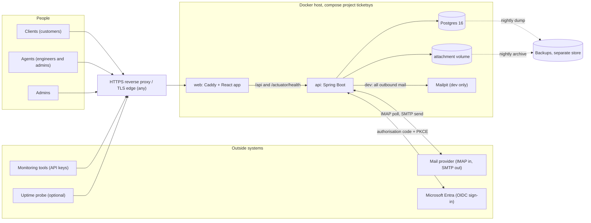
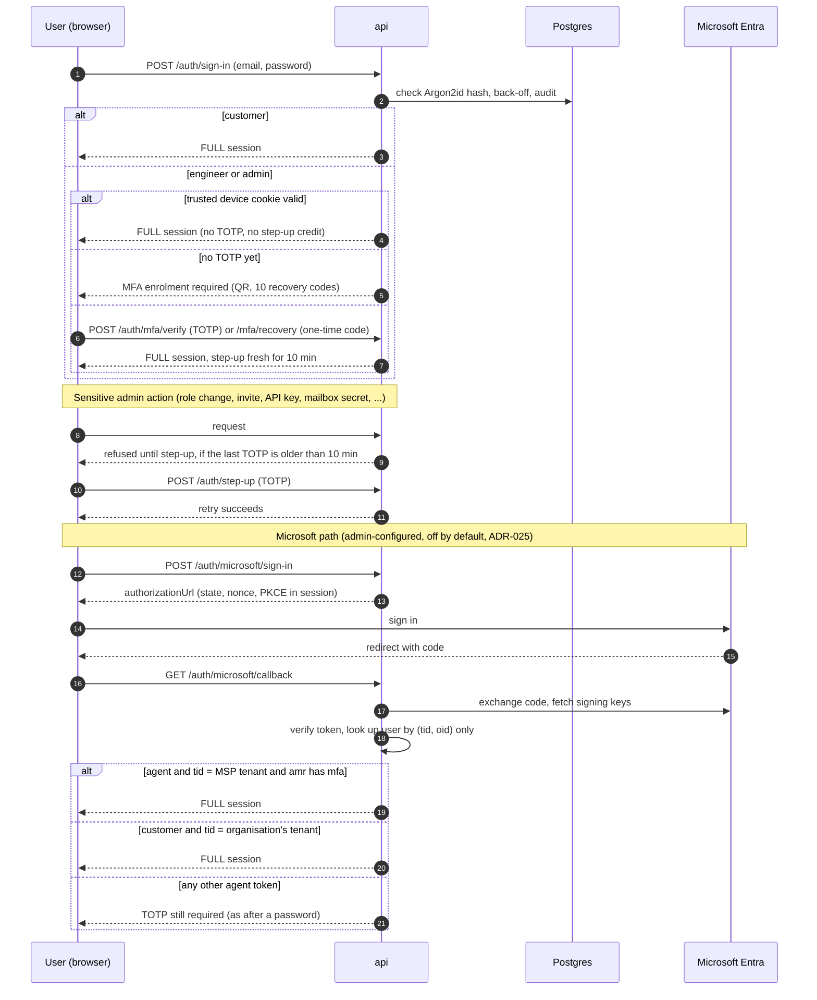
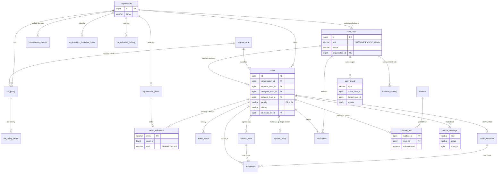

# Architecture overview

One page, C4-lite: who uses the system, what runs where, how people sign in, and how the data hangs together. Synthetic names only. Decisions are in [docs/10-decision-log.md](10-decision-log.md); detailed diagrams (containers, deployment, data model by area, lifecycle, email, sequences, security, CI, backup) are in [docs/diagrams/00-index.md](diagrams/00-index.md); detail is in the [spec](15-product-spec.md), [security](35-security.md) and [reliability](30-reliability.md) docs.

## 1. Context and deployment

- **Clients** raise tickets through the portal, by email or (monitoring tools) the API; they never see a ticket page ([ADR-018](10-decision-log.md)). **Agents** work the queue; **admins** also manage organisations, SLAs, mailboxes, API keys and sign-in settings.
- **Containers** (compose project `ticketsys`): `ticketsys-web` (Caddy serving the React build, proxying `/api` and `/actuator/health`), `ticketsys-api` (Spring Boot 4.1, Java 21), `ticketsys-postgres` (Postgres 16, named volume, no host port), the attachment disk volume mounted at `/data/attachments`, and **Mailpit** in the `dev` profile, which catches all outbound mail.
- **Inside the api**: the IMAP poller and the scheduled jobs (outbox sender, SLA timers, reminders, notification digest, retention) run in the same process; there is no separate worker. Job locks (`scheduled_job_lock`, `mail_poller_lock`) keep a second instance from doubling work.
- **Edge**: the web container publishes one HTTP port, bound to `127.0.0.1` by default (`WEB_BIND`, `WEB_PORT`). Put any HTTPS reverse proxy or TLS terminator in front of it (nginx, Caddy, a cloud load balancer, a tunnel). The api and Postgres publish no ports. Caddy and the api trust `X-Forwarded-*` only from private and loopback addresses, so the web port must not be reachable from untrusted networks ([security](35-security.md)). An uptime probe can watch the public health URL ([reliability](30-reliability.md)).
- **CI**: GitHub Actions builds and tests every pull request ([test strategy](20-test-strategy.md)); it does not deploy.

## 2. Sign-in

Levels of a session are kept server-side (Spring Session JDBC): not signed in, half-signed-in (waiting for MFA set-up or code), and FULL. Only FULL reaches `/portal`, `/agent` and `/admin`.

`security_version` on each user is bumped by a role, access, MFA or password change and by deactivation; that ends their other sessions at once. Entra's MFA is never counted as a step-up. An admin can pause two-step sign-in for one engineer for up to 30 days ([ADR-031](10-decision-log.md), [security](35-security.md)).

## 3. Data model (main tables)

Names are from the Flyway migrations in `api/src/main/resources/db/migration`. Not every column or table is shown (also: `user_mfa`, `user_device`, `auth_token`, `supporter_*`, `saved_reply`, `signature_template`, `entra_settings`, `sender_rule`, `mail_block_rule`, `ticket_participant`, `ticket_link`, `api_key`, `sla_automation_rule`).

## 4. Rules that cut across everything

- **AccessScope**: every read and write of client data is scoped to the signed-in user's organisations, in SQL. ArchUnit rules (`api/src/test/java/com/ticketsystem/api/architecture/ArchitectureTest.java`) fail the build if a repository outside `..clientdata..` exists, if JDBC is used outside it (apart from a short named allow-list), or if `AccessScope.system` is called from the wrong package. Internal notes are kept apart from client-visible code by the same rules. Negative fixtures prove each rule fails when broken.
  - **Writes bind the scope in SQL**: a write never trusts an organisation id the caller passed in. The UPDATE, DELETE or INSERT ... SELECT itself matches only rows whose ticket the scope sees (`ScopeSql.ticketVisible`, or `ScopeSql.ticketInOrganisation` where the row stores the organisation next to the ticket id, such as links, notifications and portal submissions). A write that matches nothing because the row is missing or belongs to another organisation answers 404, the same as a missing id; a write that matches nothing for a harmless reason (already confirmed, duplicate CC) re-checks visibility in SQL to tell the two apart. Writes that are admin-only or system-only need no extra condition, since those scopes see every organisation. Test: `ScopeBoundWriteIntegrationTest`.
- **Step-up**: sensitive admin actions need a TOTP or recovery code from the last 10 minutes; a trusted device and Microsoft sign-in never count.
- **Every email becomes a ticket** unless the block list stops it; guards (participant, DMARC) decide whether a mail joins a ticket or goes to triage ([spec 6 and 11b](15-product-spec.md)).
- **Migrations** are append-only: Flyway versions only go up and a merged migration is never edited or undone, so a rollback to older images first checks that the older code tolerates the newer schema ([reliability](30-reliability.md)).
- **Testing**: no merge without a green CI build ([test strategy](20-test-strategy.md)).

Related ADRs: [ADR-004](10-decision-log.md) stack, [ADR-005](10-decision-log.md) IMAP polling, [ADR-006](10-decision-log.md) and [ADR-025](10-decision-log.md) sign-in, [ADR-014](10-decision-log.md) references, [ADR-016](10-decision-log.md) hosting, [ADR-021](10-decision-log.md) Spring Boot 4, [ADR-026](10-decision-log.md) deploys and migration order.
