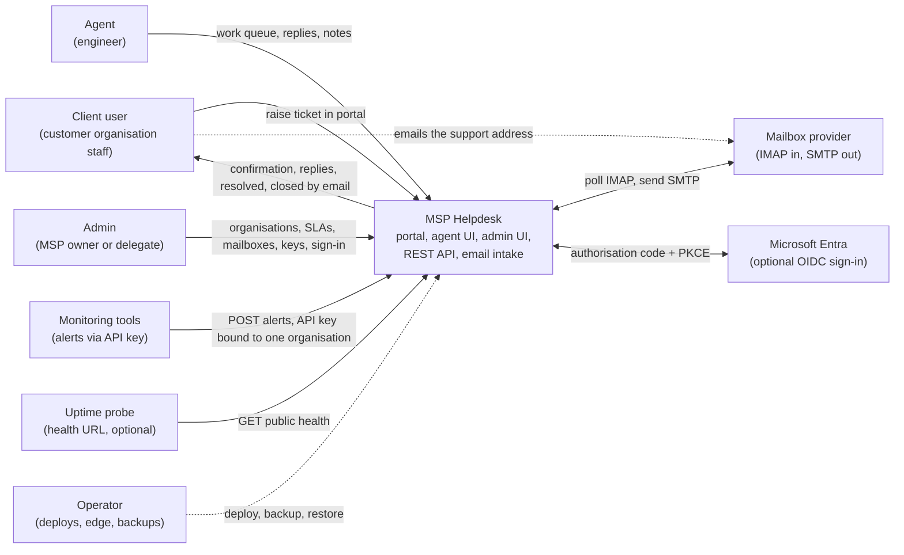

# 01 - System context

What this shows: who uses the helpdesk and which outside systems it talks to (C4 level 1). The system is one multi-client MSP helpdesk; clients never log in to see tickets ([ADR-018](../10-decision-log.md)), they raise tickets and follow them by email.

Reflects: [ADR-002](../10-decision-log.md) scope, [ADR-003](../10-decision-log.md) intake channels, [ADR-005](../10-decision-log.md) IMAP, [ADR-006](../10-decision-log.md) and [ADR-025](../10-decision-log.md) sign-in, [ADR-016](../10-decision-log.md) hosting, [ADR-018](../10-decision-log.md) raise-only portal. Spec: [sections 1-2](../15-product-spec.md), [section 4](../15-product-spec.md).

Notes:

- Microsoft sign-in is off by default and configured by an admin ([ADR-025](../10-decision-log.md)).
- The operator is a person and role, not software: whoever runs the host deploys merged `main` and owns the TLS edge, DNS and backups ([03-deployment.md](03-deployment.md), [move runbook](../runbooks/move-domain-or-server.md)).
