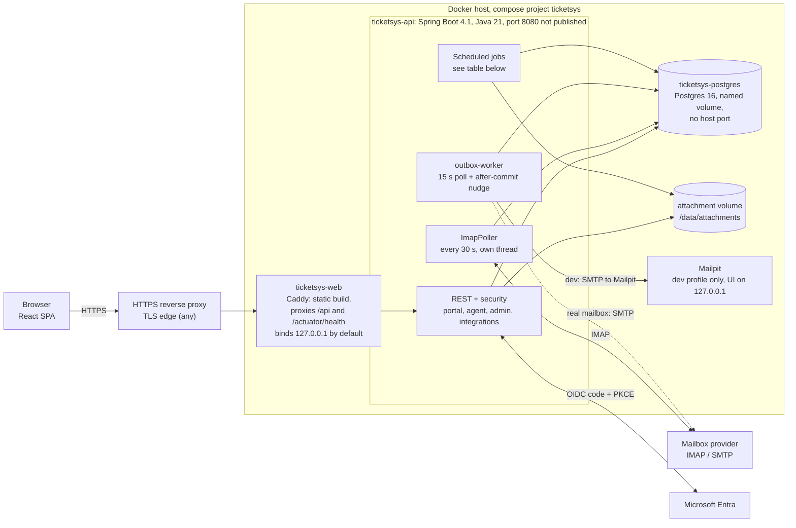

# 02 - Containers

What this shows: the running parts of the system (C4 level 2). Everything is one Docker Compose project, `ticketsys`. There is no separate worker: the IMAP poller and all scheduled jobs run inside the api process.

Reflects: [ADR-004](../10-decision-log.md) stack, [ADR-005](../10-decision-log.md) IMAP polling, [ADR-016](../10-decision-log.md) hosting, [ADR-021](../10-decision-log.md) Spring Boot 4, [ADR-028](../10-decision-log.md) one compose stack for demo and production, [ADR-039](../10-decision-log.md) faster email pickup. Spec: [section 11](../15-product-spec.md). Reliability: [docs/30-reliability.md](../30-reliability.md).

## Runtime containers

## Scheduled jobs inside the api

Locks (`scheduled_job_lock`, `mail_poller_lock`) stop a second instance doubling the work.

| Job | Rhythm | Does |
| --- | --- | --- |
| `ImapPoller` | every 30 s | reads new mail from enabled mailboxes, one transaction per mail |
| Inbound attachment worker | after each mail commits | checks and stores the files of inbound mail |
| Outbox sender | 15 s poll plus nudge after commit | sends queued `outbox_message` rows by SMTP with retries |
| `SlaMinuteJob` | every minute | recalculates SLA, flags 80% and breach, runs SLA automation rules, Pending timers (reminder, auto-resolve, auto-close), default-assignment catch-up |
| `DailyDigestJob` | checks every minute | notification digests at the configured time |
| `PendingAttachmentCleanupJob` | every 30 min | removes unbound uploads past expiry |
| `InboundRetentionJob` | hourly | raw `.eml` after 90 days, Blocked mail log after 30 days |
| `RetentionJob` | nightly 03:40 UTC | closed-ticket retention, audit after 1 year, old outbox rows and tokens |
| `DeviceService` and throttle cleanup | 6 h and 10 min | devices unused for 400 days, in-memory back-off tables |
