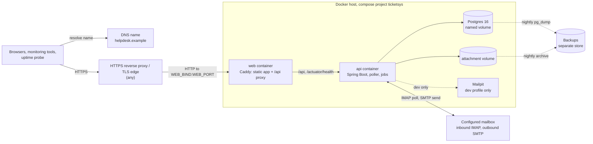
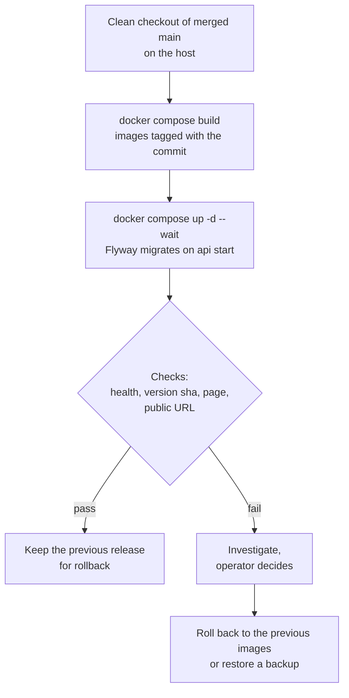

# 03 - Deployment

What this shows: where the app runs and how a browser reaches it. The project does not prescribe a host: any Linux machine with Docker Compose works, behind any HTTPS reverse proxy or TLS terminator. Setup steps are in [deployment.md](../deployment.md).

Reflects: [ADR-016](../10-decision-log.md) hosting, [ADR-026](../10-decision-log.md) deploy only merged `main`, [ADR-028](../10-decision-log.md) one compose stack for demo and production. Docs: [docs/30-reliability.md](../30-reliability.md), [move runbook](../runbooks/move-domain-or-server.md).

## Where things run

Facts and caveats:

- The web container publishes one HTTP port, bound to `127.0.0.1` by default (`WEB_BIND`, `WEB_PORT`). Keep it that way unless the edge runs on another machine on a trusted network: Caddy and the api trust `X-Forwarded-*` from private and loopback addresses, so the port must not be reachable from untrusted networks ([security](../35-security.md)). The api and Postgres publish no ports.
- The edge must serve HTTPS only and append `X-Forwarded-For`. Session cookies use the `__Host-` prefix and need HTTPS (`TS_SECURE_COOKIES=false` is for plain-http local runs only).
- Mail: inbound mail is read over IMAP (password, or OAuth2 client credentials such as Microsoft 365 `IMAP.AccessAsApp`) and outbound mail is sent over SMTP with STARTTLS, both for the mailbox an admin configures. A Microsoft Graph connector is decided but not built ([ADR-039](../10-decision-log.md)). Mailpit catches all mail in the `dev` profile and is never exposed.
- Backups are written to the host disk first; copy them to a separate store (another disk, machine or object storage) so losing the host does not lose the backups ([11-backup-restore.md](11-backup-restore.md)).
- Changing the public name or moving to a new server: [move runbook](../runbooks/move-domain-or-server.md).

## Deploy and rollback

Rollback re-runs old images against the same database. Flyway migrations are never undone, so before rolling back past a migration check that the older code tolerates the newer schema ([reliability](../30-reliability.md), Rollback). Rollback is a manual decision, not automatic.
