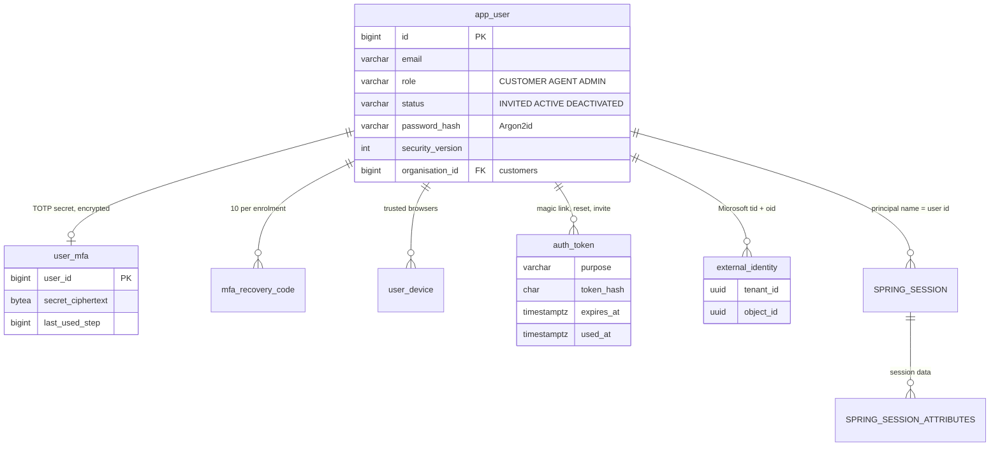
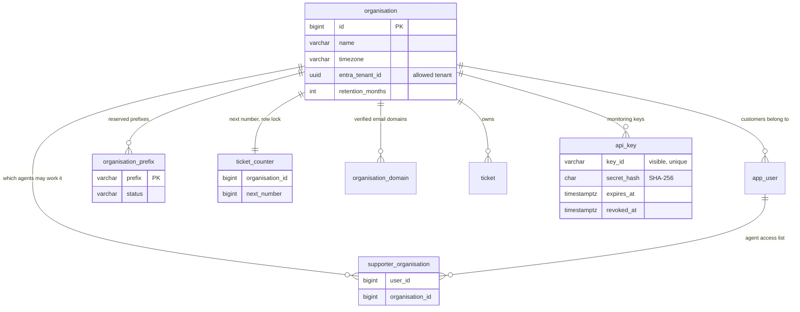
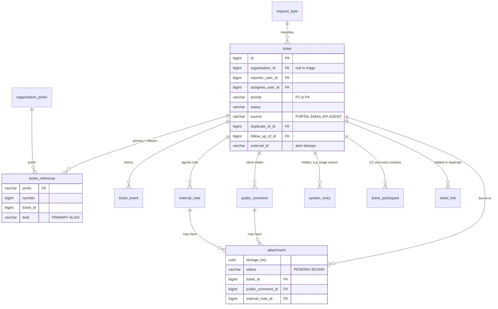
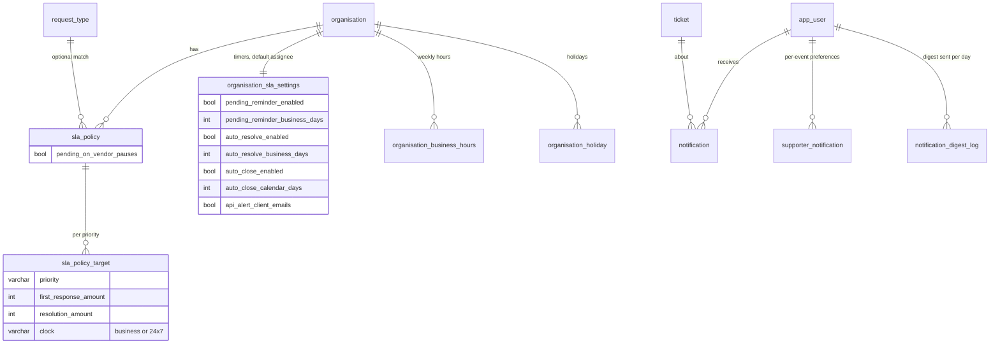
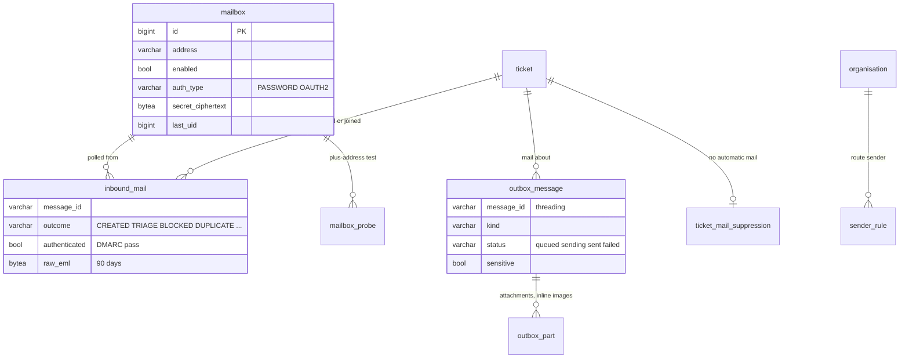
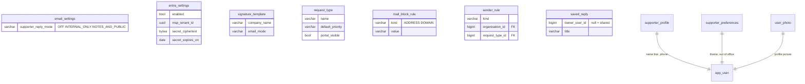
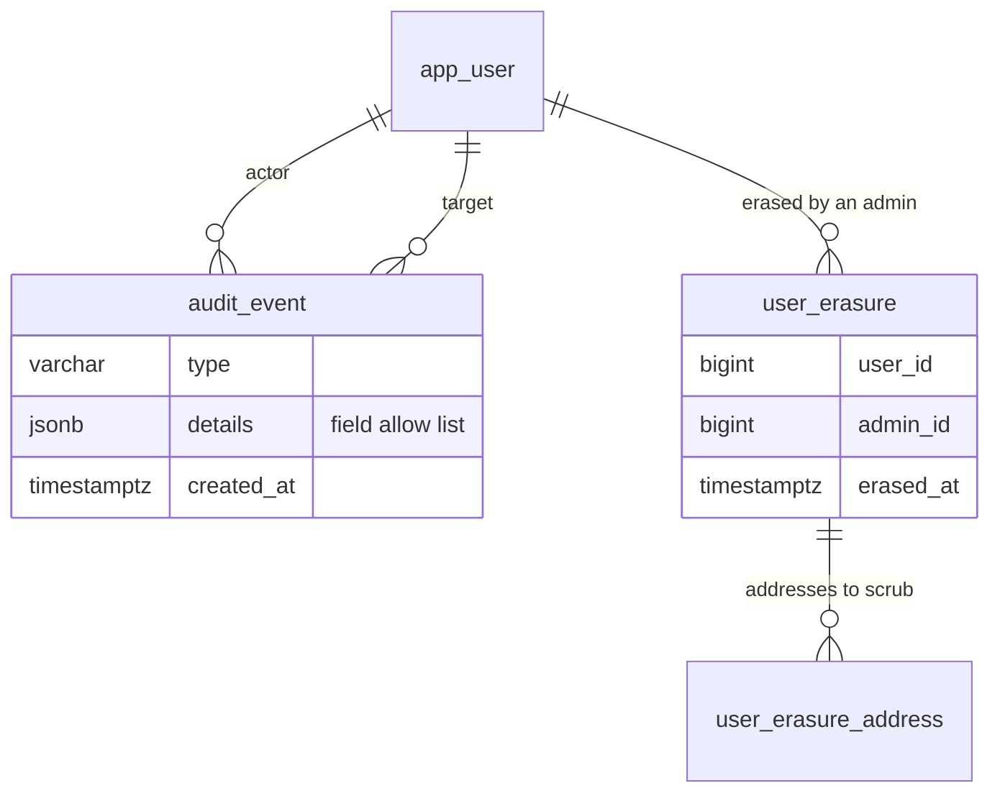

# 04 - Data model

What this shows: the main tables from the Flyway migrations in `api/src/main/resources/db/migration`, split by area so each diagram stays readable. Columns shown are the ones that matter for relationships and rules, not every column. The overview ER diagram on one page is in [docs/40-architecture.md](../40-architecture.md) section 3.

Reflects: [ADR-004](../10-decision-log.md), [ADR-009](../10-decision-log.md) C13 and C14, [ADR-014](../10-decision-log.md) references, [ADR-017](../10-decision-log.md) SLA, [ADR-022](../10-decision-log.md) email matching. Spec: [section 8](../15-product-spec.md), [section 10](../15-product-spec.md). Rules: every client-data query is scoped by organisation; migrations are append-only; references are made only by the counter service.

## A. Identity and sessions

## B. Organisations and access

## C. Tickets, comments, attachments, references

`portal_submission (user_id, idempotency_key) -> ticket_id` makes a portal submit safe to repeat.

## D. SLA and notifications

The SLA due times, paused minutes and met flags are columns on `ticket`. `scheduled_job_lock (name, locked_until)` serialises the jobs.

## E. Mail in and out

## F. Admin configuration

Single-row settings tables (`email_settings`, `entra_settings`, `signature_template`) hold one row each. Secrets are AES-GCM ciphertext with a key id (`TS_DATA_KEY`).

## G. Audit and erasure

The application database role can insert and read `audit_event` but cannot update or delete it; retention deletes only through the `purge_audit_events` function (spec section 10, docs/30-reliability.md).

## Table glossary

| Table | What it holds |
| --- | --- |
| `app_user` | Every account: customer, agent or admin; status; Argon2id hash; `security_version` |
| `user_mfa`, `mfa_recovery_code`, `user_device` | TOTP secret, one-time recovery codes, trusted browsers |
| `auth_token` | Magic links, password resets, invitations (hashed) |
| `external_identity` | Link from a user to a Microsoft (tid, oid) |
| `SPRING_SESSION*` | Server-side sessions (Spring Session JDBC) |
| `organisation`, `organisation_prefix`, `ticket_counter`, `organisation_domain` | Clients, their reference prefixes, per-organisation number counter, verified email domains |
| `api_key` | Monitoring-tool keys, one organisation each (hash only) |
| `supporter_organisation` | Which organisations an agent may work |
| `ticket`, `ticket_event`, `ticket_link`, `ticket_participant` | Tickets, history, related and duplicate links, CC contacts |
| `ticket_reference` | Primary reference and aliases per ticket |
| `public_comment`, `internal_note`, `system_entry` | Client-visible replies, agent-only notes, hidden system lines |
| `attachment` | File metadata; bytes live on the attachment volume |
| `request_type` | Ticket categories and starting priority |
| `sla_policy`, `sla_policy_target`, `organisation_sla_settings`, `organisation_business_hours`, `organisation_holiday` | SLA targets, calendar and Pending timers |
| `notification`, `notification_digest_log`, `supporter_notification`, `scheduled_job_lock` | In-app alerts, digest log, per-event preferences, job locks |
| `mailbox`, `mailbox_probe`, `mail_poller_lock` | IMAP accounts, plus-address test, poller lock |
| `inbound_mail`, `mail_block_rule`, `sender_rule` | Mail log and Blocked mail log, block list, routing rules |
| `outbox_message`, `outbox_part` | Outgoing mail queue and its attachments |
| `email_settings`, `entra_settings`, `signature_template`, `saved_reply` | Admin settings and canned replies |
| `sla_automation_rule`, `sla_automation_firing` | Admin SLA automation rules and their once-only firing records |
| `mfa_exemption` | Time-limited two-step exemption per engineer |
| `supporter_profile`, `supporter_preferences`, `user_photo` | My settings |
| `portal_submission` | Idempotency for the portal New ticket form |
| `audit_event`, `user_erasure`, `user_erasure_address` | Audit log and the personal-data erasure log |
