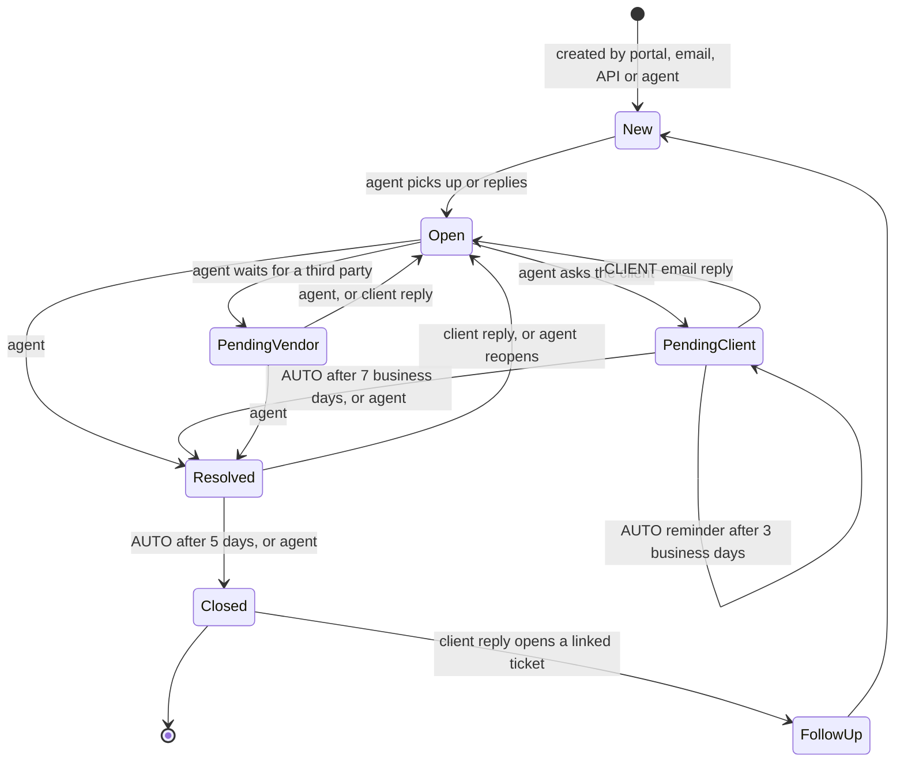
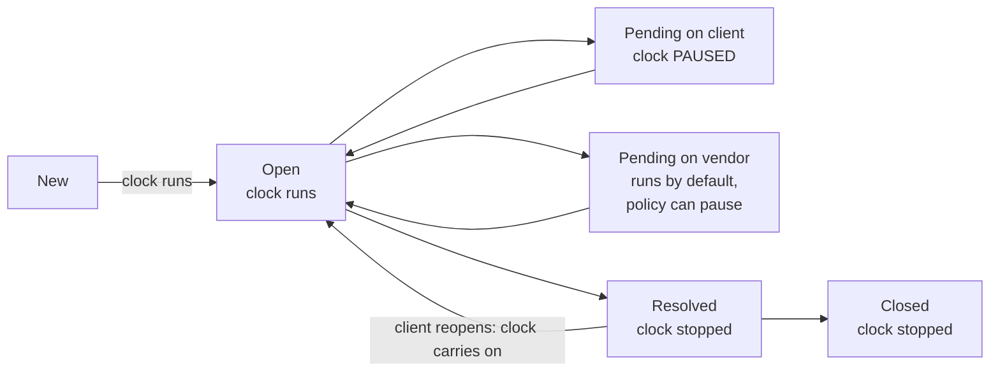

# 05 - Ticket lifecycle

What this shows: the six ticket statuses, who or what moves a ticket between them, and what the SLA clock does. The canonical state diagram is in [docs/15-product-spec.md](../15-product-spec.md) section 3 and is not repeated here; this page adds the view by actor and the SLA clock, which the spec diagram only annotates.

Reflects: [ADR-007](../10-decision-log.md) Pending on client, [ADR-012](../10-decision-log.md) Pending on vendor, [ADR-017](../10-decision-log.md) SLA, [ADR-018](../10-decision-log.md) raise-only portal. Spec: [section 3](../15-product-spec.md) (statuses, client email matrix, lifecycle diagram), [section 4.7](../15-product-spec.md) (SLA).

## Who moves a ticket

Only the system moves a ticket on the AUTO arrows (the `SlaMinuteJob`, see [02-containers.md](02-containers.md)). The reminder, the auto-resolve and the auto-close can each be switched off per organisation (`organisation_sla_settings`). Pending on vendor never sends a reminder and never auto-resolves. A Closed ticket refuses every change except internal notes.

## SLA clock by status

- Targets by priority (P1 24/7, P2 to P4 business hours) and what counts as first response are in spec section 4.7. SLA information is internal only; clients never see it.
- Due times are recalculated from creation after a status, priority, public reply or organisation change, and by the minute job. While paused the due time is empty and the UI shows "Paused".
- 80% and breach each notify once; P1 notifies every agent who can work the organisation at creation and at 80% (spec 4.7, "As built").

## Emails the client gets (summary of the spec matrix)

| Event | Email to client |
| --- | --- |
| Ticket created (not API alerts, not triage tickets) | Confirmation |
| Public reply by an agent | The reply with signature |
| Set to Resolved (agent or auto-resolve) | Resolved notice |
| 3 business days in Pending on client | Reminder (once per spell) |
| Auto-close after 5 days in Resolved | Closed notice |

Anything else (status change, assignment, internal note, Pending on vendor) sends nothing to the client.
