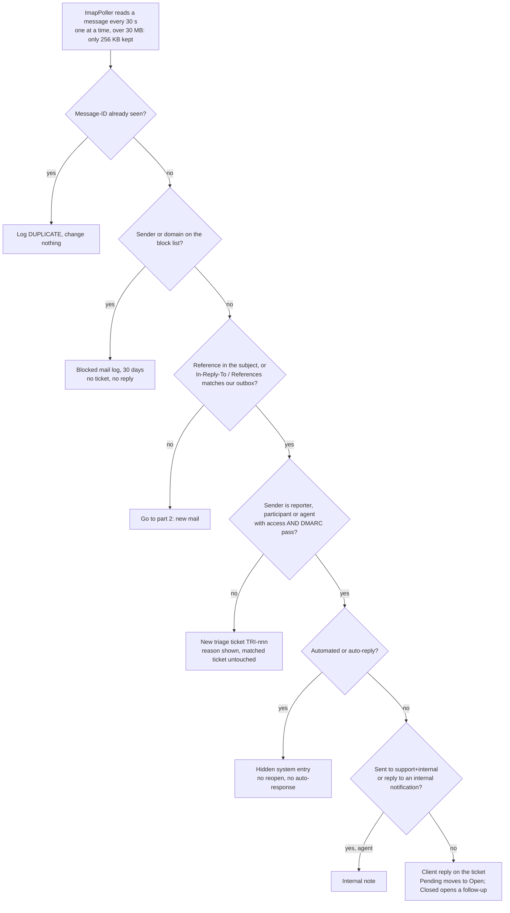
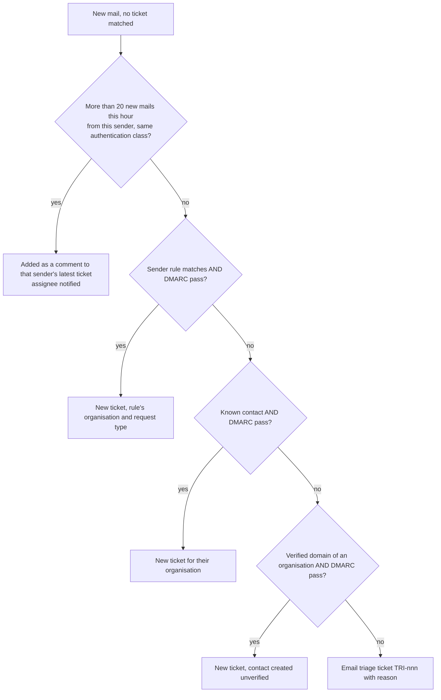
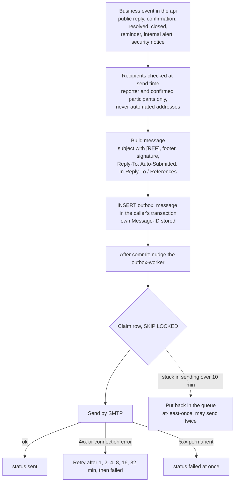

# 06 - Email flows

What this shows: how an inbound mail becomes a ticket or a comment (the decision order, split into two diagrams), and how an outbound mail is built, queued, sent and retried. The full inbound flowchart as first drawn is in [docs/15-product-spec.md](../15-product-spec.md) section 6; this page restates it in two smaller parts with the guards spelled out and does not replace it.

Reflects: [ADR-005](../10-decision-log.md) IMAP polling, [ADR-011](../10-decision-log.md) signatures, [ADR-014](../10-decision-log.md) references and threading, [ADR-020](../10-decision-log.md) mailbox config, [ADR-022](../10-decision-log.md) matching to organisations. Spec: [section 5](../15-product-spec.md) signatures, [section 6](../15-product-spec.md), [section 11b](../15-product-spec.md). Ops: [docs/30-reliability.md](../30-reliability.md) (outbox and inbound runbooks).

## 1. Inbound: first checks and ticket matching

## 2. Inbound: new mail with no ticket match

Every mail ends as a ticket, a comment, a hidden system entry, or (block list only) a log row. Triage tickets get no automatic emails (the sender may be forged). Agents can later assign a triage ticket to an organisation, optionally saving the contact or domain; the ticket gets a new primary reference and keeps `TRI-nnn` as an alias.

## 3. Outbound: building and sending

- **Signature** (ADR-011, spec section 5): public replies carry the agent's name as display name, the company signature template and fixed profile fields. The rendering rules are in spec section 5.
- **Reply-To** is the support mailbox for client mail and `support+internal@` for agent-only alerts; plus-addressing must work on the mailbox (the admin "test connection" checks it).
- **Local development** (`dev` profile): SMTP goes to Mailpit, nothing leaves the host. With an empty `SMTP_HOST` mail is queued but not sent.
- **Sensitive mail** (invitation, reset, magic link): bodies are blanked once sent or failed and it is never sent after `expires_at`; a failed one cannot be resent, the user asks again.
- Stuck mail: runbook "mail stuck in the outbox" in [docs/30-reliability.md](../30-reliability.md).
