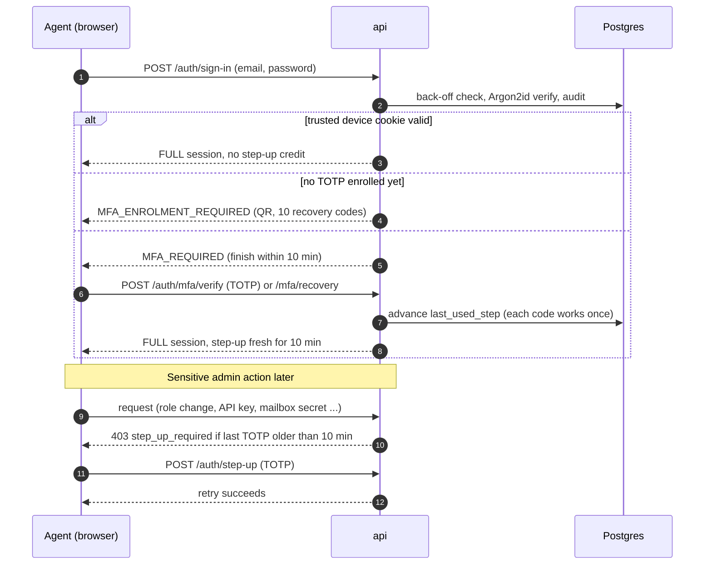
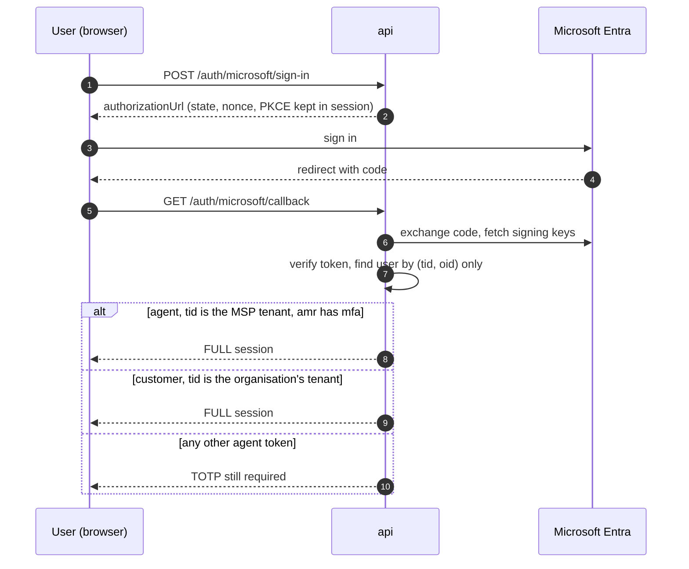
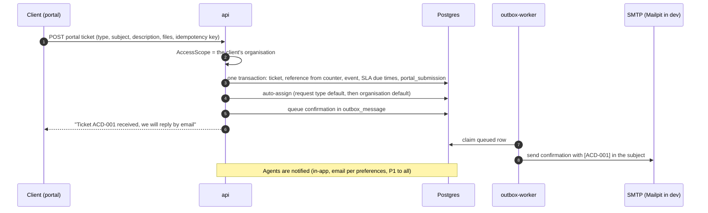
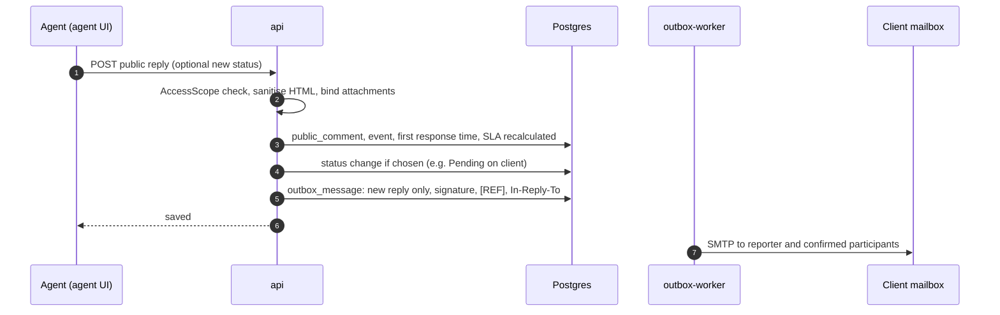
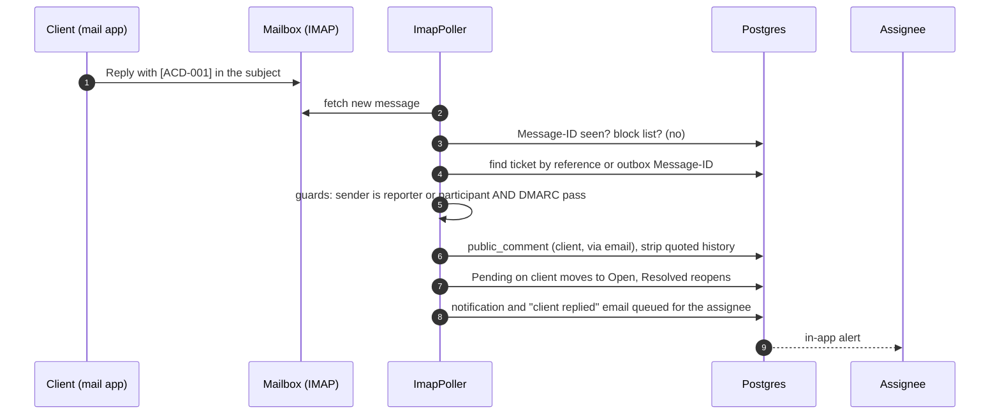
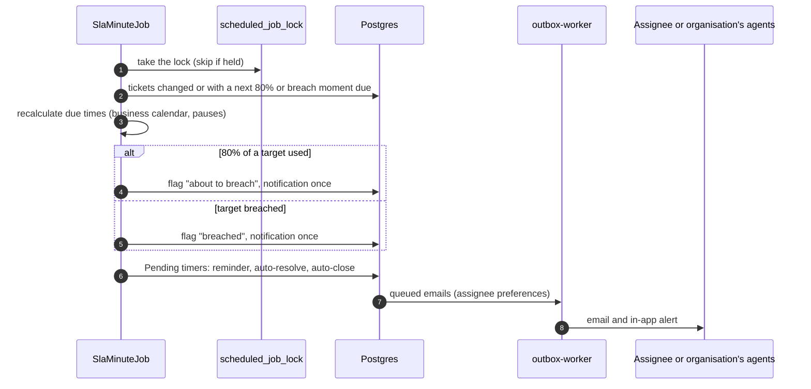

# 07 - Sequences

What this shows: six flows step by step, with the actors and the system parts that take part. The compact sign-in sequence in [docs/40-architecture.md](../40-architecture.md) section 2 is the one-page summary; the first two diagrams here split it into password and Microsoft.

Reflects: [ADR-006](../10-decision-log.md), [ADR-025](../10-decision-log.md) sign-in; [ADR-017](../10-decision-log.md) SLA; [ADR-018](../10-decision-log.md) portal; [ADR-014](../10-decision-log.md) threading. Spec: [section 7 Sign-in](../15-product-spec.md), [section 4](../15-product-spec.md), [section 11c](../15-product-spec.md). Security: [docs/35-security.md](../35-security.md) (MFA, step-up).

## 1. Password and MFA sign-in, with step-up

Customers go straight to FULL after the password (no MFA). Details: [docs/35-security.md](../35-security.md) "MFA, step-up, devices and sessions".

## 2. Microsoft sign-in

The feature is off until an admin configures and tests it (spec 11c). Entra's MFA never counts as a step-up.

## 3. Client raises a ticket in the portal

## 4. Engineer replies and the client is emailed

Internal notes follow the same path without the outbox row: they are never emailed to clients.

## 5. Inbound client reply threads to the ticket

If a guard fails the mail becomes a triage ticket instead (see [06-email-flows.md](06-email-flows.md)).

## 6. SLA job flags a breach

Customers never see any of this (spec 4.7).
