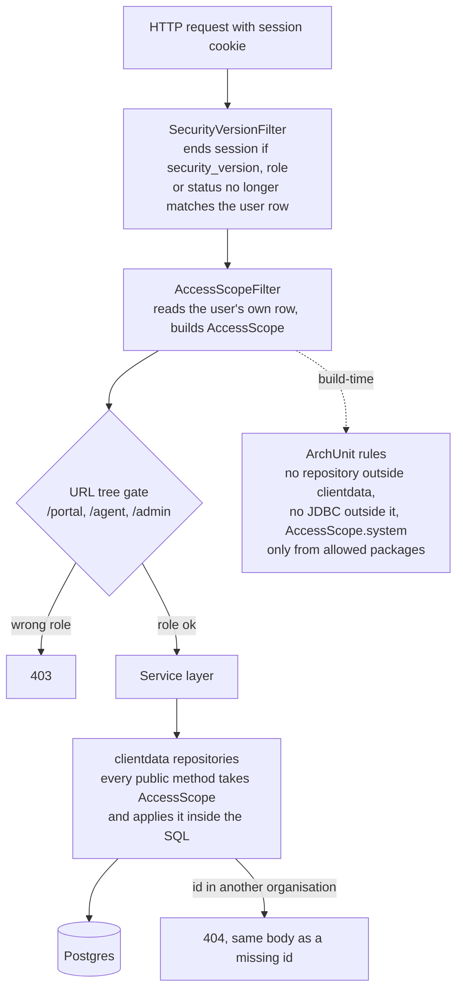
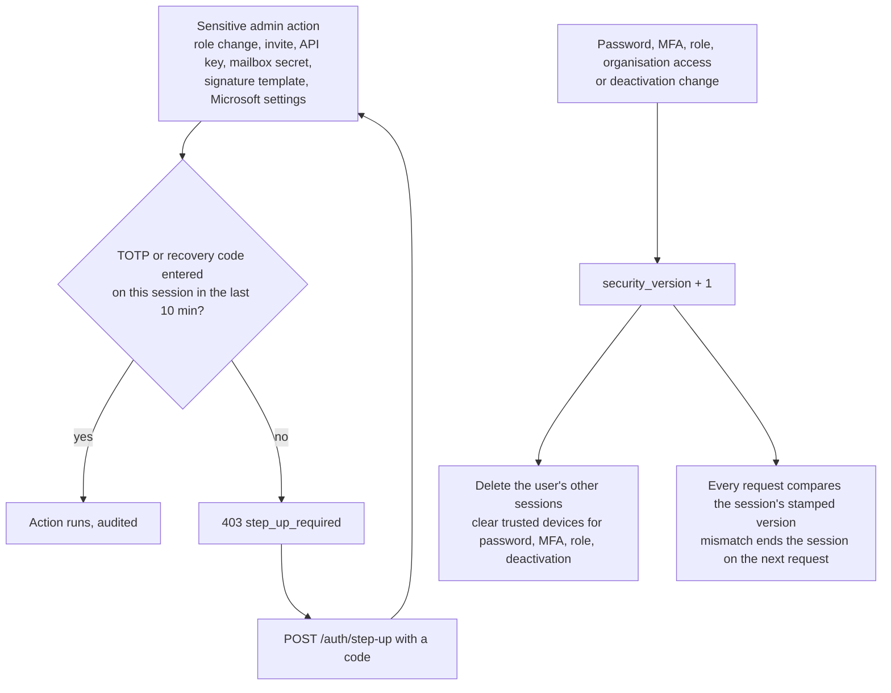

# 08 - Security and permissions

What this shows: what each role can do, how the organisation "wall" (AccessScope) stops one client seeing another's data, and how step-up and `security_version` end sessions. The threat model is in [docs/35-security.md](../35-security.md); this page is the picture.

Reflects: [ADR-006](../10-decision-log.md), [ADR-009](../10-decision-log.md) C4, C8, C13, C14, C15, [ADR-018](../10-decision-log.md), [ADR-025](../10-decision-log.md). Spec: [section 2](../15-product-spec.md) roles, [section 9](../15-product-spec.md) security design. Security doc: [docs/35-security.md](../35-security.md) "Organisations and client data" and "MFA, step-up, devices and sessions".

## Role matrix

All rules are enforced on the server, never only in the UI.

| Capability | Customer | Agent | Admin | API key |
| --- | --- | --- | --- | --- |
| Raise a ticket in the portal | own organisation | on behalf of a customer | yes | one bound organisation |
| See tickets online | no (email only, ADR-018) | organisations they are assigned to | all | no |
| Public reply, internal note | reply by email only | yes | yes | repeat alerts add a comment to its own alert ticket |
| See internal notes and SLA data | no | yes | yes | no |
| Change status, priority, request type, assignee | no | yes | yes | no |
| Create customer contacts | no | in their organisations | yes | no |
| Export queue CSV, SLA report | no | yes (audit-logged) | yes | no |
| Manage agents, organisations, SLAs, mailboxes, API keys, branding, sign-in settings | no | no | yes, with step-up for sensitive ones | no |
| Read the audit log | no | no | yes | no |
| Read stored secrets (passwords, MFA, key secrets) | no | no | no (keys shown once) | no |

## The AccessScope client wall

Scope kinds: customer (one organisation), agent (all or a list), admin (all), system jobs through `AccessScope.system(reason)`, API key (one organisation). Triage rows (no organisation) are visible to agents and system jobs only. Admin-only writes are checked three times: the URL gate, the service, and each repository write.

## Step-up and security_version

A trusted-device sign-in and Microsoft sign-in never count as step-up. Organisation and agent-access changes bump the version in SQL, so those sessions end on their next request rather than at once.
