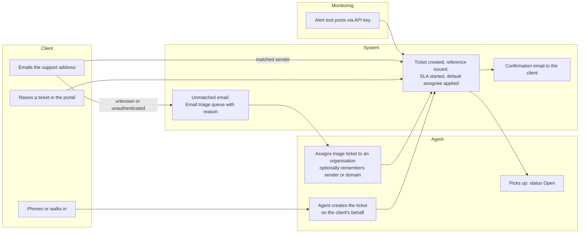
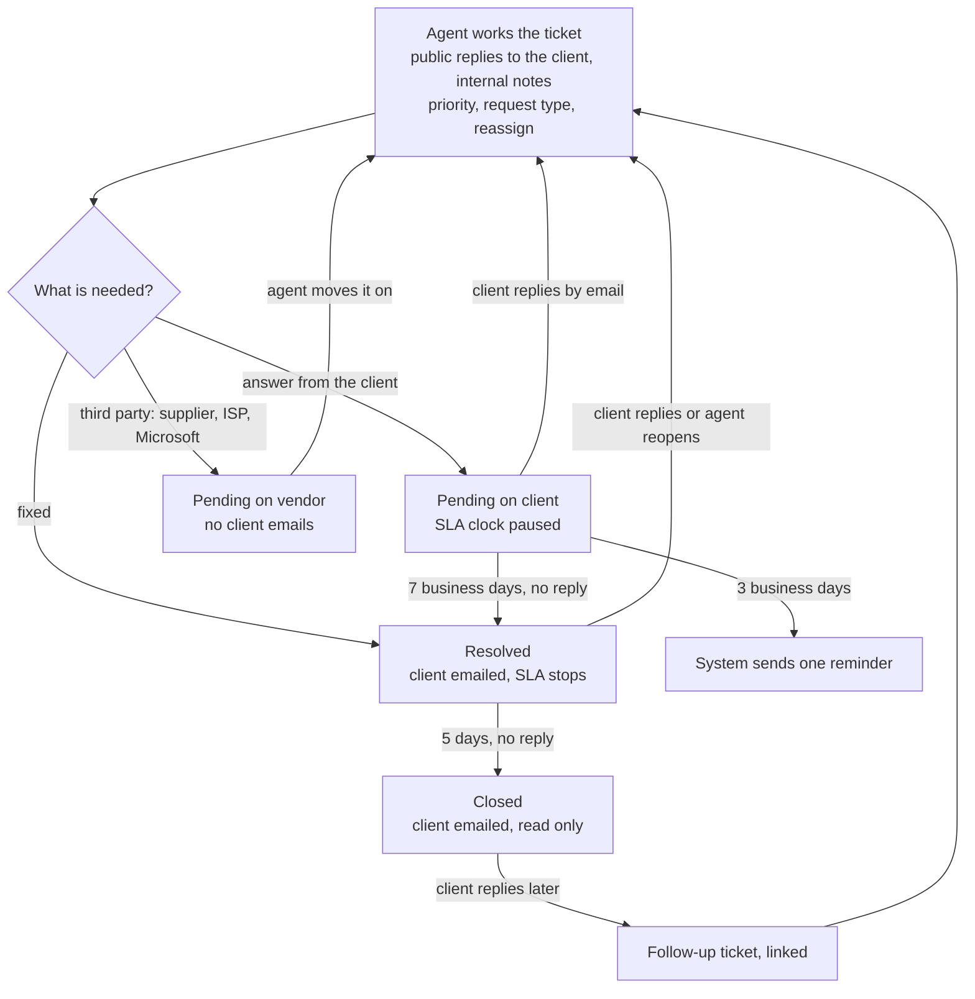

# 09 - Support business process

What this shows: the end-to-end MSP support process, for a business reader. Who does what from the moment a client asks for help until the ticket is closed, with the time targets from the SLA. Lanes are roles; the system does the automatic steps.

Reflects: [ADR-003](../10-decision-log.md) intake channels, [ADR-017](../10-decision-log.md) SLA targets, [ADR-018](../10-decision-log.md) raise-only portal, [ADR-022](../10-decision-log.md) every email becomes a ticket. Spec: [section 3](../15-product-spec.md), [section 4](../15-product-spec.md), [section 4.7](../15-product-spec.md). Lifecycle detail: [05-ticket-lifecycle.md](05-ticket-lifecycle.md).

## 1. Intake and triage

## 2. Work, wait and close

## Who does what

| Step | Client | Agent | Admin | System |
| --- | --- | --- | --- | --- |
| Raise | Portal form or email | Create for a client | - | Reference, SLA, confirmation |
| Triage | - | Assign unmatched mail, mark duplicates | Block list, sender rules | Show the reason for triage |
| Work | Answer questions by email | Reply, note, status, priority | - | Notify assignee, flag 80% and breach |
| Wait | Reply when ready | Choose Pending on client or vendor | Set timers per organisation | Reminder, auto-resolve |
| Resolve and close | Reply to reopen | Resolve, close, duplicate | - | Auto-close, Closed notice |
| Report | - | SLA report, CSV for monthly client reports | Audit log | Met or breached stored per ticket |

Time targets (defaults, admin can change per organisation): P1 first response 30 min and resolution 4 h, 24/7; P2 1 h and 8 business hours; P3 4 business hours and 3 business days; P4 1 business day and 10 business days (spec 4.7). Clients never see SLA information.
