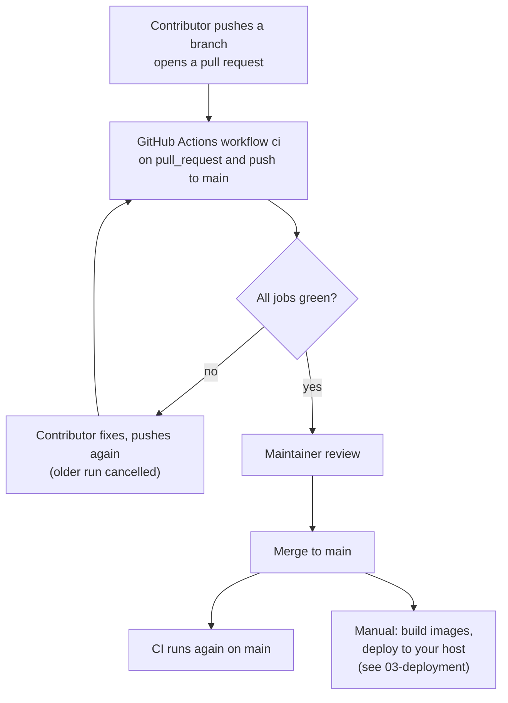
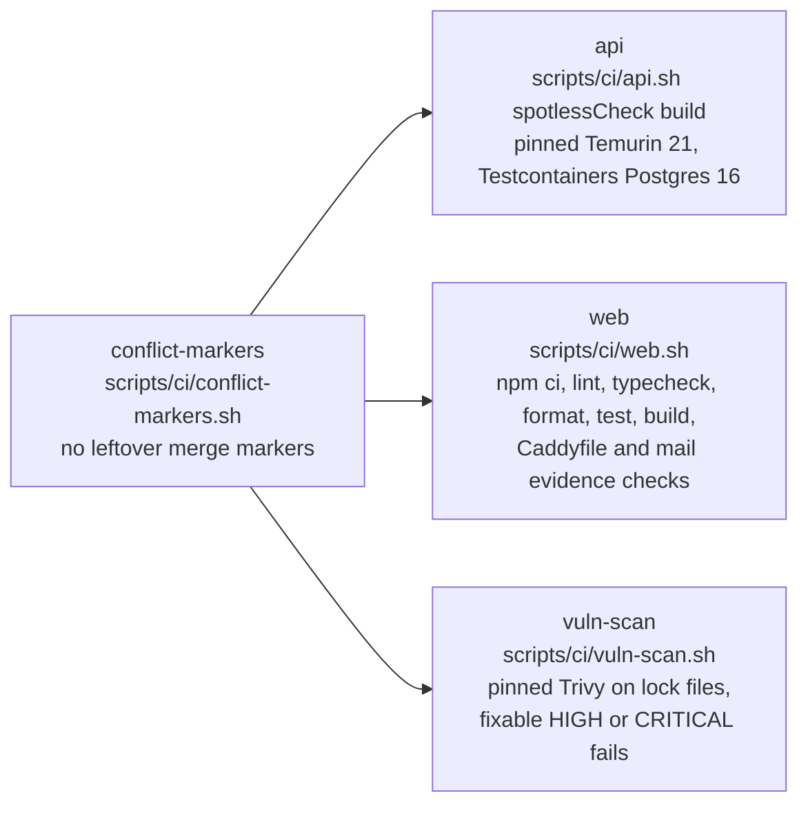

# 10 - CI/CD

What this shows: how a change gets from a pull request to a running host. CI is GitHub Actions (`.github/workflows/ci.yml`), running the same `scripts/ci/*.sh` scripts you can run on any Linux host with Docker. CI builds and tests; it never deploys. Deploying is a manual step by the operator, from merged `main` only.

Reflects: [ADR-026](../10-decision-log.md) deploy only merged `main`, migration order. Files: `.github/workflows/ci.yml`, `.github/dependabot.yml`, `scripts/ci/*.sh`. Test levels: [docs/20-test-strategy.md](../20-test-strategy.md).

## From pull request to running host

## The jobs (`.github/workflows/ci.yml`)

Job rules: GitHub-hosted `ubuntu-latest` runners; `permissions: contents: read`; checkout without persisted credentials; every action pinned by full commit SHA; time limits of 5 (conflict-markers), 40 (api), 25 (web) and 15 (vuln-scan) minutes; one run at a time per pull request (a new push cancels the old one); Gradle, npm and Trivy DB caches through `actions/cache`; api test reports uploaded on failure. The api job's build container gets the runner's Docker socket for Testcontainers ([security](../35-security.md), accepted risks).

## Merge and migration rules

- A pull request merges only with all four jobs green on its head commit.
- Flyway out-of-order is off, so applied versions only go up. If a pull request's migration version is not above `main`'s highest when it is ready to merge, rename the file to highest + 1 (no content change) and let CI run again. Merged migrations are never edited ([ADR-026](../10-decision-log.md)).
- Deploys: only merged `main`, by the operator; steps and rollback in [03-deployment.md](03-deployment.md) and [deployment.md](../deployment.md).
- Dependabot opens weekly grouped minor/patch updates for Gradle, npm, Docker base images and the actions; they go through the same jobs.
