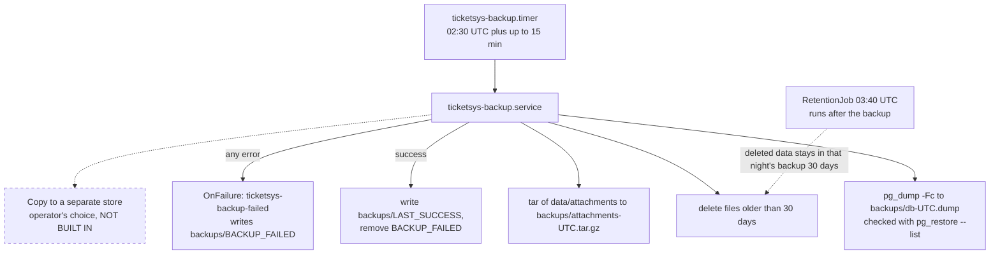
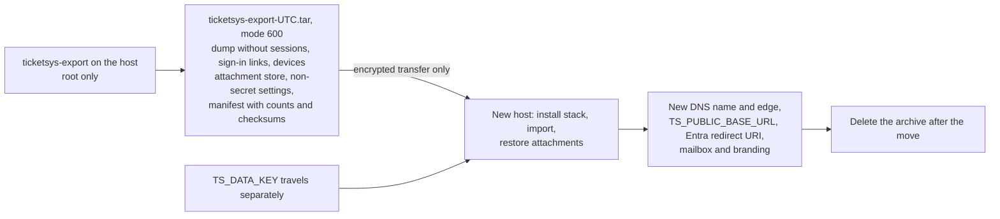

# 11 - Backup and restore

What this shows: how data is backed up every night, how long things are kept, how a restore is proved (the drill) and how the system is moved to another host. The backup unit writes to the host disk; copy the files to a separate store so a lost host does not take the backups with it.

Reflects: [ADR-016](../10-decision-log.md) hosting, [ADR-028](../10-decision-log.md) production on the same stack (RPO 24 h, RTO one working day). Spec: [section 10](../15-product-spec.md) (erasure, backups, retention). Docs: [docs/30-reliability.md](../30-reliability.md) (Backups, Restore drill, Full restore, Full export), [move runbook](../runbooks/move-domain-or-server.md), [rotate-data-key runbook](../runbooks/rotate-data-key.md). Scripts: `scripts/backup/`.

## Nightly backup and retention

The 30-day backup window is also the erasure lag (spec section 10). Alerting on a missing or stale (over 36 h) backup is not built in: watch the `LAST_SUCCESS` and `BACKUP_FAILED` markers.

## Restore drill and real restore

```mermaid
flowchart TD
  subgraph Drill["Restore drill: monthly, after backup changes, before real data"]
    D1["ticketsys-restore-drill"] --> D2["restore newest dump into scratch database<br/>ticketsys_restore_drill"]
    D2 --> D3["row counts equal the dump's own counts"]
    D3 --> D4["attachments archive of the same night<br/>holds every file the rows point at"]
    D4 --> D5["replay user_erasure with ts_erase_user,<br/>no erased person keeps a name or email"]
    D5 --> D6["drop scratch db, write RESTORE_DRILL_LAST"]
  end
  subgraph Real["Full restore: real incident"]
    R1["stop the api"] --> R2["take a fresh backup first"]
    R2 --> R3["pg_restore --clean into the live database<br/>hand audit-scrub functions back to their owner"]
    R3 --> R4["restore attachments archive, fix ownership"]
    R4 --> R5["replay the erasure log"]
    R5 --> R6["start the api, health check"]
  end
```

The drill never writes to the live database.

## Export and move

Case A (new address, same server) and case B (new server) are in the [move runbook](../runbooks/move-domain-or-server.md). The export holds password hashes and encrypted secrets, so it is not a sanitised dataset ([security](../35-security.md), accepted risks). Key rotation (`rotate-data-key`) re-encrypts MFA, mailbox and Microsoft secrets under the current key and fails safe.
